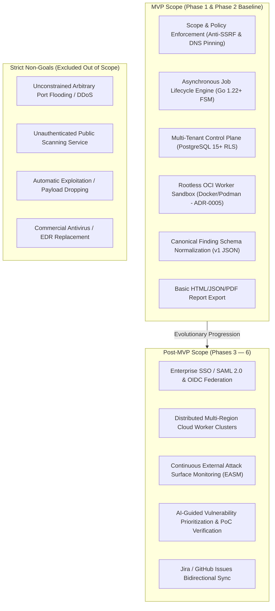
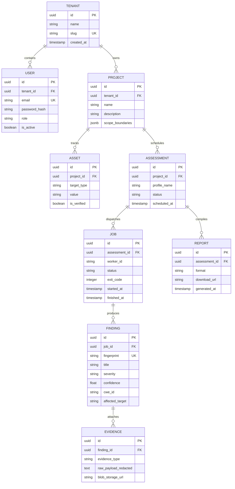
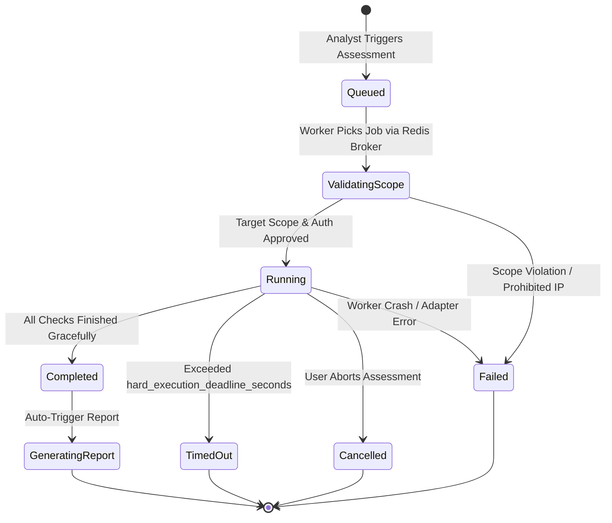

# Kelvin MVP Definition & Phase Bifurcation Framework

## 1. Product Scope Bifurcation

To guarantee rapid validation, operational reliability, and architectural purity, Kelvin explicitly bifurcates product capabilities into three distinct categories: **MVP Core Scope**, **Post-MVP Growth Scope**, and **Strict Non-Goals** (formally codified in [`docs/PRODUCT_VISION.md`](PRODUCT_VISION.md)).

---

## 2. Core Domain Data Model (MVP ERD)

The relational schema strictly isolates assessment definitions, target scoping, execution jobs, and discovered findings (formal specification: [`docs/architecture/DATA_MODEL.md`](architecture/DATA_MODEL.md), ADR-0002):

> **Note:** This MVP ERD is an illustrative sketch. The authoritative, production-grade specification — full column definitions, UUIDv7 keys, tenant-safe composite FKs, row-level security, indexing, and retention policies — is `docs/architecture/DATA_MODEL.md` (`P1-10`), which supersedes this diagram where they differ.

---

## 3. Assessment Job State Machine

To prevent deadlocks, race conditions, or unmonitored failures, every assessment job conforms to the following deterministic state transition graph (ADR-0003, ADR-0005):

---

## 4. Phase-by-Phase Bifurcation & Delivery Criteria

### Phase 1: Foundation & Core Architecture (Current Milestone — Issues P1-01 to P1-26)
* **Objective:** Establish unassailable security boundaries, target validation engine, async job state machine, clean repository scaffolding, database persistence, and developer environment.
* **Delivery Artifacts:**
  - `docs/PRODUCT_VISION.md`, `docs/security/THREAT_MODEL.md`, `docs/architecture/SYSTEM_ARCHITECTURE.md`, `docs/architecture/decisions/` (ADR-0001 to ADR-0005)
  - Scope validation engine with strict anti-SSRF and DNS rebinding socket pinning in Go (`apps/api/pkg/scope`)
  - PostgreSQL 15+ schema migrations (`db/migrations/`) + Redis 7+ background job queue abstraction
  - Unified finding and evidence normalized schema contracts (`packages/schemas/finding.v1.json`)
  - 26 tracked foundational GitHub issues

### Phase 2: Engine Integration & Sandboxing
* **Objective:** Containerized execution daemon, pluggable scanner adapter protocol, initial scanners (port/network discovery + web baseline).
* **Delivery Artifacts:**
  - Rootless OCI worker sandbox with locked egress rules (`apps/worker`, ADR-0005)
  - Adapter protocol for CLI/JSON vulnerability scanners (Nmap, Nuclei, ZAP)
  - Real-time job status streaming over WebSocket to React 18+ SPA (`apps/web`, ADR-0004)

### Phase 3: Finding Normalization, Deduplication & Reporting
* **Objective:** Automated deduplication, severity prioritization, credential redaction, and exportable PDF/JSON reports.
* **Delivery Artifacts:**
  - Canonical vulnerability ingestion engine matching `packages/schemas/finding.v1.json`
  - Sensitive token/cookie redaction pipeline
  - Customizable executive and technical assessment reports

### Phase 4: Enterprise Identity & Multi-Tenancy
* **Objective:** Complete organization separation, SAML 2.0 / OIDC integrations, fine-grained access control, and compliance-grade audit logging.
* **Delivery Artifacts:**
  - Row-Level Security (RLS) database policies verified against penetration tests
  - Audit log exporter for SIEM ingestion
  - Enterprise SSO connectors

### Phase 5 & 6: Continuous Automation & Ecosystem Extensibility
* **Objective:** Scheduled recurrence, attack surface diffing, third-party plugin developer SDK, and heuristic risk analysis.
