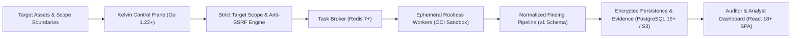
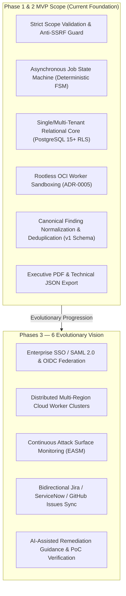
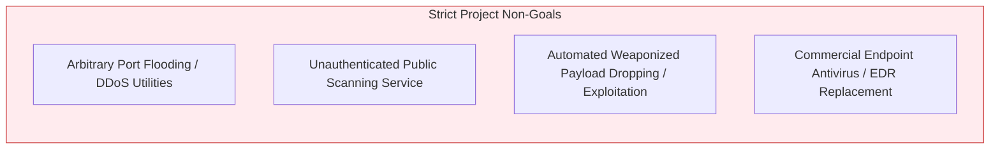

# Kelvin Security Platform — Product Vision and Scope

**Document Control**

| Field | Value |
| :--- | :--- |
| **Status** | Approved — Baseline |
| **Milestone** | Phase 1 — Foundation & Core Architecture (`P1-01`) |
| **Owner** | Product Engineering & Architecture |
| **Review Cadence** | Semi-annual or upon major milestone boundary transition |
| **Related Docs** | `docs/product/PERSONAS.md`, `docs/security/THREAT_MODEL.md`, `docs/security/ACCEPTABLE_USE.md`, `docs/architecture/SYSTEM_ARCHITECTURE.md`, `docs/architecture/SCAN_PROFILES.md`, `docs/MVP_AND_PHASE_BIFURCATION.md` |
| **Classification** | Internal — Product Specification |

---

## 1. Executive Summary & Core Problem Statement

Modern enterprise security testing is plagued by **fragmentation, operational friction, and severe security risks**:
1. **Tooling Fragmentation:** Security teams run disparate command-line scanners (Nmap, Nuclei, OWASP ZAP, OpenVAS, Trivy) in isolation, yielding incompatible output formats, conflicting severity ratings, and massive finding duplication.
2. **Operational Overhead:** Analysts waste hours correlating raw CLI logs, manually deduplicating identical vulnerabilities, and drafting custom reports instead of driving remediation.
3. **Severe Platform & SSRF Risks:** Traditional scanning platforms lack strict trust boundaries. Executing unconstrained scans against user-submitted targets frequently leads to Server-Side Request Forgery (SSRF) into cloud metadata (`169.254.169.254`), accidental scanning of internal RFC 1918 networks, and potential container breakout by compromised scanner binaries.

### The Kelvin Solution

**Kelvin** is an enterprise-grade, modular security assessment and vulnerability management platform designed exclusively for authorized assessments. It unifies heterogeneous security scanners into a single, policy-enforced control plane with deterministic state orchestration, rootless worker sandboxing, canonical vulnerability deduplication, and compliance-grade audit logging.

---

## 2. Intended Users & Primary Workflows

Kelvin is engineered around three primary user personas defined in [`docs/product/PERSONAS.md`](product/PERSONAS.md):

| Persona | Role | Primary Workflow in Kelvin |
| :--- | :--- | :--- |
| **Junior AppSec Analyst** | Vulnerability Triager | Onboards authorized targets, launches baseline scan profiles, reviews normalized findings, inspects redacted evidence, and exports remediation tickets. |
| **Senior Security Engineer** | Platform Operator | Configures custom scan profiles, validates asset ownership challenges, manages scanner adapter integrations, and inspects worker fleet health and egress policies. |
| **Compliance & Platform Admin** | Governance Auditor | Manages organization tenant settings, inspects immutable audit trails, signs off on high-impact active scans, and generates executive compliance reports. |

---

## 3. Scope Matrix: MVP Capabilities vs. Long-Term Vision

Kelvin strictly bifurcates product capabilities to ensure rapid validation without compromising security invariants.

### 3.1 In-Scope MVP Deliverables (Phase 1 & Phase 2)
* **Centralized Scope & Authorization Guard:** Cryptographic and DNS-based target ownership verification; hard blocking of RFC 1918, loopback, link-local, and cloud metadata destinations.
* **Deterministic Job Orchestration:** Asynchronous job lifecycle state machine backed by Redis 7+ and durable PostgreSQL persistence.
* **Modular Scanner Execution Daemon:** Pluggable adapter harness running scanner binaries inside disposable, unprivileged rootless OCI containers.
* **Unified Finding Schema:** Canonical ingestion pipeline normalizing disparate scanner formats into fingerprint-deduplicated vulnerability records with sensitive credential redaction.
* **Enterprise Multi-Tenancy:** Row-Level Security (RLS) policies guaranteeing tenant data isolation at the database layer.

### 3.2 Long-Term Vision (Phases 3 — 6)
* Automated recurring schedule engines with differential attack surface change alerts.
* SIEM / Webhook event streaming (Splunk, Elastic, Sentinel).
* Third-party community scanner plugin SDK and marketplace.

---

## 4. Explicit Project Non-Goals

To maintain a disciplined architectural boundary, Kelvin explicitly excludes the following capabilities:

1. **No Weaponized Exploitation / Payload Dropping:** Kelvin assesses vulnerabilities and collects non-destructive proof-of-concept evidence. It does not drop web shells, pivot through victim internal networks, or execute destructive post-exploitation payloads.
2. **No Unauthenticated Public Scanning:** Kelvin is not an open web scanner. Every assessment requires authenticated user identity, verified asset ownership or explicit authorization sign-off, and strict acceptable-use policy compliance.
3. **No Unconstrained Packet Flooding / DDoS:** Aggressive denial-of-service, SYN flooding, and unthrottled brute-force checks are strictly prohibited.
4. **No Commercial Antivirus / Host EDR:** Kelvin focuses on network, web application, and container infrastructure assessments; it does not replace host-based endpoint detection or antivirus solutions.

---

## 5. Measurable Success Criteria & Reliability Targets

The success of Phase 1 and the Kelvin MVP is measured against verifiable engineering benchmarks:

| Criterion | Target Metric | Verification Method |
| :--- | :--- | :--- |
| **SSRF Prevention** | 100% rejection of private, loopback, and cloud metadata targets | Automated negative security test suite in CI (`pkg/scope`) covering >50 bypass vectors. |
| **State Machine Determinism** | 0 zombie or orphaned jobs in `RUNNING` status | Automated lease expiration and heartbeat reconciliation in PostgreSQL and Redis. |
| **Finding Deduplication** | 0 duplicate alerts for identical target + CWE + endpoint fingerprints | Automated fixture validation using canonical fingerprint vectors. |
| **Control Plane Latency** | P95 API response time < 100ms for authenticated queries | Load test benchmarks against Go `apps/api` standard library HTTP handlers. |
| **Container Sandboxing** | 0 scanner processes running with host UID 0; rootfs strictly read-only | OCI container inspection and seccomp/AppArmor audit in worker tests. |
| **Tenant Isolation** | 0 cross-tenant data leakage incidents (BOLA/IDOR) | Mandatory automated RLS negative tests across all tenant-scoped database queries. |

---

## 6. Architecture & Governance Traceability

* **Product Requirements:** [`docs/product/PERSONAS.md`](product/PERSONAS.md)
* **Threat Modeling:** [`docs/security/THREAT_MODEL.md`](security/THREAT_MODEL.md)
* **Legal Policy:** [`docs/security/ACCEPTABLE_USE.md`](security/ACCEPTABLE_USE.md)
* **System Architecture:** [`docs/architecture/SYSTEM_ARCHITECTURE.md`](architecture/SYSTEM_ARCHITECTURE.md)
* **Architecture Decisions:** [`docs/architecture/decisions/`](architecture/decisions/)
* **Data Model & Schemas:** [`docs/architecture/DATA_MODEL.md`](architecture/DATA_MODEL.md), [`docs/architecture/FINDING_SCHEMA.md`](architecture/FINDING_SCHEMA.md)
