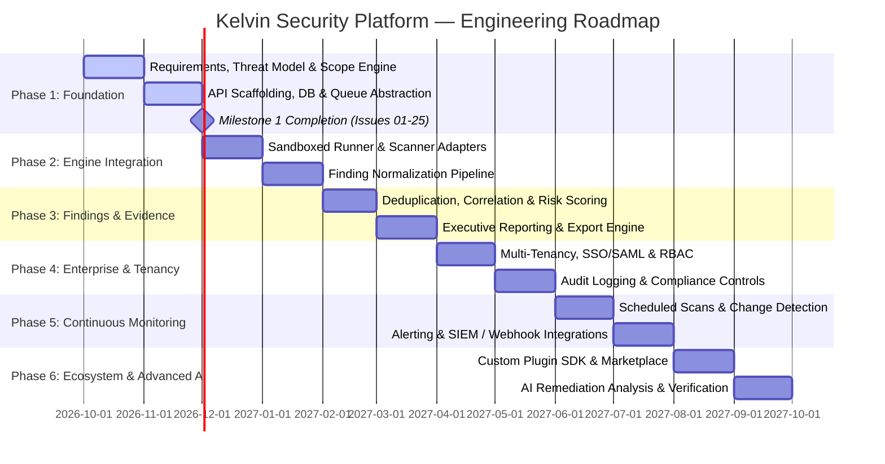
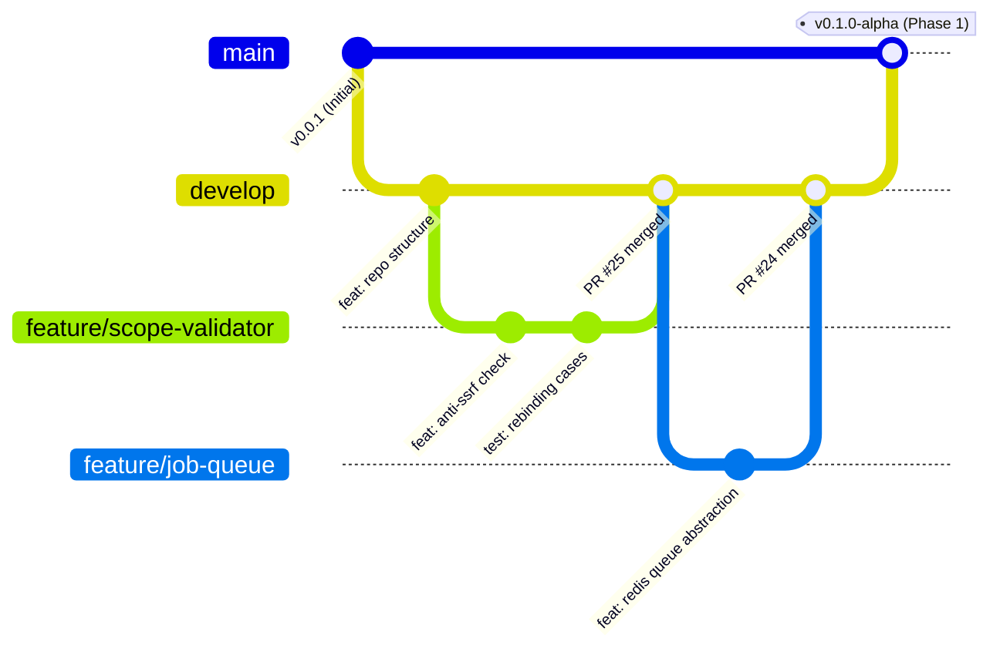

# Kelvin Platform Engineering Roadmap (225-Issue Trajectory)

## 1. Overview & Phased Trajectory

Kelvin's product development is organized into six major evolutionary phases spanning 225 planned issues. Each phase delivers a functional, tested increment of capability while preserving zero-trust security invariants.

---

## 2. Release Milestones & Phase Breakdown

| Phase | Milestone Title | Issue Range | Focus Areas | Exit Criteria |
| :--- | :--- | :--- | :--- | :--- |
| **Phase 1** | **Foundation & Core Architecture** | `P1-01` to `P1-25` *(Current)* | Scope enforcement, threat model, API scaffolding, job queues, persistence, CI/CD | Secure baseline control plane; verifiable scope rejection; job state machine |
| **Phase 2** | **Scanner Engines & Worker Isolation** | `P2-26` to `P2-65` | Worker daemon, Docker sandbox, network discovery, web scanner adapters, finding normalizers | Isolated containerized execution; 3 integrated scanner engines |
| **Phase 3** | **Findings Pipeline & Risk Intelligence**| `P3-66` to `P3-110` | Vulnerability deduplication, CWE/CVE mapping, severity calculation, evidence redaction, PDF/JSON reporting | Normalized vulnerability database; zero redundant alerts for duplicate runs |
| **Phase 4** | **Multi-Tenancy & Enterprise Governance**| `P4-111` to `P4-150`| Organization hierarchies, fine-grained RBAC, OIDC/SAML authentication, tamper-proof audit trails | Multi-tenant isolation verified by penetration tests; SOC2 readiness |
| **Phase 5** | **Continuous Assessment & Automation**   | `P5-151` to `P5-185`| Cron-based scanning, differential attack surface mapping, Slack/Jira/Webhook dispatchers | Automated alerting on newly exposed services; CI/CD pipeline scanner plugin |
| **Phase 6** | **Extensibility & Advanced Analytics**  | `P6-186` to `P6-225`| Third-party plugin SDK, distributed worker clustering, heuristic prioritization, automated PoC verification | Community plugin ecosystem; enterprise-scale distributed deployment |

---

## 3. Branching & Contribution Strategy

Kelvin enforces strict branch protection and Trunk-Based Gitflow with squash merges. Direct commits to `main` are prohibited.

### Git Workflow Rules
1. **Branch Naming:**
   - Features: `feature/<issue-number>-<short-description>` (e.g. `feature/p1-25-target-validation`)
   - Bugfixes: `fix/<issue-number>-<short-description>`
   - Documentation: `docs/<issue-number>-<short-description>`
2. **Pull Request Quality Gates:**
   - 100% passing automated CI (linting, static analysis, unit tests)
   - Mandatory security negative tests for input validation and authentication
   - Minimum 1 approved code review from code owners
   - Linear Git history maintained via Squash & Merge
