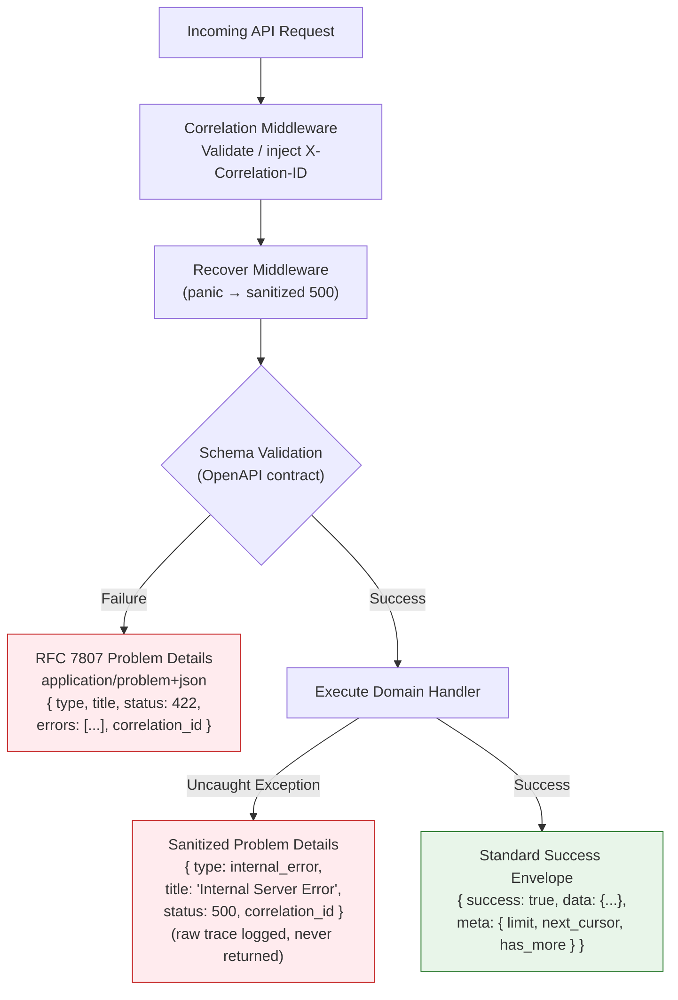
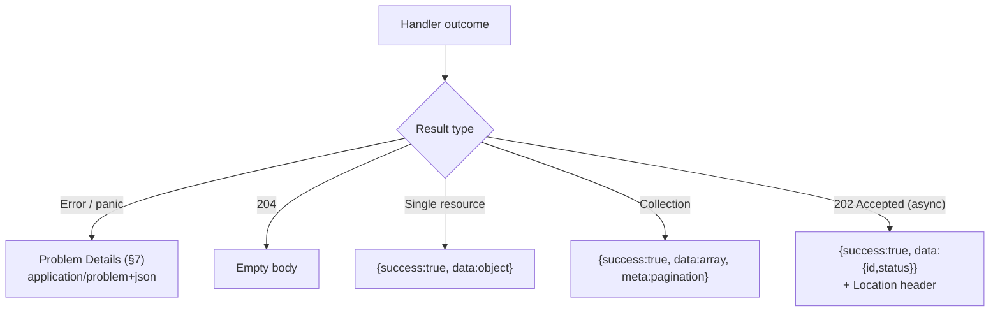
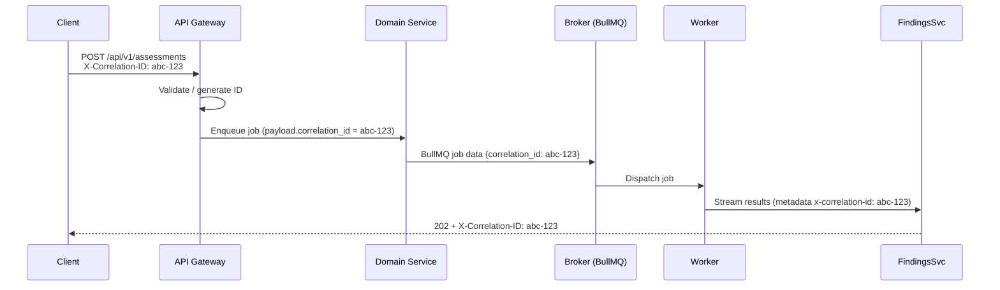

# Kelvin Security Platform — API Standards

**Document Control**

| Field | Value |
| :--- | :--- |
| **Status** | Baseline — Peer Review Required |
| **Milestone** | Phase 1 — Foundation & Core Architecture (`P1-09`) |
| **Depends On** | `docs/architecture/SYSTEM_ARCHITECTURE.md` (`P1-06`), `docs/architecture/decisions/` (`P1-07`) |
| **Owner** | Platform Engineering |
| **Review Cadence** | Quarterly, and on any envelope, error, or versioning change |
| **Related Docs** | `docs/architecture/SYSTEM_ARCHITECTURE.md`, `docs/architecture/REPOSITORY_LAYOUT.md`, `docs/security/THREAT_MODEL.md`, `docs/architecture/decisions/ADR-0001.md`, `docs/architecture/decisions/ADR-0004.md` |
| **Machine-Readable Artifacts** | `packages/schemas/api-envelope.schema.json`, `packages/schemas/api-error.schema.json`, `apps/api/openapi/openapi.yaml` |
| **Classification** | Internal — Engineering Specification |

---

## 1. Executive Summary

Every REST surface exposed by the Kelvin control plane — web dashboard SPA, Kelvin CLI, background workers, and third-party automation — speaks **one dialect**: a single success envelope, RFC 7807/9457 Problem Details for every failure, cursor-based pagination, correlation-ID request tracing, and an OpenAPI 3.1 contract that is the sole source of truth.

This document is normative. Any endpoint that violates it is a defect, regardless of whether it "works." The standards here exist to eliminate the failure modes that fragmented API designs produce:

* **Information disclosure** — stack traces, SQL fragments, table names, and file paths leaked through raw `500` bodies (threat class: Information Disclosure; `T-08` cross-tenant leakage amplifier).
* **Broken HTTP semantics** — `200 OK` with an `{ "error": "failed" }` body, validation errors returned as `500`, and bare arrays that cannot carry pagination metadata.
* **Frontend instability** — client code forced to special-case every endpoint's error shape.
* **Integration overhead** — ad-hoc pagination, filtering, and naming per endpoint.



---

## 2. Scope & Applicability

| Surface | This standard applies? | Notes |
| :--- | :--- | :--- |
| Public REST control-plane API (`/api/v1/*`) | ✅ Mandated | Envelope, Problem Details, pagination, tracing, OpenAPI contract. |
| CLI → API (REST over HTTPS) | ✅ Mandated | Same contract; API key / mTLS auth (SYSTEM_ARCHITECTURE §3.1). |
| WebSocket job telemetry (WSS) | ✅ Adapted | §13; same correlation and error semantics inside message frames. |
| Internal gRPC (Gateway → services) | ⚠️ Tracing only | Correlation ID propagated via `x-correlation-id` metadata; RPC error payloads stay internal. |
| Worker → FindingsSvc (streaming) | ⚠️ Tracing only | Correlation ID propagated; findings payload governed by `packages/schemas/finding.schema.json`, not the HTTP envelope. |
| Broker messages (Redis/BullMQ) | ⚠️ Tracing only | Job payload carries `correlation_id`; no HTTP envelope. |

**Rule:** Any new HTTP surface exposed to a client — including admin, health, and debug endpoints — is in scope. There are no exempt endpoints.

---

## 3. API Versioning

### 3.1 Decision: URL Path Versioning

Kelvin versions its API **in the URL path**: `https://<host>/api/v1/...`.

| Option | Verdict | Rationale |
| :--- | :--- | :--- |
| **URL path (`/api/v1`)** | ✅ Selected | Explicit, cacheable, trivially routable at the gateway, self-documenting for CLI/automation consumers, and maps cleanly to one OpenAPI document per major version. |
| Custom version header | ❌ Rejected | Invisible in logs, browser, and curl; breaks cache keys and linkability; adds client complexity with zero benefit for a non-public, authenticated API. |
| `Accept` header negotiation | ❌ Rejected | Conflates media-type negotiation with contract versioning; hard to test and debug. |

### 3.2 Versioning Rules

1. **Major versions only** appear in the path (`v1`, `v2`). The path prefix is `/api/{major}`.
2. **Additive changes are not version bumps.** New optional request fields, new response fields, new endpoints, and new enum values (clients must treat unknown enums as "unknown") are backwards-compatible and ship within the current major.
3. **Breaking changes** — removing/renaming fields, tightening validation, changing status codes, changing field types — require a new major path version.
4. **Pre-GA policy (Phase 1–3 alpha):** the contract may still break inside `/api/v1` with ≥ 30 days notice via the changelog. Consumers pin to a contract snapshot.
5. **GA policy (v1.0.0 tag onward):** semantic versioning of the contract; deprecations carry the `Deprecation` header (RFC 9745) and `Sunset` header (RFC 8594) with ≥ 180 days of overlap before removal.
6. **One OpenAPI document per major version** (`apps/api/openapi/openapi.yaml` for v1). Superseded majors remain in the repo until sunset.
7. **Version introspection:** `GET /api/v1/meta` returns `{ api_version, contract_version, sunset_date? }` inside the standard envelope.

---

## 4. Resource Naming & URL Structure

| Rule | Convention | Example |
| :--- | :--- | :--- |
| Base path | `/api/v1` | `https://platform.example/api/v1` |
| Nouns, plural, kebab-case | Collections are plural resource nouns | `/assessments`, `/scan-profiles`, `/finding-policies` |
| Identifiers | UUID v4 in the path, after the collection | `/assessments/6b8e1a40-…` |
| Sub-resources | One nesting level maximum | `/assessments/{id}/findings` |
| Actions (verbs) | Only for non-CRUD operations, `POST` on a sub-collection | `/assessments/{id}/cancels`, `/assessments/{id}/exports` |
| No trailing slashes, no file extensions | Redirect-normalized at gateway | `/assessments` ✅ `/assessments/` ❌ |
| Case | Lowercase kebab-case path segments; camelCase query params | `/scan-profiles?createdAtGte=2026-01-01T00:00:00Z` |
| Query strings | Filters/sorting/pagination only, never identifiers of state-changing ops | `GET` only for state reads |

**Banned:** RPC-style paths (`/getAssessments`, `/assessments/create`), verb paths for CRUD (`/assessments/delete/{id}` — use `DELETE`), and deep nesting (`/tenants/{t}/projects/{p}/…` — resolve via query filter instead).

---

## 5. Request Conventions

### 5.1 Required & Standard Headers

| Header | Direction | Requirement |
| :--- | :--- | :--- |
| `Content-Type: application/json` | Request with body | Mandatory on all bodied requests. Missing/other → `415`. |
| `Accept: application/json` | Request | Optional (JSON is the only success media type). `application/problem+json` is returned automatically on errors. |
| `X-Correlation-ID` | Request / Response | Optional inbound, always outbound. See §10. |
| `Idempotency-Key` | Request | Required on `POST /assessments` (§5.3). UUID v4. |
| `Authorization` / session cookie / `X-API-Key` | Request | Per auth scheme (§7 of SYSTEM_ARCHITECTURE). |

### 5.2 Body Limits & Encoding

* UTF-8 only. Request bodies are size-capped at the gateway (**default 1 MiB**; larger limits require an explicit per-endpoint override in the OpenAPI contract). Exceeding → `413`.
* Timestamps in bodies: RFC 3339, UTC, `Z` suffix (`2026-10-26T14:30:00Z`).
* Identifiers: lowercase UUID v4 strings.
* Field naming: **camelCase** (`scanProfileId`, `createdAt`) — matches the TypeScript client generated for `apps/web` (ADR-0004).
* Enum wire values: **SCREAMING_SNAKE_CASE** (`QUEUED`, `VALIDATING_SCOPE`, `RUNNING`, `COMPLETED`, `FAILED`, `TIMED_OUT`, `CANCELLED` — the assessment state machine of SYSTEM_ARCHITECTURE §8.4).
* Unknown request fields are **rejected** with `422` (strict validation; prevents mass-assignment and silently ignored client bugs).

### 5.3 Idempotency

* `POST` endpoints that create durable work (assessment submission, report export) **require** an `Idempotency-Key` header.
* The key is bound to `(tenant, endpoint, key)` for 24 h. Replays return the **original response** (same status, body, and `Idempotency-Key` echo) without re-executing.
* Key reuse with a different body → `409` (`idempotency_conflict`).

### 5.4 Timeouts

Request handling targets: `p99 < 500 ms` for read endpoints, `p99 < 2 s` for creates that enqueue jobs. Anything longer must be asynchronous (`202 Accepted`, §6.4) — the API never blocks a request for the duration of a scan.

---

## 6. Success Response Envelopes

All `2xx` JSON responses use the envelope defined by `packages/schemas/api-envelope.schema.json`. **Bare objects, bare arrays, and `{ message: ... }` bodies are banned.**

```json
{
  "success": true,
  "data": { },
  "meta": { }
}
```

| Member | Type | Rule |
| :--- | :--- | :--- |
| `success` | `const: true` | Always `true` in a success envelope. Failures never use this envelope (§7). |
| `data` | object \| array \| null | The resource, the collection page, or `null` (e.g. `204`). |
| `meta` | object (optional) | Pagination and request-scoped metadata only. **Required** for collection responses. |

### 6.1 Single Resource (`200`)

```json
{
  "success": true,
  "data": {
    "id": "6b8e1a40-9f2d-4c1e-8a7b-3d5f0c2e9b11",
    "name": "External perimeter — Q4",
    "status": "RUNNING",
    "createdAt": "2026-10-26T14:30:00Z"
  }
}
```

### 6.2 Collection (`200`) — always paginated

```json
{
  "success": true,
  "data": [
    { "id": "6b8e1a40-…", "status": "RUNNING" },
    { "id": "a1c3f5d2-…", "status": "COMPLETED" }
  ],
  "meta": {
    "limit": 25,
    "count": 2,
    "next_cursor": "eyJpZCI6ImExYzNmNWQyIn0",
    "has_more": true
  }
}
```

Collections **never** return unpaginated arrays. The default `limit` is 25, maximum 100 (§8).

### 6.3 Mutations

| Operation | Status | Body | Extra headers |
| :--- | :--- | :--- | :--- |
| `POST` (synchronous create) | `201 Created` | Envelope with the created resource | `Location: /api/v1/<collection>/<id>` |
| `POST` (async work enqueued) | `202 Accepted` | Envelope; `data` = `{ id, status: "QUEUED", … }` | `Location` to the job resource |
| `PUT` / `PATCH` | `200 OK` | Envelope with the updated resource | — |
| `DELETE` | `204 No Content` | **No body** | — |

`204` is the only successful response without an envelope. Any `2xx` with a body must use the envelope.

### 6.4 Envelope Selection



---

## 7. Error Handling — RFC 7807 Problem Details

### 7.1 Media Type & Schema

Every non-`2xx` response is an **RFC 7807/9457 Problem Details** object serialized as `application/problem+json`, validated by `packages/schemas/api-error.schema.json`.

| Member | Type | Presence | Rule |
| :--- | :--- | :--- | :--- |
| `type` | string (URN) | Required | Stable problem-type identifier from the registry (§7.2). Clients **must** treat it as opaque; branching on `title` is forbidden. |
| `title` | string | Required | Human-readable, stable per type, no dynamic data. |
| `status` | integer | Required | Must equal the HTTP status line. |
| `detail` | string | Optional | Specific to this occurrence; **sanitized** (§7.3). |
| `instance` | string (URI-reference) | Optional | The request path of this occurrence. |
| `correlation_id` | UUID | **Required** | The `X-Correlation-ID` of the failing request (§10). |
| `timestamp` | RFC 3339 | Optional | Time the problem was produced. |
| `errors[]` | array | `422` only | Field-level failures (§7.4). |
| `retry_after_seconds` | integer | `429`/`503` | Mirrors the `Retry-After` header. |

Problem type URIs use the immutable URN namespace `urn:kelvin:problem:<code>` (RFC 7807 permits any URI). A dereferenceable HTTPS alias may be published later without breaking clients.

### 7.2 Problem Type Registry

| HTTP | `type` (URN) | `title` | When |
| :--- | :--- | :--- | :--- |
| 400 | `urn:kelvin:problem:malformed_request` | Malformed Request | Unparseable JSON, wrong types, bad header syntax. |
| 400 | `urn:kelvin:problem:invalid_cursor` | Invalid Cursor | Expired/malformed pagination cursor or cursor-filter mismatch. |
| 401 | `urn:kelvin:problem:unauthenticated` | Unauthenticated | Missing, expired, or invalid credentials. `WWW-Authenticate` set. |
| 403 | `urn:kelvin:problem:forbidden` | Forbidden | Authenticated but RBAC denies the action (THREAT_MODEL `T-15`). |
| 404 | `urn:kelvin:problem:not_found` | Resource Not Found | Unknown ID **or** existing resource outside the caller's tenant (indistinguishable by design, `T-08`). |
| 405 | `urn:kelvin:problem:method_not_allowed` | Method Not Allowed | `Allow` header set. |
| 409 | `urn:kelvin:problem:conflict` | Conflict | Illegal state-machine transition, duplicate name, idempotency-key body mismatch. |
| 413 | `urn:kelvin:problem:payload_too_large` | Payload Too Large | Body exceeds gateway/endpoint cap. |
| 415 | `urn:kelvin:problem:unsupported_media_type` | Unsupported Media Type | Body without `application/json`. |
| 422 | `urn:kelvin:problem:validation_failed` | Validation Failed | Schema/field validation failed; `errors[]` populated. |
| 422 | `urn:kelvin:problem:target_scope_violation` | Target Scope Violation | Target fails RFC 1918/loopback/metadata blocklist or ownership verification (SYSTEM_ARCHITECTURE §8.3 mandates `422` here). |
| 429 | `urn:kelvin:problem:rate_limited` | Too Many Requests | Rate/quota exceeded; `Retry-After` + `RateLimit-*` headers. |
| 500 | `urn:kelvin:problem:internal_error` | Internal Server Error | Unhandled panic/bug. Generic only (§7.3). |
| 503 | `urn:kelvin:problem:service_unavailable` | Service Unavailable | Dependency outage / maintenance; `Retry-After`. |

**Scope vocabulary note:** "Forbidden" (`403`) is *authorization* failure. "Target Scope Violation" (`422`) is *scan target policy* failure. Both exist; never conflate them.

### 7.3 Sanitization — Non-Negotiable Rules

An internal error response **must never** contain, and the API **must never** serialize, any of:

* Stack traces, goroutine dumps, Go type names, or file paths (`*.go:123`).
* SQL/ORM statements, table or column names, constraint names, database error strings.
* Internal hostnames, IPs, ports, or dependency versions.
* Tenant identifiers or resource names belonging to another tenant.
* Raw exception messages from third-party libraries.

Mapping guidance:

| Internal failure | HTTP | Client sees | Server logs (with `correlation_id`) |
| :--- | :--- | :--- | :--- |
| Unhandled panic | 500 | `internal_error`, generic `detail` | Full stack trace at `ERROR` |
| DB unique violation | 409 | `conflict` with domain message | Constraint name, query, driver error |
| DB connection loss | 503 | `service_unavailable` | Driver error, DSN host (redacted creds) |
| Validation of user input | 422 | `validation_failed` + `errors[]` | Field paths, rejected values |

Clients correlate a `500` to a server log line **only** via `correlation_id`. This is the sole diagnostic channel across the trust boundary and directly mitigates Information Disclosure (`T-08`).

### 7.4 Field-Level Validation Errors

`422` responses carry `errors[]`; each entry:

```json
{
  "errors": [
    {
      "field": "targets[0].host",
      "code": "private_address_blocked",
      "message": "Target resolves to a blocked private address range.",
      "allowed_values": []
    }
  ]
}
```

* `field` — dotted path with zero-based array indices, e.g. `scanProfileId`, `targets[0].host`.
* `code` — stable `snake_case` machine code; clients may branch on it.
* `message` — human-readable, English, sanitized.
* `allowed_values` — optional; populated for enum/range rejections.
* All failing fields are reported in one response (not one-at-a-time).

### 7.5 Worked Examples

**`422` — validation failure**

```json
{
  "type": "urn:kelvin:problem:validation_failed",
  "title": "Validation Failed",
  "status": 422,
  "detail": "One or more fields failed validation.",
  "instance": "/api/v1/assessments",
  "correlation_id": "f47ac10b-58cc-4372-a567-0e02b2c3d479",
  "timestamp": "2026-10-26T14:31:02Z",
  "errors": [
    { "field": "name", "code": "required", "message": "Name is required." },
    { "field": "targets[0].host", "code": "private_address_blocked", "message": "Target resolves to a blocked private address range." }
  ]
}
```

**`500` — sanitized internal error (what the client sees)**

```json
{
  "type": "urn:kelvin:problem:internal_error",
  "title": "Internal Server Error",
  "status": 500,
  "detail": "An unexpected error occurred. Provide the correlation_id to support.",
  "correlation_id": "9b2c1e77-4d3a-4f6e-8c1b-2a5d8e0f3c64",
  "timestamp": "2026-10-26T14:32:10Z"
}
```

**What is logged server-side for that same request (never returned):**

```
ERROR panic recovered  correlation_id=9b2c1e77-…  error="pgx: relation \"findings\" does not exist"
goroutine 42 [running]: … /app/internal/findings/store.go:218 …
```

**`429` — rate limited**

```json
{
  "type": "urn:kelvin:problem:rate_limited",
  "title": "Too Many Requests",
  "status": 429,
  "detail": "Request budget exceeded for this API key.",
  "correlation_id": "1f0a…",
  "retry_after_seconds": 30
}
```

### 7.6 Anti-Patterns (CI-Rejectable)

| Banned pattern | Why | Correct |
| :--- | :--- | :--- |
| `200 OK` + `{ "error": "failed" }` | Breaks HTTP semantics; clients must status-check anyway | Real status code + Problem Details |
| `500` for invalid user input | Masks bugs; pollutes incident signals | `422` + `errors[]` |
| Bare arrays / bare objects | No room for pagination/correlation metadata | Success envelope (§6) |
| `{ "message": "…" }` error bodies | Not machine-parseable, inconsistent | Problem Details |
| HTML error pages from the gateway | Leaks stack/version info; unparseable by clients | JSON Problem Details everywhere, including 404/403 at the gateway |
| Echoing `err.Error()` from DB drivers | Discloses schema/SQL | Mapped domain problem (§7.3) |
| `success: false` inside the success envelope | Two error channels | Errors never use the success envelope |

---

## 8. Pagination, Sorting, Filtering & Field Selection

### 8.1 Cursor Pagination (Mandatory for Collections)

All collection endpoints use **opaque cursor pagination**. Offset/`page` pagination is banned for findings, assessments, assets, and audit streams — offsets drift under concurrent writes and degrade to O(n) on large tables.

| Query param | Type | Default | Rule |
| :--- | :--- | :--- | :--- |
| `limit` | integer | 25 | Range 1–100. Out of range → `422`. |
| `cursor` | string | — | Opaque `base64url` token issued by a previous response's `meta.next_cursor`. |

* Cursors encode the sort key + tie-break ID + a hash of the active filter/sort set. Using a cursor with a different filter/sort → `400 invalid_cursor`.
* Cursors are opaque: clients must not parse or construct them.
* `meta.next_cursor` is `null`/absent on the last page; `meta.has_more` is always present; `meta.count` is the page size; `meta.total` is included **only** where an exact count is cheap (admin views), and is otherwise omitted — never computed via `COUNT(*)` over unbounded tenant tables.
* Consistency note: the reconciled wire shape replaces the legacy illustrative `{ page, limit, total }` sketch; `limit` is retained, `page`/offset is dropped, and `total` is optional.

### 8.2 Sorting

* Param: `sort=createdAt:desc,severity:asc` — comma-separated `field:direction`, direction defaults to `asc`.
* Sortable fields are an **allow-list per endpoint**, declared in the OpenAPI contract. Unknown field → `422` (`unknown_field`).
* Every sort is made **stable** by appending `id` as a final tie-breaker server-side.

### 8.3 Filtering

* Named, documented, allow-listed query params per endpoint (`status=RUNNING`, `severity=HIGH,CRITICAL`).
* Multi-value filters: comma-separated within one param; combining params is logical AND.
* Generic bracket syntax (`filter[field]=value`) is banned — it is hard to document, easy to over-expose, and invites injection of unindexed predicates.
* Operators (`gte`, `contains`, …) are only added as explicitly named params (`createdAtGte`), declared in the contract.

### 8.4 Sparse Fieldsets

* `fields=id,status,severity` — server returns only listed attributes.
* Allow-listed per resource; unknown field → `422`.
* Never accept `fields` values that would disable redaction or tenant guards.

### 8.5 Query Param Grammar

| Param class | Example | Notes |
| :--- | :--- | :--- |
| Pagination | `?limit=50&cursor=eyJ…` | §8.1 |
| Sorting | `?sort=createdAt:desc` | §8.2 |
| Filtering | `?status=RUNNING&severity=HIGH,CRITICAL` | §8.3 |
| Sparse fields | `?fields=id,status,targets` | §8.4 |
| Full-text (where offered) | `?q=nuclei` | Documented per endpoint; sanitized; never interpolated into raw SQL |

---

## 9. HTTP Status Code Catalog

| Status | Use | Body shape |
| :--- | :--- | :--- |
| 200 | Successful read/update | Success envelope |
| 201 | Resource created | Success envelope + `Location` |
| 202 | Async work accepted | Success envelope + `Location` |
| 204 | Delete succeeded | Empty |
| 400 | Malformed request / bad cursor | Problem Details |
| 401 | Unauthenticated | Problem Details + `WWW-Authenticate` |
| 403 | Forbidden (RBAC) | Problem Details |
| 404 | Not found / cross-tenant | Problem Details |
| 405 | Method not allowed | Problem Details + `Allow` |
| 409 | Conflict / illegal state transition | Problem Details |
| 413 | Payload too large | Problem Details |
| 415 | Unsupported media type | Problem Details |
| 422 | Validation or target-scope failure | Problem Details + `errors[]` |
| 429 | Rate limited | Problem Details + `Retry-After`, `RateLimit-*` |
| 500 | Unhandled server fault | Problem Details (sanitized) |
| 503 | Dependency outage / maintenance | Problem Details + `Retry-After` |

Rate-limit headers on every authenticated response: `RateLimit-Limit`, `RateLimit-Remaining`, `RateLimit-Reset` (IETF draft field semantics); `429` adds `Retry-After`.

**Auth semantics:** `401` = credentials missing/invalid. `403` = credentials valid, action denied. A `404` for a resource that exists in another tenant is intentional (`T-08`); never distinguish "exists elsewhere" from "does not exist."

---

## 10. Correlation IDs & Request Tracing

### 10.1 Header Contract

| Rule | Value |
| :--- | :--- |
| Header | `X-Correlation-ID` |
| Inbound | Optional. If present, must match `^[A-Za-z0-9._-]{1,128}$`. |
| Invalid inbound value | Discarded (logged at `WARN`); server generates a fresh ID. Requests are never rejected for a bad correlation header. |
| Absent inbound value | Server generates a UUID v4. |
| Outbound | Echoed on **every** response — success and error. |
| In error bodies | Required member of every Problem Details object (`correlation_id`). |
| Logging | Mandatory field on every structured log line for the request (`packages/common/logging`). |

### 10.2 Propagation Across Services



1. Gateway → internal gRPC: `x-correlation-id` metadata.
2. Control plane → broker: every job payload carries `correlation_id`.
3. Worker → FindingsSvc: gRPC/HTTPS metadata `x-correlation-id`.
4. WebSocket: the welcome frame echoes the correlation ID established at handshake.

One assessment, from CLI click to worker log line to finding row, is greppable by a single ID. This is the distributed-tracing backbone until full OpenTelemetry adoption (future ADR) adds `traceparent`.

---

## 11. OpenAPI 3.1 Contract & Tooling

### 11.1 The Contract Is the Source of Truth

* **Canonical spec:** `apps/api/openapi/openapi.yaml`, **OpenAPI 3.1.0** (aligned with JSON Schema draft 2020-12, the same dialect as `packages/schemas/*.json`).
* **Spec-first rule:** no endpoint implementation merges without a corresponding contract entry declaring paths, params, request/response schemas, and Problem Details responses.
* Shared components (`Problem`, `FieldError`, envelope schemas, pagination params, correlation header, auth schemes) live in the spec's `components/` and are referenced by every operation — no per-endpoint redefinition of envelopes or errors.

### 11.2 Toolchain (Mandated)

| Concern | Tool | Gate |
| :--- | :--- | :--- |
| Spec linting | Redocly CLI (`@redocly/cli lint`) | CI, blocking |
| Breaking-change detection | `oasdiff` against `main` | CI, blocking pre-GA optional / post-GA blocking |
| Go server types + validation | `oapi-codegen` (types/interfaces) + `kin-openapi` (runtime request validation) | Build |
| TypeScript client for `apps/web` | `openapi-typescript` → generated types in `apps/web/src/services/` (never hand-edited) | CI, blocking on drift |
| Interactive docs | Redoc / Swagger UI at `/api/v1/docs` | Enabled non-prod by default; env-gated in prod |
| Contract tests | Schema-validate every handler response against envelope/Problem schemas | CI, blocking |

### 11.3 Documentation Hygiene

Every operation declares: summary, description, tags, all params, `2xx` envelope schema, and **every** applicable Problem Details response via shared `$ref`s (at minimum `401`, `403`, `429`, `500`). Examples are mandatory for `200`, `201`/`202`, and `422`.

---

## 12. Server-Side Enforcement Architecture

### 12.1 Middleware Order (Go, `apps/api`)

1. **Correlation** — validate/generate ID, store in context (§10).
2. **Recover** — panic → full stack to logs, sanitized `500` Problem to client (§7.3).
3. **Access log** — structured line with method, path, status, duration, correlation ID (no bodies, no secrets).
4. **Body limit** — per §5.2.
5. **AuthN** → **AuthZ** (tenant context injected at gateway; deny-by-default RBAC).
6. **Request validation** — `kin-openapi` against the contract.
7. **Handler** — returns typed results; writes only through the envelope writer.

Handlers never call `json.NewEncoder(w).Encode(anything)` directly. They return domain results; the envelope writer (§6) or Problem writer (§7) serializes. This makes it structurally impossible to leak naked structs or stack traces.

### 12.2 Canonical Error Types

`packages/common/errors` defines the single error vocabulary: `NewValidation`, `NewNotFound`, `NewForbidden`, `NewConflict`, `NewTargetScopeViolation`, `NewInternal(err)`. `NewInternal` stores the cause for logging **only** — it has no exported field or method that can reach a response serializer.

### 12.3 CI Gates (Blocking)

| Gate | Checks |
| :--- | :--- |
| OpenAPI lint | Spec conforms to Redocly config; shared components referenced, not redeclared |
| Contract tests | Handler responses validate against `api-envelope.schema.json` / `api-error.schema.json` |
| Leak tests | No response body matches `(?i)goroutine \|\.go:\d+ \|pgx\|lib/pq\|SELECT .* FROM \|sql:` |
| Error-registry test | Every `type` emitted in code exists in the §7.2 registry and spec |
| `govulncheck` / `staticcheck` / `golangci-lint` | Per ADR-0001 |

---

## 13. WebSocket Telemetry (Adapted Semantics)

* Endpoint: `WSS /api/v1/telemetry` (job-state streaming per SYSTEM_ARCHITECTURE §3.1).
* Handshake requires the same auth as REST; a correlation ID is established and echoed in the `welcome` frame.
* Frames: `{ type, data, meta?, correlation_id }` — envelope discipline applies to `data`.
* Error frames carry the **same Problem Details object** (§7) as an `error` member; sanitized `500` rules apply.
* Server-side frame schema validation; oversize frames dropped with a `policy_violation` error frame.

---

## 14. Governance & Change Control

1. **This document is normative.** Endpoint PRs are rejected if they deviate from the envelopes, problem registry, pagination, or tracing rules without an approved amendment here.
2. **Amendments require Platform Engineering review** and a matching update to `apps/api/openapi/openapi.yaml` and, where applicable, `packages/schemas/`.
3. **New problem types** must be added to the §7.2 registry and the OpenAPI components in the same PR that first emits them.
4. **Breaking envelope or pagination changes** constitute a new API major version (§3.2).
5. **Review cadence:** quarterly, and on any change to auth, tenancy, or the gateway.

---

## 15. Traceability

| Artifact | Reference |
| :--- | :--- |
| Planning reference | `P1-09` |
| Milestone | Phase 1 — Foundation & Core Architecture |
| Blocked by | `P1-06` — `docs/architecture/SYSTEM_ARCHITECTURE.md`; `P1-07` — `docs/architecture/decisions/` (ADR-0001 Go, ADR-0004 React/TS client) |
| Success envelope schema | `packages/schemas/api-envelope.schema.json` |
| Problem Details schema | `packages/schemas/api-error.schema.json` |
| OpenAPI contract benchmark | `apps/api/openapi/openapi.yaml` |
| Threat controls | `docs/security/THREAT_MODEL.md` — T-02 (authn), T-08 (cross-tenant / information disclosure), T-15 (RBAC) |
| Repository layout | `docs/architecture/REPOSITORY_LAYOUT.md` |
| Contribution rules | `CONTRIBUTING.md` |

---

*Kelvin Security Platform — Phase 1 Engineering Backlog*
