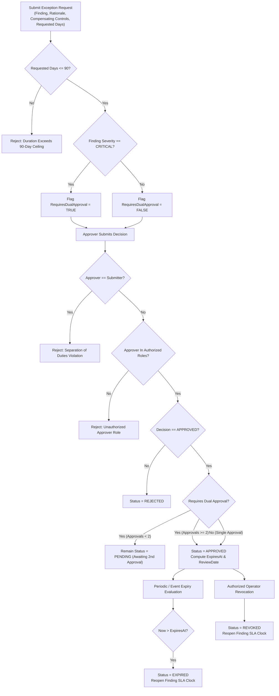

# Accepted-Risk Approval and Exception Governance Architecture

## 1. Overview
The Accepted-Risk Approval and Exception Governance subsystem manages the formal lifecycle for risk exceptions, business justifications, and compensating control waivers. It enforces separation of duties, mandatory dual approval for critical risks, strict maximum duration ceilings, and automated expiration state transitions without compromising underlying audit or evidence data.

## 2. Risk Exception Approval Lifecycle

## 3. Key Architectural Guarantees
1. **Mandatory Separation of Duties (Anti-Self-Approval)**: The user submitting the risk exception cannot sign off on or approve their own request under any circumstances.
2. **Dual-Authorization for Critical Severity**: Findings with severity `CRITICAL` mandate sign-offs from two distinct authorized principals (e.g., Security Lead + CISO) before activating.
3. **90-Day Maximum Expiration Ceiling**: Exception durations cannot exceed 90 days. A formal review milestone is automatically set prior to expiration.
4. **Automated Expiry and Clock Resumption**: Expired or revoked exceptions transition automatically to `EXPIRED` or `REVOKED`, re-engaging active SLA remediation clocks and notifying finding workflows.
5. **Data and Evidence Preservation**: Accepting risk modifies governance state while leaving original finding fingerprints, scanner envelopes, and collected evidence untouched.
