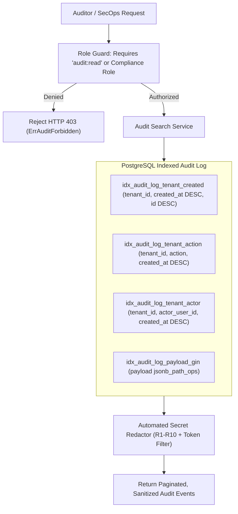

# Advanced Audit Search and Filtering Architecture

## 1. Overview
The Advanced Audit Search and Filtering engine empowers authorized security officers, compliance auditors, and organization owners to perform multi-dimensional investigations across immutable audit records stored in PostgreSQL.

## 2. Architecture & Query Lifecycle

## 3. Key Invariants & Safeguards

### Strict Tenant Boundary Isolation
All audit searches enforce `tenant_id` as an immutable filter dimension. Cross-tenant audit viewing is physically blocked both by SQL parameter binding and application-level validation.

### Defense-in-Depth Secret Redaction
Even though audit recording should omit secrets by policy, the search layer executes an automated scrubbing pass over all returned payloads. Any accidentally captured credentials, bearer tokens, passwords, or AWS keys are replaced with `[REDACTED]` before leaving the server.

### DB Resource Protection & DoS Prevention
- Hard query limit capped at 100 entries per request (default: 20).
- Stable sorting on `(created_at DESC, id DESC)` ensures deterministic pagination across page boundaries without duplicate or missing rows.
- Dedicated B-Tree composite indexes prevent costly table scans during forensic inquiries.
- Append-only ADR-0002 compliance: the search interface is read-only; no UPDATE or DELETE queries are ever permitted on `audit_log`.
