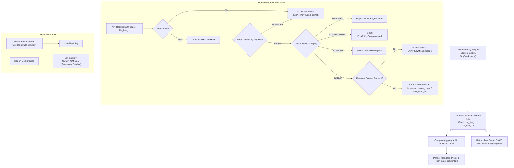

# API Credential and Key Lifecycle Management Architecture

## 1. Overview
The API Credential and Key Lifecycle Management subsystem provides cryptographic key provisioning, one-way SHA-256 storage, scoped authorization boundaries, zero-downtime rotation, and instant compromise isolation for integration tokens and automation access keys.

## 2. API Key Lifecycle & Authentication Flow

## 3. Key Architectural Guarantees
1. **One-Way Cryptographic Hashing**: Plaintext API keys (`klv_live_...`) are returned strictly once upon generation. Only their SHA-256 hashes and display prefixes (`klv_live_a1b2c3`) are persisted.
2. **Leakage Prevention**: Credential entities redact secrets and hashes in `json.Marshal` and `String()` implementations. Utility functions mask keys for logging.
3. **Explicit Scope Bounding**: API keys enforce granular permission scopes (e.g. `scans:trigger`, `scans:read`), denying access by default to ungranted endpoints.
4. **Immediate Revocation and Compromise Quarantine**: Revoking or flagging a key as `COMPROMISED` synchronously halts all incoming requests with immediate rejection.
5. **Telemetry Tracking**: Successful authentications update `last_used_at`, `last_used_ip`, and `usage_count` without recording secret key material.
