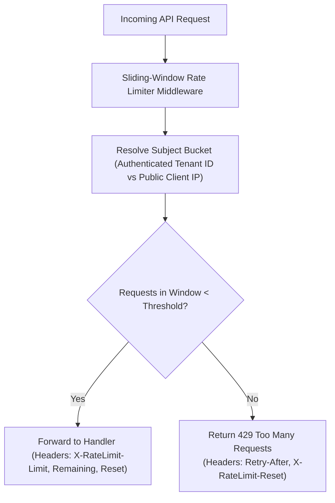

# API Rate Limiting & Fair-Use Controls Architecture

## 1. Overview
The API Rate Limiting & Fair-Use Controls subsystem protects KELVIN's public and internal endpoints from resource starvation, denial of service (DoS), and abuse by enforcing tenant-aware, sliding-window rate limiting.

## 2. Architecture & Rate Limiting Pipeline

## 3. Operational Categories & Thresholds

| Category | Typical Endpoints | Default Limit | Burst Allowance |
|---|---|---|---|
| **STANDARD** | Findings listing, Asset management, Policy evaluation | 100 req/min | 20 requests |
| **EXPENSIVE** | Assessment initiation, Report PDF compilation, Bulk triage exports | 10 req/min | 2 requests |

## 4. Key Invariants & Safeguards

### Anti-Spoofing Tenant Attribution
Tenant rate-limit keys are strictly populated from authenticated context (`tenant.ID(ctx)`). Unauthenticated requests (e.g. login or public endpoints) are bound to verified client remote IPs. Untrusted client headers (such as `X-Tenant-ID`) are ignored to prevent attackers from exhausting another tenant's rate limit budget.

### Standardized RFC 6585 Feedback
Throttled clients receive HTTP status `429 Too Many Requests` accompanied by:
- `Retry-After`: Designated seconds before retry is permissible.
- `X-RateLimit-Limit`: Maximum requests permitted per window.
- `X-RateLimit-Remaining`: Remaining request allowance (`0` when throttled).
- `X-RateLimit-Reset`: Unix timestamp when the oldest request exits the sliding window.
