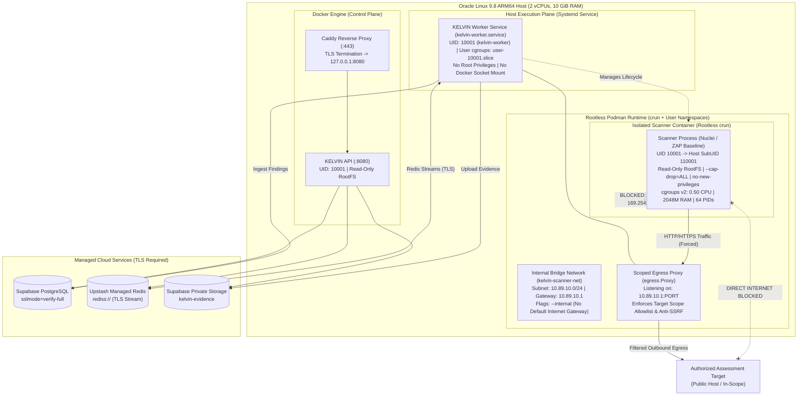

# Kelvin Scanner Execution Platform — Architecture Reconciliation Report

**Document Version:** 1.0.0  
**Date:** 2026-11-14  
**Classification:** Security Architecture & Platform Engineering  
**Governing ADR:** [ADR-0008: Secure OCI Execution Architecture](decisions/ADR-0008.md)  
**Target Host:** Oracle Linux Server 9.8 (ARM64 / aarch64, 2 vCPUs, 10 GiB RAM)  

---

## 1. Executive Summary

This report reconciles the merged Scanner Execution Platform implementation with **ADR-0008**.

### The Architectural Discrepancy Resolved
In earlier development iterations, staging deployment was inadvertently drafted around a Docker Compose service (`deploy/staging/docker-compose.yml: worker`). This introduced severe architectural conflicts:
1. The containerized worker lacked Docker/Podman binaries within its Alpine base image.
2. Mounting `/var/run/docker.sock` into the worker was **strictly prohibited** by ADR-0008 because it provides unauthenticated root-equivalent control over the host kernel.
3. The internal proxy bound to `127.0.0.1`, which was unreachable across container network namespaces.

### The Reconciled Approved Architecture: ADR-0008 Option A
As mandated by ADR-0008, the staging scanner execution plane is **reconciled as a host-level, unprivileged Go daemon managed by systemd** (`kelvin-worker.service`), executing under a dedicated non-root user (`kelvin-worker`, UID/GID 10001), using **Rootless Podman** with the **crun** OCI runtime and Linux **cgroups v2** on Oracle Linux 9.8 ARM64.

---

## 2. Comprehensive Security Architecture & Threat Model



### Threat Vector Analysis

| Threat Scenario | Attack Vector | Mitigating Controls | Residual Risk |
| :--- | :--- | :--- | :--- |
| **Host Takeover via Container Engine** | Attacker compromises container or worker and gains host root via Docker socket. | `/var/run/docker.sock` is **never** mounted or accessible to the worker. Worker and scanner containers run as unprivileged UID 10001 within rootless user namespaces. Host root remains completely inaccessible. | **Negligible** |
| **Scanner Container Breakout** | Exploit in scanner tool (e.g., ZAP/Nuclei parser vulnerability or libc exploit) executes arbitrary code. | Container runs with `--read-only` rootfs, `--cap-drop=ALL`, `--security-opt=no-new-privileges`, UID 10001 mapped to host subuid 110001. Breakout lands in unprivileged user namespace with zero host capabilities. | **Extremely Low** |
| **Direct Network Bypass / SSRF** | Scanner tool bypasses HTTP proxy environment variables to hit cloud metadata (IMDS `169.254.169.254`) or internal RFC 1918 subnets. | Scanner container is attached to `--network=kelvin-scanner-net` created with `--internal`. The kernel bridge drops all default internet and LAN routing. Traffic can only exit via the egress proxy, which strictly blocks private IPs, metadata, and multi-A DNS rebinding. | **Zero** |
| **Control Plane Credential Theft** | Malicious template or target exploit reads relational database or Supabase service keys from container environment. | Strict environment allowlist enforced in `Spec.Validate()`. Control plane credentials (`KELVIN_DATABASE_URL`, `SUPABASE_SERVICE_ROLE_KEY`, `JWT_SECRET`, `REDIS_PASSWORD`) are prohibited in container specs. Runtime sanitizes `exec.Command` environment. | **Zero** |
| **Resource Starvation / Fork Bomb** | Malicious or runaway scan spawns thousands of child processes or consumes VM memory. | Strict cgroups v2 limits enforced at container creation: `--pids-limit 64`, `--cpus=0.50`, `--memory=2048m`, `--memory-swap=2048m`. User slice limits (`user-10001.slice`) constrain total worker host resource consumption. | **Negligible** |
| **Container & Scratch Space Leaks** | Crashed or cancelled tasks leave orphan containers or temporary disks consuming host storage. | Synchronous context cancellation with 5s/10s grace periods (`podman stop --time=5`) followed by forced removal (`podman rm --force`). Temporary directories cleaned in `defer`. | **Negligible** |

---

## 3. Host-Level Worker Implementation Details

### 3.1 Dedicated Systemd Service Unit (`deploy/systemd/kelvin-worker.service`)
- **Execution Identity:** User `kelvin-worker` (UID 10001), Group `kelvin-worker` (GID 10001).
- **Session Lingering:** `loginctl enable-linger kelvin-worker` ensures the systemd user session and cgroups v2 slice remain active without an interactive login.
- **Environment Management:** Hardened environment file `/etc/kelvin/worker.env` with `0600` permissions.
- **Rootless Session Environment:** Explicitly exports `XDG_RUNTIME_DIR=/run/user/10001` and `DBUS_SESSION_BUS_ADDRESS=unix:path=/run/user/10001/bus`.
- **Process Sandboxing:** Enforces `NoNewPrivileges=true`, `ProtectSystem=strict`, `ProtectHome=read-only`, and strict `ReadWritePaths=/var/lib/kelvin-worker /run/user/10001 /var/log/kelvin /tmp`.

### 3.2 OCI Runtime Discovery & Fail-Closed Verification
`apps/worker/internal/sandbox/oci.go` has been hardened to verify ADR-0008 compliance:
- Discovers `podman` in host PATH (prioritized over Docker).
- Queries `podman info --format json` to extract structured metadata:
  - `Rootless: true` (strictly required; rootful Podman is rejected).
  - `CgroupVersion: v2` (strictly required; cgroups v1 is rejected).
  - `OCIRuntime: crun` (verified low-level runtime).
- `VerifyScannerNetwork(ctx, "kelvin-scanner-net")`: verifies that the dedicated internal bridge exists before accepting tasks.
- If running in `staging` or `production` without rootless Podman, the worker **fails closed at startup** (`log.Fatal`).

---

## 4. Network Isolation & Egress Topology

### 4.1 Internal Scanner Bridge (`kelvin-scanner-net`)
- **Subnet:** `10.89.10.0/24`
- **Gateway:** `10.89.10.1`
- **Creation Flag:** `--internal` (drops all kernel routing to host LAN and external WAN).
- **Container Flag:** `--network=kelvin-scanner-net` (or `--network=none` for passive offline tasks).

### 4.2 Ephemeral Egress Proxy Binding
- `egress.Proxy` binds to the bridge gateway IP:
  ```env
  KELVIN_EGRESS_PROXY_BIND_ADDR=10.89.10.1:0
  KELVIN_EGRESS_PROXY_ADVERTISED_HOST=10.89.10.1
  ```
- Containers reach the proxy via `http://10.89.10.1:<allocated_port>`.
- The proxy enforces:
  1. RFC 1918 private IPv4 subnets denied.
  2. RFC 3927 IPv4 link-local (`169.254.169.254` IMDS) denied.
  3. Loopback (`127.0.0.0/8`, `::1`) denied.
  4. Multi-A record DNS rebinding protection (resolves target DNS before dialing and validates every IP).
  5. Strict target scope whitelist (only authorized URLs/domains).

---

## 5. Scanner Image Release Governance

### 5.1 Authoritative Manifest Status
- **Canonical Manifest:** `deploy/scanners/images.lock.json`
- **Status:** **`not-released`**
- **Release Lock:** `deploy/scanner-image-lock.yaml`
- **Status:** **`not-released`**
- **Catalog Digest:** `sha256:72544e12d0409da7ce430a89dafb86bdf2a971e34986eb936db55f53fb9915b2` (verified against `deploy/scanners/templates/kelvin.safe.web.v1/catalog.json`).

### 5.2 Fail-Closed Execution Governance
- In staging and production, `ValidateReleaseStatusForExecution` strictly rejects executing any scanner container when `status == "not-released"`.
- Images must be built on ARM64 (`scripts/scanners/build-images.sh`), scanned with Trivy, signed, and published to GHCR before the manifest status can transition to `certified`.

---

## 6. Deployment and Rollback Procedures

### 6.1 Host Deployment (`scripts/deploy/staging-deploy.sh`)
1. Runs `scripts/deploy/validate-worker-host.sh` to audit OS, ARM64 architecture, cgroups v2, UID 10001, subuid/subgid, linger, podman, and crun.
2. Validates the existence and readability of the database CA certificate (`SUPABASE_CA_CERT_PATH`).
3. Verifies release lock consistency between JSON and YAML manifests.
4. Checks that required environment variables exist in `/etc/kelvin/worker.env` without logging or printing secrets.
5. Builds the worker binary: `go build -trimpath -ldflags="-s -w" -o /opt/kelvin/bin/kelvin-worker.new ./apps/worker/cmd/runner`.
6. Backs up the active binary to `/opt/kelvin/bin/kelvin-worker.prev` for genuine rollback.
7. Installs the new binary and executes `systemctl restart kelvin-worker.service`.
8. Verifies service readiness with `systemctl is-active kelvin-worker.service`.
9. Confirms API Gateway stability (`http://127.0.0.1:8080/healthz`).

### 6.2 Host Rollback (`scripts/deploy/staging-rollback.sh`)
1. Immediately stops the worker service: `systemctl stop kelvin-worker.service`.
2. Restores `/opt/kelvin/bin/kelvin-worker.prev` to `/opt/kelvin/bin/kelvin-worker` if it exists.
3. Restarts the service with the restored known-good binary. If no previous binary exists, the service remains stopped safely so that no uncertified scans can run.
4. Verifies API Gateway operational stability.

---

## 7. Operational Readiness Checklist & Remaining Blockers

```
[X] 1. Architecture Approved (ADR-0008 Option A: Host Worker with Rootless Podman)
[X] 2. Code Implemented (Contracts, Adapters, OCI Sandbox, Egress Proxy, Systemd Unit)
[X] 3. Automated Tests Passing (100% test pass rate across entire repository)
[ ] 4. Host Environment Setup Executed on Oracle ARM64 VM (Pending 'setup-rootless-podman.sh')
[ ] 5. Environment File Configured (/etc/kelvin/worker.env with staging secrets)
[ ] 6. ARM64 Scanner Images Built, Certified, and Published to GHCR
[ ] 7. Release Manifest Updated from 'not-released' to 'certified'
[ ] 8. End-to-End Live Assessment Executed and Certified
```

### Remaining Operational Prerequisites on Oracle Linux 9.8 Host:
1. Run `sudo bash scripts/deploy/setup-rootless-podman.sh` on the host to create user `kelvin-worker`, configure subuid/subgid, enable linger, and create `kelvin-scanner-net`.
2. Configure `/etc/kelvin/worker.env` with valid staging credentials.
3. Build, scan, and publish ARM64 scanner images to GHCR using `scripts/scanners/build-images.sh`.
4. Deploy the host worker using `sudo bash scripts/deploy/staging-deploy.sh`.
