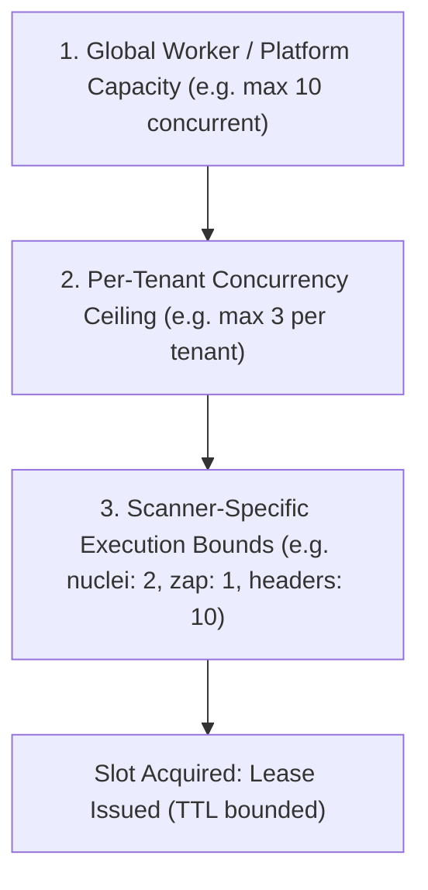
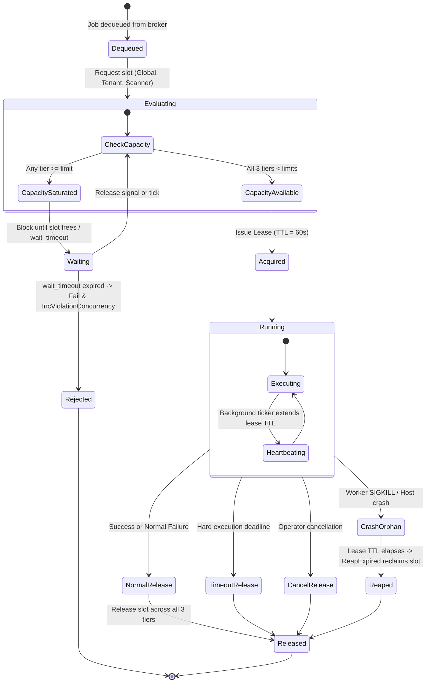

# Assessment Concurrency Controls & Capacity Management

## 1. Executive Summary

In accordance with ADR-0005 (Worker Execution Isolation) and Issue P2-28, Kelvin enforces a deterministic, multi-tiered concurrency control architecture across worker execution runtimes.

Unchecked simultaneous scanner invocations risk:
1. **Target Disruption**: Saturating target networks and triggering automated defense locks (WAF rate limits, IPS bans).
2. **Worker Starvation**: Monopolizing host cgroups v2 slices, CPU cores, or memory bandwidth.
3. **Noisy Neighbor Inequity**: Allowing a single aggressive tenant to exhaust platform-wide scanning capacity.

This document details the multi-tiered concurrency bounds (Global, Per-Tenant, Scanner-Specific), lease lifecycle management, crash recovery guarantees (TTL-based automatic reclamation), and observable saturation metrics.

---

## 2. Multi-Tiered Concurrency Hierarchy

Execution capacity is governed by a 3-tier hierarchical constraint model:



### Hierarchy Rules:
1. **Tier 1 — Global Limit**: Governs the total number of simultaneous containerized or in-process scanners running across the worker node or platform cluster.
2. **Tier 2 — Per-Tenant Limit**: Prevents any single tenant from dominating worker capacity. Default: max 3 concurrent scanners per tenant.
3. **Tier 3 — Scanner-Specific Limits**: Configured per scanner based on resource footprint and network intensity:
   - `zap-baseline`: Tightly bounded to 1 per worker (heavy CPU/memory footprint).
   - `nuclei`: Bounded to 2 concurrent executions (active template volume).
   - `tls_assessor` / `http_headers` / `http_preflight`: Bounded to 10 concurrent executions (low-overhead network probes).

A scanner execution can proceed **only if capacity is available in all three tiers simultaneously**.

---

## 3. Concurrency Slot Lifecycle & State Machine



---

## 4. Race Condition Prevention & Distributed Atomicity

Kelvin prevents race conditions through atomic capacity evaluation:

### 4.1 In-Process Controller (`MemoryController`)
- Synchronized via `sync.Mutex` with multi-tier capacity checking before any slot allocation.
- Uses signaling channels (`notifyCh`) to wake waiting jobs immediately upon slot release.
- Idempotency guarantee: Re-requesting a slot for an already active `JobID` returns the existing lease without double-counting.

### 4.2 Distributed Controller (`RedisController`)
- Multi-worker clusters coordinate via atomic Redis Lua script (`acquireLua`).
- Evaluates sorted sets (`kelvin:concurrency:global`, `kelvin:concurrency:tenant:<id>`, `kelvin:concurrency:scanner:<scanner>`) in a single Redis transaction.
- Purges expired leases, checks counts, and adds lease IDs atomically in one server-side round trip.

---

## 5. Worker Crash Recovery & Slot Reclamation

A primary failure mode in distributed task systems is worker process crashes (OOM kills, power loss, SIGKILL), which leave concurrency slots permanently consumed.

To guarantee zero slot leaks:
1. **Bounded Lease TTL**: Every acquired lease carries a strict time-to-live (`DefaultLeaseTTL`, default 60s).
2. **Periodic Heartbeat**: Active executions run a background heartbeat goroutine extending lease TTL every 10–20 seconds.
3. **Automatic Expiry Reaping**:
   - `TryAcquire` purges expired leases before evaluating available capacity.
   - Background worker reaper (`ReapExpired`) runs every 30 seconds to clean up orphaned slots and wake pending jobs.

---

## 6. Saturation Metrics & Observability

Concurrency utilization is exposed via structured snapshots and Prometheus counters:

```go
type MetricsSnapshot struct {
    Timestamp      time.Time                 `json:"timestamp"`
    Global         SaturationInfo            `json:"global"`
    Tenants        map[string]SaturationInfo `json:"tenants"`
    Scanners       map[string]SaturationInfo `json:"scanners"`
    TotalAcquired  uint64                    `json:"total_acquired"`
    TotalReleased  uint64                    `json:"total_released"`
    TotalRejected  uint64                    `json:"total_rejected"`
    TotalReaped    uint64                    `json:"total_reaped"`
}
```

### Metrics & Gauges:
- **`SaturationRatio`**: Active slots divided by total tier capacity ($0.0 \dots 1.0$). Ratio $\ge 1.0$ indicates tier saturation.
- **`ViolationConcurrency`** (`metrics.ViolationConcurrency`): Incremented whenever a job is rejected due to concurrency exhaustion.
- **Worker Active Jobs Gauge** (`metrics.IncActiveJobs`, `metrics.DecActiveJobs`): Tracks node-level execution density.

---

## 7. Verification & Automated Test Coverage

Concurrency controls are verified across unit and daemon layers:

1. **`TestGlobalConcurrencyLimitEnforcement`**: Verifies that requests exceeding global capacity fail closed with `ErrCapacityUnavailable` until a slot is released.
2. **`TestPerTenantConcurrencyLimitEnforcement`**: Verifies tenant isolation; saturation by Tenant A does not block Tenant B.
3. **`TestScannerSpecificConcurrencyLimitEnforcement`**: Verifies scanner limits (e.g. ZAP baseline cap of 1) even when tenant and global capacity are available.
4. **`TestConcurrentRaceConditionSafety`**: Launches 50 parallel goroutines competing for 5 slots; verifies active count never exceeds 5 and all slots return to 0.
5. **`TestWorkerCrashRecoveryReapExpired`**: Simulates worker death with short lease TTL; verifies `ReapExpired` reclaims capacity without manual intervention.
6. **`TestDaemonRejectsJobWhenConcurrencySaturated`**: Verifies worker daemon integration; saturated jobs fail with `ViolationConcurrency`.
7. **`TestDaemonAcquiresAndReleasesSlotOnSuccess`**: Verifies clean release of slots upon successful scanner completion.
