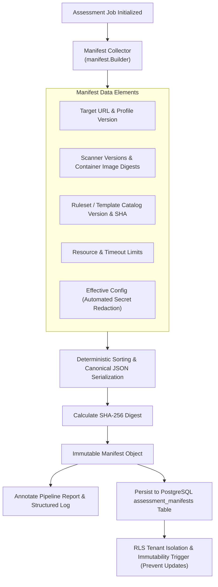

# Immutable Assessment Execution Manifests

This document defines Kelvin's architecture, data schema, cryptographic verification, and database immutability guarantees for assessment execution manifests, fulfilling requirement **P2-35** (Issue #111).

---

## 1. Overview & Objective

To satisfy compliance audits, enable reproducible vulnerability testing, and guarantee execution provenance, Kelvin records a tamper-evident execution manifest for every assessment run.

The **Execution Manifest Architecture** guarantees:
1. **Complete Configuration Traceability:** Records the exact assessment profile version, scanner identifiers, scanner versions, adapter versions, OCI container image digests, ruleset/template catalog versions and digests, target specification, and resource boundaries.
2. **Cryptographic Integrity & Tamper Detection:** A deterministic SHA-256 digest is computed across the canonical serialization of the manifest. Modifying any field (such as scanner version, rule catalog, or target URL) invalidates the digest.
3. **Immutability Enforcement:** Persisted in PostgreSQL table `assessment_manifests` with database triggers preventing any `UPDATE` statements, and in-memory store invariants preventing overwrite.
4. **Automated Secret Redaction:** Eliminates accidental leakage of credentials, tokens, or API keys by recursively sanitizing configuration maps prior to hashing and persistence.
5. **Multi-Tenant Isolation:** Protected by Row-Level Security (RLS) policies scoped strictly to `current_tenant_id()`.

---

## 2. Architecture & Data Flow



---

## 3. Data Schema & Contracts

### 3.1 Go Manifest Model (`apps/worker/internal/manifest`)

```go
type Manifest struct {
    ManifestVersion string            `json:"manifest_version"`
    AssessmentID    string            `json:"assessment_id"`
    TenantID        string            `json:"tenant_id"`
    RunID           string            `json:"run_id"`
    ProfileID       string            `json:"profile_id"`
    ProfileVersion  string            `json:"profile_version"`
    Target          string            `json:"target"`
    StartedAt       time.Time         `json:"started_at"`
    Scanners        []ScannerComponent `json:"scanners"`
    ResourceLimits  ResourceLimits    `json:"resource_limits"`
    EffectiveConfig map[string]any    `json:"effective_config"`
    Digest          string            `json:"digest"`
}
```

### 3.2 Database Schema (`assessment_manifests`)

Defined in migration `apps/api/db/migrations/000004_assessment_manifests.up.sql`:
```sql
CREATE TABLE IF NOT EXISTS assessment_manifests (
  id uuid PRIMARY KEY DEFAULT gen_random_uuid(),
  tenant_id uuid NOT NULL,
  assessment_id uuid NOT NULL,
  run_id text NOT NULL,
  profile_id text NOT NULL,
  profile_version text NOT NULL DEFAULT '1.0',
  target_url text NOT NULL,
  scanners jsonb NOT NULL,
  resource_limits jsonb NOT NULL,
  effective_config jsonb NOT NULL,
  manifest_digest text NOT NULL,
  created_at timestamptz NOT NULL DEFAULT now(),
  CONSTRAINT fk_manifests_assessment_tenant
    FOREIGN KEY (assessment_id, tenant_id) REFERENCES assessments (id, tenant_id) ON DELETE CASCADE,
  CONSTRAINT uq_assessment_manifests_run
    UNIQUE (tenant_id, assessment_id, run_id)
);

CREATE TRIGGER trg_prevent_manifest_update
  BEFORE UPDATE ON assessment_manifests
  FOR EACH ROW EXECUTE FUNCTION enforce_assessment_manifest_immutability();
```

---

## 4. Verification & Testing

Validated in `apps/worker/internal/manifest/manifest_test.go`:
- `TestManifestBuildAndVerify`: Verifies canonical digest generation and self-validation.
- `TestManifestImmutabilityTamperDetection`: Verifies that tampering with scanner versions, target URLs, or configurations invalidates the cryptographic digest.
- `TestManifestSecretRedaction`: Verifies recursive redaction of tokens and authorization headers.
- `TestDeterministicDigestOrdering`: Verifies identical digests regardless of scanner component insertion order.
- `TestMemoryStoreImmutability`: Verifies store rejects duplicate writes and mutation.
- `TestManifestValidationRejectsMalformed`: Verifies validation rules reject empty coordinates or invalid target URLs.
