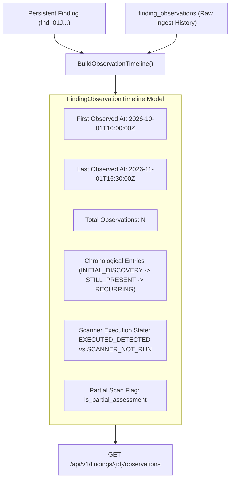

# Assessment History and Finding Observation Timeline

**Document ID:** KELVIN-ARCH-0052  
**Status:** Approved  
**Workstream:** Workstream E (Assessment History & Remediation)  
**Issue Reference:** P3-34 (#187)  

---

## 1. Purpose & Overview

The Assessment History and Finding Observation Timeline subsystem aggregates point-in-time assessment observations into an immutable, chronological timeline for each persistent vulnerability.

It tracks when a vulnerability was first observed (`first_seen_at`), each subsequent confirmation (`last_seen_at`), partial assessment executions, and scanner execution states. Critically, it enforces the foundational security invariant: **absence of evidence is not evidence of absence** — if an assessment completes without running the scanner that detected a finding, the finding is never falsely marked as resolved.

---

## 2. Timeline Aggregation Architecture



---

## 3. Data Model & Presence Classifications

### 3.1 Observation Timeline Entry
- **`observation_id`**: Point-in-time observation UUID.
- **`assessment_id` & `job_id`**: Originating assessment execution context.
- **`scanner_id`**: Scanner engine that captured the observation.
- **`presence_state`**:
  - `INITIAL_DISCOVERY`: The initial baseline observation that instantiated the finding.
  - `STILL_PRESENT`: Subsequent scan re-confirming the ongoing vulnerability.
  - `RECURRING`: Re-appearance after a finding was previously marked resolved.
- **`is_partial_assessment`**: Set to `true` if the originating assessment completed with warnings (`COMPLETED_WITH_WARNINGS`) or partial target timeouts.
- **`scanner_execution`**:
  - `EXECUTED_DETECTED`: Scanner was executed and detected the vulnerability.
  - `SCANNER_NOT_RUN`: Scanner was omitted from the scan profile or cancelled.

---

## 4. REST API Endpoint

- **Path:** `GET /api/v1/findings/{id}/observations`
- **Query Parameters:** `limit` (default 50, max 100), `offset` (default 0).
- **Response Format:**
  ```json
  {
    "data": {
      "finding_id": "8bbdc187-5777-40c2-9020-f1ff45607bb0",
      "tenant_id": "422da8e8-1614-4dc4-839f-0c4a04d26279",
      "first_observed_at": "2026-10-01T10:00:00Z",
      "last_observed_at": "2026-11-01T15:30:00Z",
      "total_observations": 2,
      "current_status": "CONFIRMED",
      "timeline": [
        {
          "observation_id": "55c464c5-349f-4318-912f-6143f2a58b87",
          "assessment_id": "97e682d3-1c37-4d92-bb8a-d7607730e668",
          "job_id": "2bc997d9-2900-47b7-bd6a-d2ff864070be",
          "scanner_id": "zap",
          "observed_at": "2026-10-01T10:00:00Z",
          "is_partial_assessment": false,
          "assessment_status": "COMPLETED",
          "scanner_execution": "EXECUTED_DETECTED",
          "presence_state": "INITIAL_DISCOVERY",
          "evidence_count": 1
        }
      ]
    },
    "meta": {
      "count": 1,
      "limit": 50,
      "offset": 0
    }
  }
  ```

---

## 5. Security & Architectural Invariants

- **ADR-0002 Compliance:** Strict tenant isolation; cross-tenant requests fail with `404 Not Found`.
- **Data Immutability:** Historical observations are never updated or deleted when subsequent scans execute.
- **Resolution Safety:** Absence of an observation during a partial or different scan profile never triggers automated auto-resolution.
