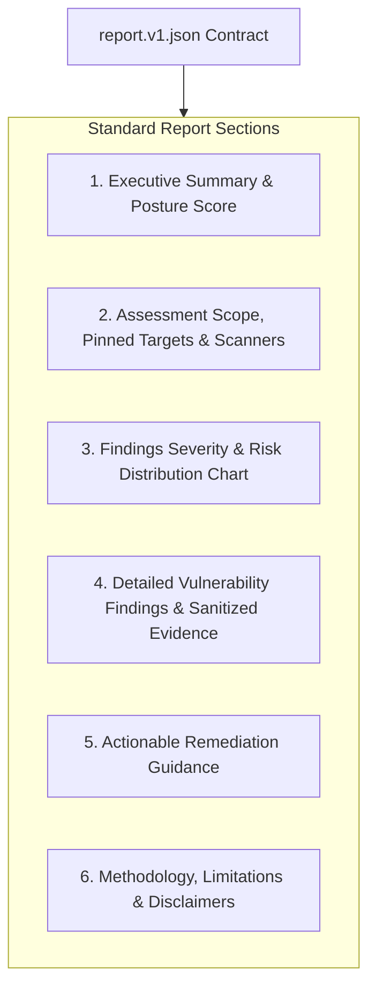

# Assessment Report Structure and Template Contracts

## 1. Purpose & Scope

This specification defines the structure, content requirements, and template contracts for KELVIN's customer-facing security assessment reports.

The report document represents an immutable, point-in-time security audit deliverable designed for both executive leadership and technical remediation teams.

---

## 2. Standard Report Structure & Sections

### Section 1: Executive Summary & Posture Score
- **Overall Risk Score:** Normalized composite risk rating (0-100).
- **Posture Band:** Categorical posture classification (`CRITICAL`, `HIGH`, `MEDIUM`, `LOW`, `CLEAN`).
- **Aggregate Counts:** Total findings broken down by severity level (`critical`, `high`, `medium`, `low`, `info`).
- **Executive Narrative:** High-level summary of posture strengths, prominent threat vectors, and recommended urgency.

### Section 2: Assessment Scope, Targets & Tools
- **Targets Scanned:** Explicit list of approved domains, hosts, and IP boundaries.
- **Scanners Executed:** Adapters invoked during the assessment (e.g., `nuclei`, `zap`, `tls`).
- **Profile Applied:** Configuration profile used (e.g., `full-external-audit`, `light-passive`).

### Section 3: Execution Status & Partial Assessment Disclosures
- **Execution Status:** Assessment outcome (`COMPLETED`, `PARTIAL`, `FAILED`).
- **Partial Disclosures (Mandatory):** Whenever an assessment terminates partially (e.g., scanner timeout, rate-limiting abort), the report must prominently disclose which scans did not finish and what coverage gaps exist.

### Section 4: Findings Summary & Risk Distribution
- Graphical breakdowns of findings by severity, CVE exploitability, and contextual priority bands.

### Section 5: Detailed Vulnerability Findings & Sanitized Evidence
- **Identification:** Finding UUID, SHA-256 fingerprint, CWE reference, CVE identifiers, and CVSS v3.1 score.
- **Endpoint Location:** Specific URL path, protocol, port, or parameter where the flaw was observed.
- **Sanitized Evidence (ADR-0005):** Evidence excerpts with guaranteed redaction of bearer tokens, cookies, passwords, and sensitive API keys.

### Section 6: Actionable Remediation Guidance
- Concrete recommendations, remediation task identifiers, target completion dates, and owner references.

### Section 7: Provenance, Template Version & Methodology Disclaimers
- Compilation engine version, template identifier (`kelvin-assessment-report-v1`), SHA-256 integrity hash, and legal/liability disclaimers.

---

## 3. Security & Architectural Invariants

- **Multi-Tenant Isolation (ADR-0002):** Reports are scoped strictly to a single tenant (`tenant_id = app.current_tenant_id`).
- **Data Traceability:** All report figures, scores, and findings map directly to persistent findings and assessment execution manifests.
- **Evidence Protection (ADR-0005):** Under no circumstances may unredacted credentials or authorization tokens appear in exported reports.
- **Versioned Contracts:** Schema version `report.v1.json` enforces schema compliance across API and worker boundaries.
