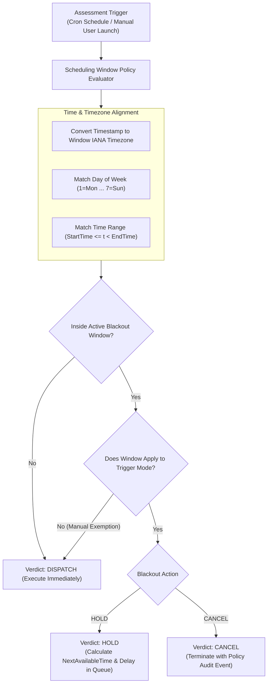

# Assessment Scheduling and Maintenance-Window Policies Architecture (P4-22)

## Executive Summary

Security scanning against production infrastructure during business peak hours can cause latency spikes, service interruptions, or false alarms.

Issue **P4-22** implements the enterprise assessment scheduling and maintenance-window subsystem, allowing organizations to declare recurring maintenance and blackout windows with explicit IANA timezone semantics, deterministic `HOLD` / `CANCEL` policies, and discrimination between automated scheduled scans and emergency manual triggers.

---

## 1. Scheduling & Blackout Evaluation Workflow



---

## 2. Security Invariants & Defenses

### 2.1 Explicit IANA Timezone Handling
- Avoids ambiguous daylight-saving time calculations by utilizing standard IANA location identifiers (e.g. `America/New_York`, `Europe/London`, `Asia/Tokyo`, `UTC`).
- The evaluation engine dynamically loads the IANA location and converts the execution instant, ensuring zero ambiguity during daylight saving transitions.

### 2.2 Deterministic Blackout Actions
- **`HOLD`**: When an assessment is scheduled or reaches a worker during a blackout window, the engine returns `VerdictHold` and computes the exact UTC timestamp `NextAvailableTime` when the blackout window concludes. The task is delayed in the Redis queue until that time.
- **`CANCEL`**: If configured with `CANCEL`, the assessment execution is permanently stopped, preventing backlogged scan floods when business hours conclude.

### 2.3 Manual vs Scheduled Discrimination
- Emergency ad-hoc scans (e.g. validating zero-day patch deployments during an incident) can be exempted from business-hour blackouts by setting `applies_to_manual = false`.
- Automated cron schedules still respect the blackout restrictions (`applies_to_scheduled = true`).

---

## 3. Database Schema

Managed in `scheduling_windows`:

```sql
CREATE TABLE IF NOT EXISTS scheduling_windows (
  id                   UUID PRIMARY KEY DEFAULT gen_random_uuid(),
  organization_id      UUID NOT NULL REFERENCES organizations(id) ON DELETE CASCADE,
  name                 VARCHAR(255) NOT NULL,
  window_type          VARCHAR(50) NOT NULL, -- MAINTENANCE, BLACKOUT
  time_zone            VARCHAR(100) NOT NULL DEFAULT 'UTC',
  days_of_week         JSONB NOT NULL DEFAULT '[1,2,3,4,5]'::jsonb, -- 1=Monday ... 7=Sunday
  start_time           VARCHAR(5) NOT NULL, -- "HH:MM"
  end_time             VARCHAR(5) NOT NULL, -- "HH:MM"
  blackout_action      VARCHAR(50) NOT NULL DEFAULT 'HOLD', -- HOLD, CANCEL
  applies_to_manual    BOOLEAN NOT NULL DEFAULT true,
  applies_to_scheduled BOOLEAN NOT NULL DEFAULT true,
  status               VARCHAR(50) NOT NULL DEFAULT 'ACTIVE', -- ACTIVE, DISABLED
  created_at           TIMESTAMPTZ NOT NULL DEFAULT clock_timestamp(),
  updated_at           TIMESTAMPTZ NOT NULL DEFAULT clock_timestamp()
);

CREATE INDEX IF NOT EXISTS idx_scheduling_windows_org
  ON scheduling_windows (organization_id, status);
```

---

## 4. Acceptance Criteria & Test Verification

| Acceptance Criterion | Verification Method | Status |
| :--- | :--- | :--- |
| Explicit IANA timezone validation & conversion | `TestSchedulingService_Configuration/configure_valid_scheduling_window` | Verified |
| Blackout window evaluation with HOLD action | `TestSchedulingService_Evaluation/scheduled_scan_inside_blackout_is_HELD_with_next_available_time` | Verified |
| Next available execution time calculation | Evaluated `res.NextAvailableTime` matches window conclusion in UTC | Verified |
| Manual scan emergency exemption | `TestSchedulingService_Evaluation/manual_scan_bypasses_blackout_when_applies_to_manual_is_false` | Verified |
| Blackout window with CANCEL action | `TestSchedulingService_Evaluation/blackout_window_with_CANCEL_action_terminates_scan` | Verified |
