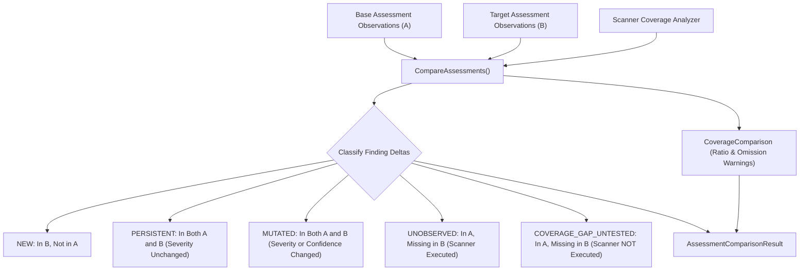

# Assessment-to-Assessment Comparison

**Document ID:** KELVIN-ARCH-0053  
**Status:** Approved  
**Workstream:** Workstream E (Assessment History & Remediation)  
**Issue Reference:** P3-35 (#188)  

---

## 1. Purpose & Overview

The Assessment-to-Assessment Comparison subsystem provides differential vulnerability analysis across two scan evaluations (Base vs. Target) of the same target scope.

It isolates newly discovered vulnerabilities, persistent confirmations, mutated severities, and unobserved findings. Crucially, it audits scanner coverage differences: if a scanner ran during the base assessment but was omitted in the target assessment, missing findings are classified as `COVERAGE_GAP_UNTESTED` rather than falsely assumed to be resolved.

---

## 2. Comparison Engine Architecture



---

## 3. Finding Delta Classifications

| Delta Category | Definition | Interpretation & Action |
|---|---|---|
| `NEW` | Discovered in Target assessment, absent in Base | New attack surface or introduced defect |
| `PERSISTENT` | Observed in both Base and Target with identical severity | Unremediated security defect |
| `MUTATED` | Observed in both Base and Target, but severity or confidence shifted | Risk exposure modified (e.g., HIGH $\rightarrow$ CRITICAL) |
| `UNOBSERVED` | Present in Base, absent in Target, and relevant scanner executed | Potential remediation (requires verification check) |
| `COVERAGE_GAP_UNTESTED` | Present in Base, absent in Target, BUT scanner was omitted | Unresolved status preserved due to coverage omission |

---

## 4. REST API Endpoint

- **Path:** `GET /api/v1/assessments/{base_id}/compare/{target_id}`
- **Response Format:**
  ```json
  {
    "data": {
      "tenant_id": "8bbdc187-5777-40c2-9020-f1ff45607bb0",
      "base_assessment_id": "422da8e8-1614-4dc4-839f-0c4a04d26279",
      "target_assessment_id": "97e682d3-1c37-4d92-bb8a-d7607730e668",
      "total_base_findings": 5,
      "total_target_findings": 4,
      "new_count": 1,
      "persistent_count": 2,
      "mutated_count": 1,
      "unobserved_count": 1,
      "coverage_gap_count": 0,
      "coverage": {
        "base_scanners": ["zap", "nuclei"],
        "target_scanners": ["zap", "nuclei"],
        "common_scanners": ["zap", "nuclei"],
        "omitted_scanners": [],
        "coverage_ratio": 1.0
      },
      "deltas": [
        {
          "fingerprint": "a3f5b7...",
          "title": "SQL Injection",
          "category": "PERSISTENT",
          "base_severity": "HIGH",
          "target_severity": "HIGH",
          "explanation": "Vulnerability re-confirmed in target assessment"
        }
      ],
      "compared_at": "2026-11-02T14:25:00Z"
    }
  }
  ```

---

## 5. Security & Architectural Invariants

- **ADR-0002 Tenant Isolation:** Both assessments must belong to the authenticated tenant context; cross-tenant comparisons are blocked.
- **Coverage Transparency:** Differences in tool sets generate explicit warnings (`CoverageWarning`) and avoid false negative resolution.
- **Data Immutability:** Comparing assessments never mutates existing persistent finding states.
