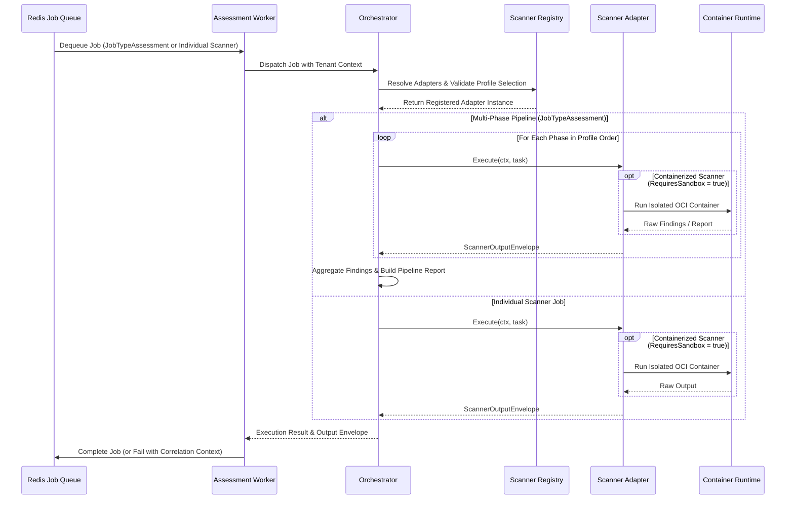

# Assessment Worker Scanner Adapter Integration (P2-21)

## 1. Executive Summary & Purpose

The Kelvin Assessment Worker integrates the Phase 1 queue and execution foundation with the Phase 2 scanner adapter ecosystem. Under **P2-21**, the worker daemon and its orchestration engine connect assessment jobs directly to registered scanner adapters, enabling both individual scanner execution and multi-phase assessment pipeline orchestration.

This integration preserves Phase 1 lifecycle contracts (`q.Dequeue`, `q.Complete`, `q.Fail`, heartbeat monitoring, and resource limits) while enforcing strict isolation boundaries (ADR-0005) and canonical output normalization (ADR-0002).

---

## 2. Architecture & Orchestration Flow

---

## 3. Worker Orchestrator (`apps/worker/internal/daemon/orchestrator.go`)

The `Orchestrator` decouples the worker queue lifecycle and failure reporting from scanner-specific mechanics:

### 3.1 Dual Execution Modes
1. **In-Process Adapters (`RequiresSandbox: false`)**:
   - Scanners such as `http_preflight`, `tls_assessor`, and `http_security_headers` execute directly in the worker runtime.
   - Sandboxing is enforced via network egress policies, custom HTTP transports, and bounded execution timeouts without container overhead.
   - Outputs are stamped via `registry.StampOutput` and encoded into `ScannerOutputEnvelope`.
2. **Containerized Adapters (`RequiresSandbox: true`)**:
   - Scanners such as `zap` and `nuclei` execute inside rootless OCI sandboxes (ADR-0005, unprivileged non-root `UID 10001`, dropped capabilities, read-only rootfs).
   - Reports are normalized into canonical finding representations (`finding.v1.json`) via `NormalizeZAPReport` and `NormalizeNucleiReport`.

### 3.2 Multi-Phase Pipeline Orchestration
When an assessment job (`JobTypeAssessment` or `JobTypePipeline`) is dequeued:
- The orchestrator loads the versioned profile (`adapters.GetAssessmentProfile(task.ProfileID)`).
- Executes scanner phases sequentially (`profile.DefaultScannerOrder`).
- Enforces prerequisite dependencies: if `phase.RequirePrev` is set and a prior phase fails, downstream phases are skipped and recorded in `AssessmentPipelineReport`.
- Aggregates findings and envelopes across all executed scanners into a consolidated assessment output.

---

## 4. Context Preservation & Validation Invariants

1. **Context Preservation**:
   - The worker establishes tenant context via `tenant.ParseAndWithID(ctx, job.TenantID)`.
   - Every downstream task, process invocation, and output envelope retains `JobID`, `AssessmentID`, `TenantID`, and `CorrelationID`.
2. **Fail-Closed Execution Gate**:
   - The worker rejects unvalidated requests:
     - Malformed UUIDs or missing targets produce immediate job failures.
     - Profile whitelists are enforced before execution (`adapters.ValidateProfileSelection(task.ProfileID, task.Scanner)`). Requesting unpermitted scanners (e.g. active scanning under `kelvin.profile.passive.v1`) is rejected.
     - Unready runtimes (checked via `readiness.Checker`) fail before invoking scanner binaries.
3. **Structured Failure Reporting**:
   - Failures (timeouts, crashes, out-of-memory, validation rejections) are mapped to explicit termination causes (`metrics.CauseCrash`, `metrics.CauseDeadline`, `metrics.CauseOOM`, `metrics.CauseValidation`) and recorded in queue job state.
