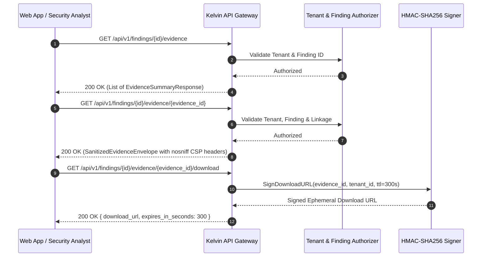

# Authorized Evidence Retrieval and Access Controls

**Document ID:** KELVIN-ARCH-0049  
**Status:** Approved  
**Workstream:** Workstream D (Evidence Management & Auditability)  
**Issue Reference:** P3-31 (#184)  

---

## 1. Purpose & Overview

The Authorized Evidence Retrieval and Access Controls subsystem regulates how users, compliance auditors, and automated workflows inspect, preview, and download technical vulnerability proof.

It enforces strict multi-tenant authorization boundaries, protects against IDOR (Insecure Direct Object Reference) guessing attacks, applies automatic secret redactions on presentation paths, mandates hardened response headers, and issues short-lived pre-signed download URLs.

---

## 2. API Contract & Delivery Architecture



---

## 3. Endpoints Specification

### 3.1 List Evidence for Finding
- **Path:** `GET /api/v1/findings/{id}/evidence`
- **Access Control:** Requires valid tenant session. Verifies finding ownership before returning evidence.
- **Response:**
  ```json
  {
    "data": [
      {
        "id": "e43b679a-2cfc-4bd6-9f86-cfc0919ce763",
        "finding_id": "97e682d3-1c37-4d92-bb8a-d7607730e668",
        "evidence_type": "HTTP_EXCERPT",
        "content_type": "text/plain",
        "size_bytes": 450,
        "checksum_sha256": "4b227777d4dd1fc61c6f884f48641d02b4d121d3fd328cb08b5531fcacdabf8a",
        "redaction_status": "SANITIZED_PRESENTATION",
        "created_at": "2026-11-02T13:45:00Z"
      }
    ],
    "meta": {
      "count": 1
    }
  }
  ```

### 3.2 Evidence Detail & Presentation
- **Path:** `GET /api/v1/findings/{id}/evidence/{evidence_id}`
- **Security Headers:**
  - `X-Content-Type-Options: nosniff`
  - `Content-Security-Policy: default-src 'none'`
- **Behavior:** By default, returns a `SanitizedEvidenceEnvelope` with secret patterns (Authorization, Cookie, API keys) redacted.

### 3.3 Ephemeral Pre-Signed Download
- **Path:** `GET /api/v1/findings/{id}/evidence/{evidence_id}/download`
- **TTL:** 300 seconds (5 minutes).
- **Security Headers:**
  - `Content-Disposition: attachment; filename="evidence-<evidence_id>.txt"`
  - `X-Content-Type-Options: nosniff`
- **Response:**
  ```json
  {
    "data": {
      "evidence_id": "e43b679a-2cfc-4bd6-9f86-cfc0919ce763",
      "download_url": "/api/v1/evidence/e43b679a-2cfc-4bd6-9f86-cfc0919ce763/download?expires=1793627100&signature=...&tenant_id=...",
      "expires_in_seconds": 300,
      "content_type": "text/plain",
      "size_bytes": 450
    }
  }
  ```

---

## 4. Security & Architectural Invariants

- **ADR-0002 Compliance:** Strict tenant isolation enforced at gateway level; cross-tenant requests fail with `404 Not Found` without disclosing artifact existence.
- **IDOR Protection:** Evidence IDs must be linked to the specific `finding_id` in `r.PathValue("id")`; unlinked requests are rejected.
- **Untrusted MIME Safety:** Direct downloads and previews are prohibited for executable formats (`IsSafeMimeType()`).
- **Short-Lived Signed URLs:** Download links expire after 300 seconds and are signed with HMAC-SHA256.
