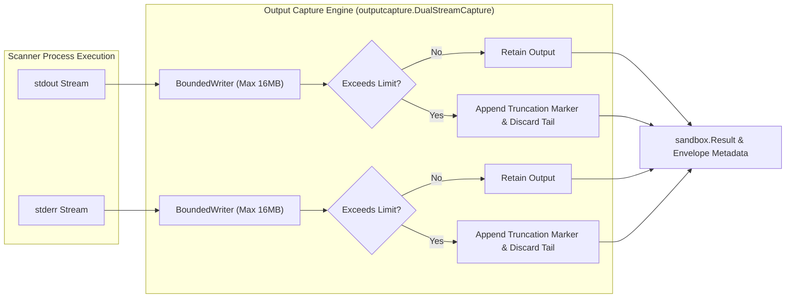

# Bounded Scanner Output Capture

This document defines Kelvin's architecture and runtime mechanics for bounded, memory-safe capture of scanner stdout and stderr streams, fulfilling requirement **P2-33** (Issue #109).

---

## 1. Overview & Objective

External security scanners (e.g. Nuclei, OWASP ZAP) and auxiliary assessment utilities generate high-volume diagnostic logs, verbose debugging traces, and raw JSON outputs. Without strict capture boundaries at the worker boundary, rogue or misconfigured scanner tools could generate gigabytes of output, causing worker out-of-memory (OOM) faults, exhausting disk space, or destabilizing the worker daemon.

The **Bounded Scanner Output Capture** architecture ensures:
1. **Memory Ceiling Enforcement:** In-memory capture buffers have hard ceilings (default: 16MB, absolute max: 50MB per stream) that safely discard excess bytes once reached without allocating unbounded memory.
2. **Stream Separation:** Standard output (`stdout`) and standard error (`stderr`) are captured independently into isolated buffers to ensure diagnostic separation.
3. **Truncation Detection & Markers:** Truncation is explicitly tracked in result metadata (`StdoutTruncated`, `StderrTruncated`) and injected with clear in-stream truncation notices.
4. **Encoding & Malformation Resilience:** Raw byte streams are safely decoded and sanitized into valid UTF-8, replacing invalid byte sequences or terminal escape anomalies with standard Unicode replacement characters (`\uFFFD`) without crashing.
5. **Context & Deadline Respect:** Streaming I/O respects worker execution deadlines and task cancellation tokens.

---

## 2. Architecture & Data Flow



---

## 3. Core Components

### 3.1 `BoundedWriter` (`internal/outputcapture`)

A thread-safe `io.Writer` wrapping a byte buffer with a fixed maximum size:
- Tracks total incoming stream bytes (`TotalBytes() int64`).
- Reserves space for `TruncationMarker = "\n... [OUTPUT TRUNCATED: maximum capture buffer limit reached]\n"`.
- Once capacity is reached, writes are safely discarded and `truncated` is marked `true`.
- Sanitizes UTF-8 upon extraction to prevent downstream JSON encoding or database insertion errors.

### 3.2 `DualStreamCapture`

Encapsulates dual `BoundedWriter` instances for stdout and stderr:
```go
type StreamResult struct {
    Stdout          string
    Stderr          string
    StdoutBytes     int64
    StderrBytes     int64
    StdoutTruncated bool
    StderrTruncated bool
}
```

### 3.3 Integration with OCI Sandbox & Worker Orchestration

In `apps/worker/internal/sandbox/oci.go`:
- Container process execution binds `cmd.Stdout` and `cmd.Stderr` to `outputcapture.NewBoundedWriter(maxCaptureBytes)`.
- `sandbox.Result` contains `StdoutBytes`, `StderrBytes`, `StdoutTruncated`, and `StderrTruncated`.
- Orchestrator logs warnings and annotates execution metadata if a scanner produced truncated output.

---

## 4. Verification & Testing

The implementation is verified in `apps/worker/internal/outputcapture/capture_test.go` and `apps/worker/internal/sandbox/sandbox_test.go`:
- `TestBoundedWriterEmpty`: Verifies empty stream handling without spurious truncation markers.
- `TestBoundedWriterNormal`: Verifies full stream retention below limit.
- `TestBoundedWriterOversizedTruncation`: Verifies that sending 50KB through a 1KB limit strictly caps memory at 1KB, sets `Truncated = true`, records accurate total bytes, and appends the truncation marker.
- `TestBoundedWriterMalformedUTF8`: Verifies that malformed UTF-8 byte sequences are cleansed without panicking.
- `TestDualStreamCaptureSeparation`: Verifies stdout and stderr remain strictly distinct.
- `TestCopyBoundedWithCancellation`: Verifies streaming readers terminate promptly when context is cancelled.
- `TestBoundedWriterConcurrentWrites`: Verifies thread safety during high-concurrency writes.
