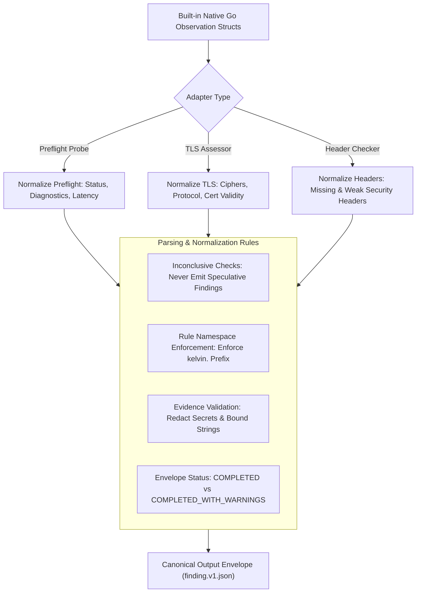

# Built-In HTTP and TLS Result Parsers Architecture

This document defines Kelvin's architecture, normalization rules, and validation invariants for native assessment checks (HTTP preflight reachability, HTTP security headers/cookies, and TLS configuration/ciphers/certificates), fulfilling requirement **P2-41** (Issue #117).

---

## 1. Overview & Objective

Kelvin features high-performance native Go adapters for foundational security assessments:
- **HTTP Preflight**: Connectivity, DNS resolution, redirect hopping, and reachability probe.
- **HTTP Security Headers & Cookies**: Strict evaluations for HSTS, CSP, X-Frame-Options, X-Content-Type-Options, Referrer-Policy, and cookie attributes (`Secure`, `HttpOnly`, `SameSite`).
- **TLS Configuration Assessor**: Cipher negotiation, deprecated TLS protocol support (TLS 1.0/1.1), certificate validity/expiration, and chain trust verification.

These built-in checks generate structured native Go observation records. The Built-In Result Parsers normalize these outcomes into Kelvin's unified output envelope (`ScannerOutputEnvelope`) and canonical finding format (`finding.v1.json`).

---

## 2. Architecture & Normalization Pipeline

---

## 3. Inconclusive vs Confirmed Check Invariants

A critical requirement of P2-41 is distinguishing confirmed configuration defects from inconclusive checks:

| Check Condition | Classification | Emitted Findings | Diagnostic Level | Output Status |
|---|---|---|---|---|
| Target drops connection / refuses TCP | Inconclusive | **None** (Quarantined) | `warning` (`TARGET_UNREACHABLE` / `TLS_CHECK_INCONCLUSIVE`) | `COMPLETED_WITH_WARNINGS` |
| Assessment times out | Inconclusive | **None** (Quarantined) | `error` (`DEADLINE_EXCEEDED`) | `TIMED_OUT` |
| Assessment cancelled | Inconclusive | **None** (Quarantined) | `error` (`CANCELLED`) | `CANCELLED` |
| HTTP responds without HSTS / CSP | Confirmed | `kelvin.http_headers.*` | None | `COMPLETED` |
| Server negotiates TLS 1.0 or expired cert | Confirmed | `kelvin.tls.*` | None | `COMPLETED` |

### 3.1 Preflight Reachability Probe
- Preflight is an environmental readiness probe. It **never** emits vulnerability findings.
- Successful probes record `HTTP_RESPONDED` with response metrics in `http_preflight.observation`.
- Connection drops or redirect failures record appropriate diagnostics (`REDIRECT_LIMIT_EXCEEDED`, `REDIRECT_LOOP`, `TARGET_UNREACHABLE`).

### 3.2 Rule Namespace & Evidence Formatting
- All built-in rules use strict namespaces:
  - Security headers: `kelvin.http_headers.<rule_name>`
  - TLS checks: `kelvin.tls.<rule_name>`
- Evidence objects are normalized to standard types (`HEADER_DUMP`, `CERTIFICATE_DUMP`, `LOG`) with all sensitive authorization tokens, session cookies, and query strings redacted prior to serialization.
