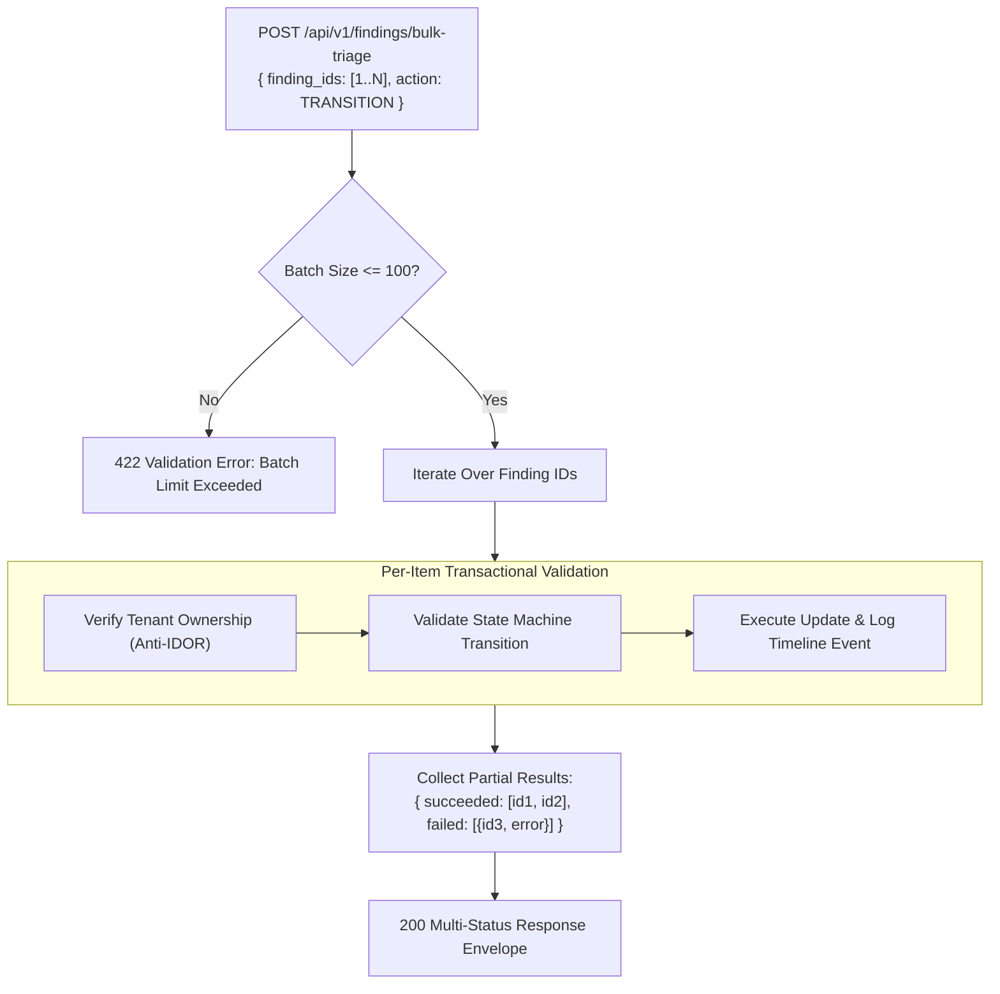

# Bulk Finding Triage Operations Architecture

## Overview
The Kelvin Bulk Finding Triage subsystem enables security analysts to execute batch operations across multiple findings while preserving individual authorization, state machine invariants, and immutable per-finding audit logs.

Supported bulk actions include batch lifecycle status transitions and temporary batch suppression. Every bulk request enforces strict batch sizing limits (1 to 100 items), independently evaluates each candidate finding within its tenant boundary, and returns a detailed multi-status result envelope disclosing per-item successes and granular failure causes.

## Core Invariants

1. **Strict Batch Sizing Limits:**
   - Every bulk request must contain between 1 and 100 finding IDs (`1 <= len(finding_ids) <= 100`).
   - Empty batches or batches exceeding 100 items are rejected upfront with `422 Unprocessable Entity`.

2. **Per-Item Isolation & Multi-Status Responses:**
   - Individual failures (e.g. non-existent finding, cross-tenant IDOR attempt, illegal lifecycle transition, or already suppressed finding) **do not** roll back successfully updated findings.
   - The API returns `200 OK` with an aggregated multi-status payload containing lists of `succeeded` and `failed` items.

3. **Audit History & Timeline Immutability:**
   - Every successfully modified finding receives an individual lifecycle event and an immutable activity timeline record tagged with the `batch_id` and action details (`BULK_TRIAGE_APPLIED`).

4. **Sensitive Action Rationale Enforcement:**
   - Bulk transitions to sensitive states (`FALSE_POSITIVE`, `ACCEPTED_RISK`) or bulk suppressions strictly require a non-empty `reason` parameter.

## API Contract
`POST /api/v1/findings/bulk-triage`
Requires authentication with `finding:write` permission. Supports idempotency via `Idempotency-Key` header.
Strict tenant isolation is enforced: any finding ID not belonging to the authenticated tenant is recorded as `not_found` in the failure list.
