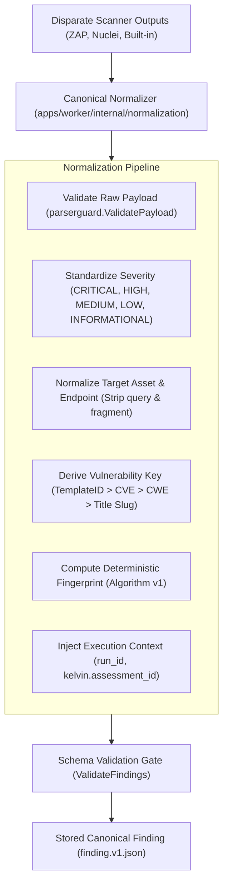

# Canonical Finding Normalization & Deterministic Fingerprinting

This document defines Kelvin's shared normalization layer, canonical schema mappings (`finding.v1.json`), and deterministic fingerprinting algorithm, fulfilling requirement **P2-42** (Issue #118).

---

## 1. Overview & Objective

Heterogeneous scanners (OWASP ZAP Baseline, ProjectDiscovery Nuclei, and built-in HTTP/TLS checkers) emit disparate raw outputs. The **Shared Normalization Layer** (`apps/worker/internal/normalization`) provides a zero-trust ingestion gate that standardizes findings into Kelvin's canonical finding schema (`finding.v1.json`, ADR-0002).

Core obligations:
1. **Schema Standardization**: Strict mapping of engine-specific fields to `finding.v1.json` (`additionalProperties: false`).
2. **Deterministic Fingerprinting**: Stable SHA-256 deduplication fingerprint derived across repeated scans and engines.
3. **Traceability**: Invariant injection of assessment UUID and scanner run ID into finding metadata.
4. **Defensive Validation Gate**: Payloads must pass size checks, UTF-8 checks, nesting depth limits, and structural validation before acceptance.

---

## 2. Normalization Architecture & Lifecycle



---

## 3. Deterministic Fingerprint Algorithm (v1)

### 3.1 Precedence Rules for Vulnerability Key
Evaluated in priority order; first available key wins:
1. `vulnerability.template_id`: Lowercased, trimmed (e.g., `cve-2021-44228`).
2. Lowest `vulnerability.cve_ids` entry: Lexicographic sort of uppercase CVE IDs, selecting first (e.g., `CVE-2023-99999`).
3. `vulnerability.cwe_id`: Uppercase, trimmed (e.g., `CWE-79`).
4. Title slug: Lowercase; every run of non-alphanumeric characters replaced with `-`; trimmed (e.g., `login-form-sql-injection`).

### 3.2 Asset & Endpoint Canonicalization
- **Asset**: Trimmed. IP literals formatted via RFC 5952. Hostnames lowercased with trailing dot stripped.
- **Endpoint**: Absolute URL. Scheme and host lowercased. Default ports (`http:80`, `https:443`) omitted. Path cleaned of dot-segments. Percent-encoded sequences uppercased (`%2F`). Query strings and fragments completely stripped.

### 3.3 Canonical Preimage & Hash
```text
canonical = "v1\n" + normalized_asset + "\n" + normalized_endpoint + "\n" + vulnerability_key
fingerprint = lowercase_hex(sha256(utf8(canonical)))
```

---

## 4. Normalization Invariants

- **Extension Point**: `scanner_meta` is the sole extension point. Sub-keys must be namespace-qualified (e.g., `zap.plugin_id`, `nuclei.template_id`, `kelvin.assessment_id`). Root-level unknown fields are strictly rejected.
- **Evidence Attestation**: All evidence entries must provide an explicit `redacted_fields` array (even when empty) certifying that sensitive tokens were redacted prior to storage.
- **Quarantine on Error**: In `NormalizeBatch`, invalid records are collected into individual errors without crashing the pipeline, allowing valid findings from the same assessment run to be persisted safely.
