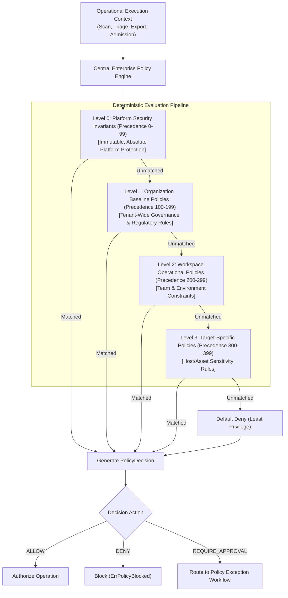

# Centralized Enterprise Policy Engine Architecture (P4-19)

## Executive Summary

Enterprise security operations require a unified, deterministic mechanism to evaluate compliance and operational policies across all workflow boundaries — including scanner execution, target admission, finding triaging, evidence retention, and report export.

Issue **P4-19** establishes the architectural foundation for the Centralized Enterprise Policy Engine, defining hierarchical precedence, immutable platform invariants, fail-closed guarantees, explainable audit decision trails, and clean separation between evaluation and enforcement.

---

## 1. Architectural Model & Evaluation Hierarchy

The policy engine evaluates rules in strict, deterministic precedence order:



---

## 2. Core Architectural Invariants

### 2.1 Immutable Platform Invariants (Non-Overrideable)
- Platform-level security boundaries (e.g. prohibiting scans against loopback/internal link-local networks, blocking unverified domain auto-joining, and enforcing multi-tenant isolation) reside at **Level 0 (Precedence 0-99)**.
- Organization and workspace administrators cannot configure policies that override or weaken platform invariants.

### 2.2 Fail-Closed Guarantee
- If a condition evaluation fails due to an internal error, network glitch, or corrupt state, the engine refuses access immediately:
  - Produces `ActionDeny`.
  - Returns `ErrPolicyEvaluationFailed`.
  - Records the error in the explainability audit trail.

### 2.3 Separation of Evaluation from Enforcement
- **Evaluation** (`Evaluate`): Gathers context, matches rules against inputs, and produces an immutable, explainable `PolicyDecision` without side effects.
- **Enforcement** (`Enforce`): Translates `PolicyDecision` into execution barriers (`nil`, `ErrPolicyBlocked`, or `ErrPolicyRequiresApproval`).

### 2.4 Explainability Audit Trail
Every policy decision records:
- Evaluated scope and matched rule ID.
- Human-readable reason.
- Timestamp.
- Step-by-step trace of which rules were tested, skipped, or triggered.

---

## 3. Policy Schema Specification

Canonical contract stored in `packages/schemas/enterprise_policy.v1.json`:

```json
{
  "id": "uuid",
  "organization_id": "uuid",
  "workspace_id": "uuid",
  "name": "string",
  "policy_type": "SCAN_EXECUTION | TARGET_ADMISSION | FINDING_ACTION | DATA_EXPORT | INTEGRATION_ACCESS",
  "scope": "PLATFORM | ORGANIZATION | WORKSPACE | TARGET",
  "precedence": "integer (0-1000)",
  "action": "ALLOW | DENY | REQUIRE_APPROVAL",
  "condition_expression": "string",
  "version": 1,
  "status": "ACTIVE | DISABLED | ARCHIVED"
}
```

---

## 4. Acceptance Criteria & Test Verification

| Acceptance Criterion | Verification Method | Status |
| :--- | :--- | :--- |
| Central policy architecture documented & approved | `docs/architecture/CENTRALIZED_ENTERPRISE_POLICY_ENGINE_ARCHITECTURE.md` | Verified |
| Explicit evaluation and enforcement boundaries | `PolicyEngine.Evaluate` vs `PolicyEngine.Enforce` | Verified |
| Deterministic precedence (Platform > Org > Workspace > Target) | `TestPolicyEngine_PrecedenceAndInvariants` | Verified |
| Defined fail-closed behavior on condition errors | `TestPolicyEngine_FailClosedAndApproval/fail-closed_behavior_on_condition_error` | Verified |
| Decoupling from scanner-specific implementations | Generic `EvaluationContext` with extensible attributes | Verified |
