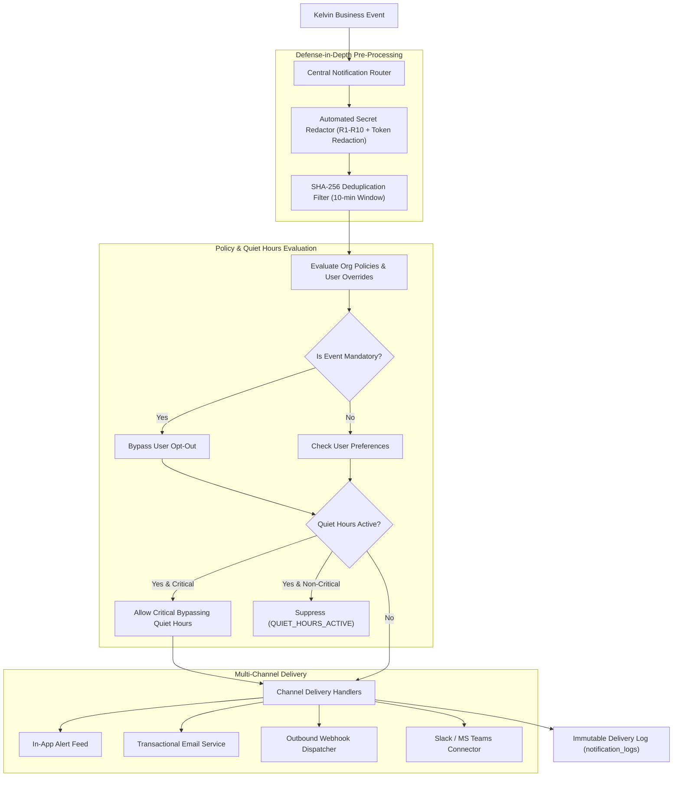

# Central Notification Preferences & Delivery Management Architecture

## 1. Overview
The Central Notification Router provides a unified, decoupled notification subsystem across KELVIN, abstracting multi-channel delivery (`in_app`, `email`, `webhook`, `collaboration`) away from core security and scanning engines.

## 2. Architecture & Delivery Pipeline

## 3. Key Design Principles

### Decoupled Non-Blocking Delivery
Notification dispatch failures (e.g. downstream SMTP timeouts, HTTP 504 from webhook receivers) are logged as `failed` in `notification_logs` and never roll back or fail the originating business transaction (assessment scans, finding creations, remediation workflows).

### Anti-Storm Deduplication
Events compute a 256-bit hash from `(OrganizationID, EventType, ResourceID, Title)`. Identical notifications dispatched within a 10-minute sliding window are suppressed with `DUPLICATE_EVENT` to avoid alert fatigue.

### Enterprise Governance & Mandatory Events
Organizations designate critical compliance and vulnerability events (e.g., `findings.critical`, `policy.violation`) as mandatory. Users cannot opt out of these security-critical notifications.

### Defense-in-Depth Information Protection
Notification subjects, titles, and bodies are scrubbed through normative redaction (R1-R10) plus cloud token patterns, preventing raw credentials, private keys, or API tokens from being sent to external notification channels.
