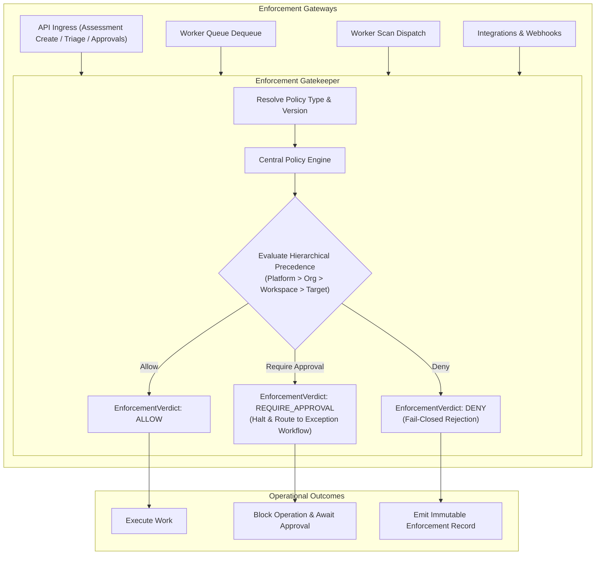
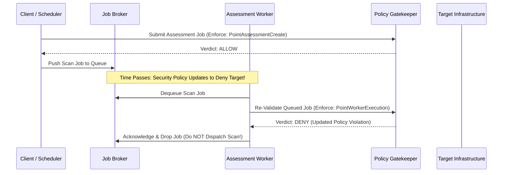

# Central Policy Enforcement Across Application Boundaries Architecture

## 1. Overview
The Central Policy Enforcement Gatekeeper provides a unified enforcement mechanism across API, job queue, worker execution, and integration boundaries. It ensures that organization and platform policies are evaluated deterministically rather than being scattered across disparate controllers, and protects queued and in-progress jobs against stale authorization windows.

## 2. Enforcement Architecture

## 3. Queued and In-Progress Job Policy Re-check Lifecycle

## 4. Key Architectural Guarantees
1. **Unified Cross-Boundary Gatekeeping**: Every application boundary (`ASSESSMENT_CREATE`, `ASSESSMENT_SCHEDULE`, `WORKER_EXECUTION`, `PROFILE_SELECT`, `FINDING_TRIAGE`, `REMEDIATION_ACTION`, `EXCEPTION_APPROVAL`, `INTEGRATION_TRIGGER`) evaluates against the canonical centralized engine.
2. **Pre-Execution Re-Validation of Queued Work**: Workers must synchronously re-evaluate the active policy state upon job dequeue, guaranteeing that queued jobs cannot bypass policies updated while waiting in the broker queue.
3. **In-Progress Scan Preemption**: In-progress scans evaluate updated policies; violations of Level 0 platform security invariants immediately trigger `TERMINATE` actions, whereas organization changes trigger safe `PAUSE` actions.
4. **Immutable Enforcement Records**: Every enforcement decision, matched rule, policy version, and explainability audit trail is logged to `policy_enforcement_records` for compliance verification.
5. **Fail-Closed Guarantee**: Evaluation errors or rule evaluation timeouts immediately yield `ActionDeny`.
