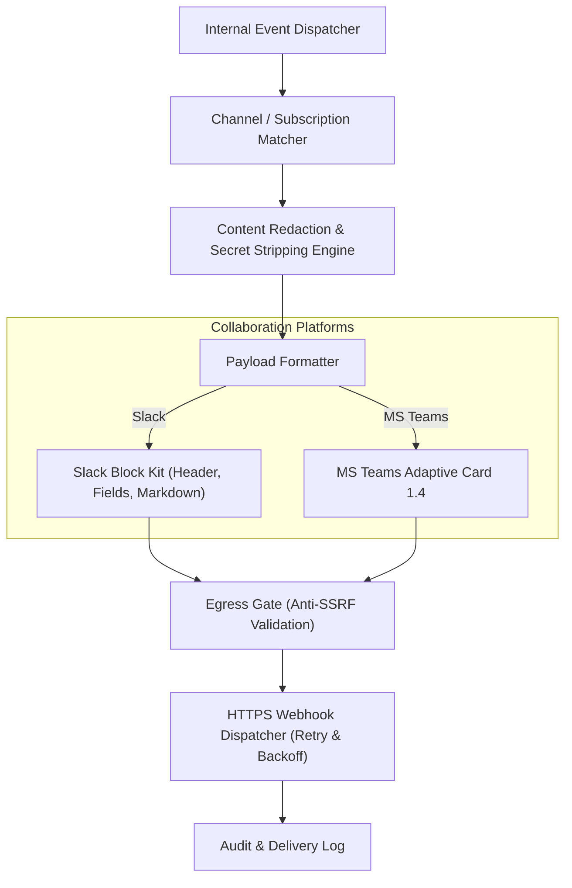

# Collaboration Platform Notifications Integration (Slack & Microsoft Teams)

## 1. Overview
The Collaboration Platform Notifications integration allows organizations in KELVIN to route security findings, policy violations, and assessment milestones directly to Slack channels and Microsoft Teams teams/channels.

## 2. Architectural Highlights & Invariants

### Defense-in-Depth Anti-SSRF
All destination webhook URLs are strictly validated prior to registration and outbound dispatch against private, loopback, and metadata address spaces (`10.0.0.0/8`, `172.16.0.0/12`, `192.168.0.0/16`, `127.0.0.0/8`, `169.254.169.254`, `100.64.0.0/10`).

### Automated Information Redaction
To prevent secret leakage onto external messaging channels:
- Bearer tokens, private keys, AWS access keys (`AKIA...`), KELVIN API keys (`klv_live_...`), and webhook secrets (`whsec_...`) are automatically detected and masked with `[REDACTED]`.
- Raw vulnerability exploit payloads and verbose stack traces are excluded from collaboration envelopes.

### Resilient Delivery & Lifecycle
- Up to 3 retry attempts with exponential backoff for transient 5xx / connection failures.
- Non-retryable error handling for authentication failures (401/403) and rate limits (429).
- Administrative controls to immediately disable or revoke destinations, terminating all subsequent notification traffic immediately.
