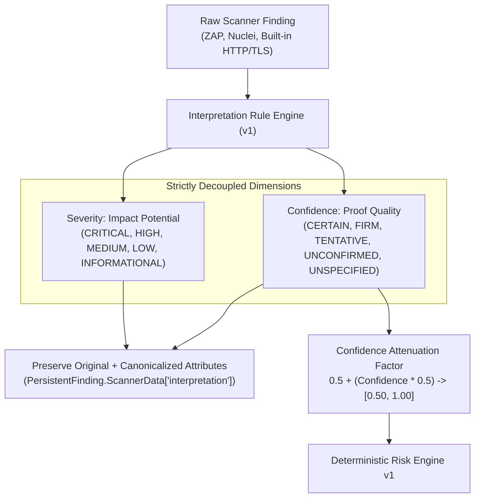

# Confidence and Severity Interpretation Rules

## Overview
The Kelvin **Confidence and Severity Interpretation Engine** (`kelvin.interpretation.v1`) normalizes security finding classifications across disparate scanners without overwriting or discarding native scanner inputs.

A foundational architectural invariant is that **Severity** and **Confidence** are orthogonal evaluation dimensions:
- **Severity** measures **potential business impact** (the magnitude of harm if exploited: `CRITICAL`, `HIGH`, `MEDIUM`, `LOW`, `INFORMATIONAL`).
- **Confidence** measures **evidentiary certainty** (the reliability of proof and risk of false positives: `CERTAIN`, `FIRM`, `TENTATIVE`, `UNCONFIRMED`, `UNSPECIFIED`).

## Canonical Taxonomies

### 1. Canonical Severity
Derived from standard CVSS bands or normalized scanner severity levels:
- `CRITICAL` (CVSS 9.0 – 10.0 or scanner critical)
- `HIGH` (CVSS 7.0 – 8.9 or scanner high)
- `MEDIUM` (CVSS 4.0 – 6.9 or scanner medium)
- `LOW` (CVSS 0.1 – 3.9 or scanner low)
- `INFORMATIONAL` (CVSS 0.0 or informational / best practice)

### 2. Canonical Confidence Bands
- `CERTAIN` (`[0.90, 1.00]`): Deterministic check or concrete exploit payload verification.
- `FIRM` (`[0.70, 0.89]`): Strong active indicator with low probability of false positives.
- `TENTATIVE` (`[0.40, 0.69]`): Indirect pattern or heuristic match requiring human triage.
- `UNCONFIRMED` (`[0.00, 0.39]`): Speculative or weak signal with high false positive probability.
- `UNSPECIFIED`: Scanner does not publish confidence data; Kelvin assigns a conservative baseline score.

## Scanner Translation Matrix & Exceptions

| Scanner | Native Severity | Native Confidence | Canonical Severity | Canonical Confidence | Band | Notes |
|---|---|---|---|---|---|---|
| **OWASP ZAP** | `3` / `High` | `3` / `High` | `HIGH` | `0.90` | `CERTAIN` | ZAP risk 3 maps to High; confidence 3 is Certain |
| **OWASP ZAP** | `2` / `Medium` | `2` / `Medium` | `MEDIUM` | `0.70` | `FIRM` | ZAP risk 2 maps to Medium |
| **OWASP ZAP** | `1` / `Low` | `1` / `Low` | `LOW` | `0.50` | `TENTATIVE` | Heuristic / passive scan finding |
| **OWASP ZAP** | `0` / `Info` | `0` / `False Positive` | `INFORMATIONAL` | `0.20` | `UNCONFIRMED` | Informational or filtered item |
| **Nuclei** | `critical` | *(omitted)* | `CRITICAL` | `0.95` | `CERTAIN` | Template match acts as proof of vulnerability |
| **Nuclei** | `medium` | `cvss: 9.8` | `CRITICAL` | `0.95` | `CERTAIN` | Authoritative CVSS score overrides native severity |
| **Built-in HTTP/TLS** | `MEDIUM` | *(deterministic)* | `MEDIUM` | `1.00` | `CERTAIN` | Cryptographic/protocol checks have absolute proof |
| **Generic / Unknown**| `HIGH` | *(omitted)* | `HIGH` | `0.80` | `UNSPECIFIED` | `confidence_unspecified: true` explicitly preserved |

## Decoupled Dimensions Invariant

KELVIN explicitly forbids conflating severity with confidence:
- A **tentative remote code execution** is `Severity: CRITICAL, Confidence: TENTATIVE`. It represents an existential threat that must be investigated promptly despite incomplete proof.
- A **certain missing Content-Security-Policy header** is `Severity: LOW, Confidence: CERTAIN`. Even though proof is 100% indisputable, the severity remains low.

## Confidence Attenuation in Risk Prioritization

To prevent low-confidence findings from artificially overwhelming triage queues while ensuring critical threats remain visible, the engine computes a bounded confidence attenuation factor:

$$\text{ConfidenceFactor} = 0.5 + (\text{Confidence} \times 0.5)$$

- Range is bounded to `[0.50, 1.00]`.
- Even a tentative finding retains at least **50% of its base severity weight**, preventing dangerous blindness to high-severity warnings while rewarding verified proof with full prioritization weight.
