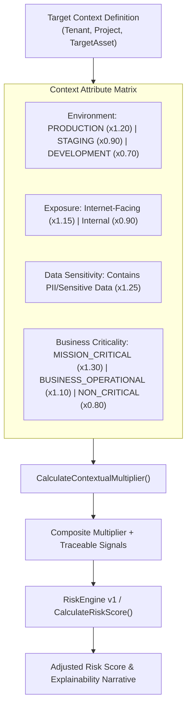

# Contextual Risk Factors Architecture

## Overview
The Kelvin **Contextual Risk Factors** subsystem enriches finding risk calculations by integrating explicit, asset-level operational attributes rather than relying solely on raw scanner severity or generic heuristics.

Contextual metadata is stored per-tenant and per-target in `target_risk_contexts`. When evaluating findings, the `RiskEngine` applies mathematically traceable multipliers derived from verified target context. In accordance with architectural invariants, unestablished or missing context defaults strictly to neutral multipliers (`1.0x`), preventing fabricated or arbitrary risk elevation.

## Explicit Target Context Attributes

| Field | Type / Enum | Default | Multiplier Impact |
|---|---|---|---|
| `environment` | `PRODUCTION`, `STAGING`, `DEVELOPMENT`, `UNKNOWN` | `UNKNOWN` | PRODUCTION: `1.20x` STAGING: `0.90x` DEVELOPMENT: `0.70x` UNKNOWN: `1.00x` |
| `internet_facing` | `boolean` | `false` | `true`: `1.15x` `false`: `0.90x` |
| `contains_pii` | `boolean` | `false` | `true`: `1.25x` `false`: `1.00x` |
| `business_criticality` | `MISSION_CRITICAL`, `BUSINESS_OPERATIONAL`, `NON_CRITICAL`, `UNKNOWN` | `UNKNOWN` | MISSION_CRITICAL: `1.30x` BUSINESS_OPERATIONAL: `1.10x` NON_CRITICAL: `0.80x` UNKNOWN: `1.00x` |
| `source` | `string` | `"MANUAL_ANALYST"` | Preserves origin of context metadata |
| `updated_by` | `uuid.UUID` | `null` | Tracks analyst or agent responsible for update |

## Core Architectural Invariants

1. **Strict Tenant & Project Isolation:**
   - Target context is partitioned by `(tenant_id, project_id, target_asset)`.
   - PostgreSQL Row-Level Security (RLS) and repository-level validation enforce that context cannot leak across tenant boundaries (ADR-0002).

2. **No Fabricated Risk (Neutral Defaults):**
   - If no target context is established for an asset, or if fields are `UNKNOWN`, the contextual multiplier defaults to `1.0x`.
   - Unverified systems do not receive artificially elevated or deflated risk scores.

3. **Deterministic & Explainable:**
   - Every contextual adjustment produces a human-readable list of explanatory signals (e.g. `Env: PRODUCTION (x1.20)`, `Exposure: Internet-Facing (x1.15)`), incorporated directly into `RiskAssessmentResult.Explanation`.

4. **Extensibility for Phase 4 Asset Inventory:**
   - The data model and APIs are designed to integrate seamlessly with automated cloud asset discovery and CMDB integrations planned for Phase 4.

## API Endpoints

- `PUT /api/v1/projects/{project_id}/targets/context`
  - Upserts target context attributes for an asset and returns the calculated composite multiplier and signals.
- `GET /api/v1/projects/{project_id}/targets/context?target_asset={asset}`
  - Retrieves target risk context and composite multiplier for a specified asset.
