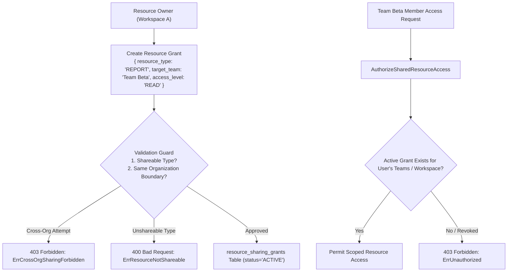

# Controlled Resource Sharing Across Teams

**Milestone:** P4-06 (Issue #204)  
**Workstream:** Workstream A — Organization & Team Administration  
**Status:** Approved / Implemented  

---

## 1. Overview & Purpose

While Kelvin enforces strict tenant isolation at the database layer (ADR-0002), enterprise workflows often require sharing curated security assets—such as standardized scan profiles, executive assessment reports, or remediation finding benchmarks—across multiple operational teams or workspaces within the same organization.

This specification establishes the **Controlled Resource Sharing Framework**, ensuring that cross-team sharing is explicit, revocable, strictly confined to authorized resource types within the same organization boundary, and fully auditable.

---

## 2. Architecture & Sharing Grant Model

---

## 3. Shareable vs. Strictly Isolated Resources

| Resource Type | Shareable Status | Permitted Access Levels | Rationale |
| :--- | :--- | :--- | :--- |
| **`SCAN_PROFILE`** | **Shareable** | `READ`, `EXECUTE` | Reusable corporate scanning templates and compliance benchmarks. |
| **`REPORT`** | **Shareable** | `READ` | Curated, presentation-safe assessment reports (ADR-0005). |
| **`FINDING`** | **Shareable** | `READ` | Specific finding summaries for cross-team remediation tracking. |
| **`RAW_EVIDENCE`** | **NON-SHAREABLE** | *None* | Raw traffic dumps, payloads, and tokens must remain locked in the originating workspace tenant. |
| **`API_TOKENS`** | **NON-SHAREABLE** | *None* | Machine credentials cannot be shared across workspaces. |

---

## 4. Security & Isolation Invariants

1. **Zero Cross-Organization Sharing**:
   - Sharing grants can only target teams or workspaces that belong to the **exact same Organization** (`organization_id`).
   - Any attempt to share a resource with an entity from another organization is immediately rejected with `ErrCrossOrgSharingForbidden`.
2. **Immediate Revocation**:
   - Calling `RevokeSharingGrant` marks the grant as `REVOKED`. The authorization guard instantly revokes subsequent read or execute operations without delay.
3. **Evidence Isolation Intact**:
   - Sharing a finding or report does **not** grant access to the underlying raw HTTP evidence payloads or private server tokens, adhering strictly to ADR-0005.

---

## 5. Audit Logging Invariants

All resource sharing actions emit immutable structured audit events:

- `resource.shared`: Recorded when a new grant is provisioned, detailing the resource type, ID, source workspace, target entity, and granted access level.
- `resource.unshared`: Recorded when a grant is revoked, detailing the revoking user ID and timestamp.

---

## 6. Verification & Validation

The sharing grant validation, cross-organization rejection, team grant authorization, and immediate revocation are verified by comprehensive unit tests in `apps/api/internal/hierarchy/sharing_test.go`.
