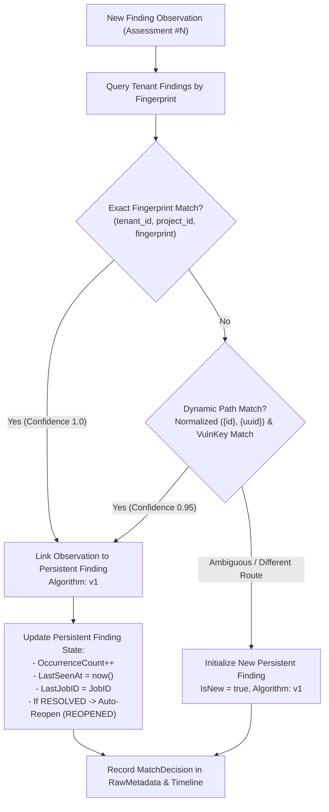

# Cross-Assessment Recurring Finding Detection

## Overview

Security scanning workflows execute recurrent assessments across releases, daily CI/CD runs, and scheduled scans. Finding intelligence requires reliably associating newly observed vulnerabilities with existing persistent finding records within the same tenant and project, updating occurrence counts and timestamps, and auto-reopening previously resolved findings when vulnerabilities regress.

The **Cross-Assessment Recurring Finding Detection Engine** applies a layered, deterministic matching strategy that combines exact versioned fingerprinting, conservative dynamic path normalization, and ambiguity guards to prevent incorrect finding merges.

---

## Architecture & Workflow

---

## Layered Matching Strategy

| Level | Match Type | Matching Criteria | Algorithm Version | Confidence Score | Decision Rationale |
|---|---|---|---|---|---|
| **Level 1** | **Exact Deterministic Fingerprint** | `tenant_id`, `project_id`, `fingerprint` (SHA-256 of `asset \| endpoint \| vuln_key`) match exactly | `v1` | `1.0` | `Exact deterministic fingerprint match (Algorithm v1)` |
| **Level 2** | **Dynamic Path Recurrence** | Matching tenant, project, asset, and vulnerability key; dynamic path matches under parameterization (`/{id}`, `/{uuid}`) with stripped ephemeral query strings | `v1-dynamic-path` | `0.95` | `Dynamic path parameterized match ({id}/{uuid})` |
| **Level 3** | **Uncertain / Distinct Routing** | Overlapping asset and vulnerability type, but different endpoint routes (e.g. `/api/v1/users` vs `/api/v1/orders`) | `v1` | `0.0` | `Uncertain match: distinct endpoint routes; preserved as separate findings` |

---

## Security & Operational Invariants

1. **Strict Multi-Tenant Isolation (ADR-0002):**
   - Recurrence matching only queries and compares findings sharing the authenticated `tenant_id` and `project_id`. Findings are never matched or linked across tenant boundaries.
2. **Conservative Ambiguity Guard:**
   - Similar findings across different routes or parameters are marked ambiguous (`isAmbiguous = true`) and provisioned as distinct findings to avoid erroneous grouping of independent security flaws.
3. **Auditability & Traceability:**
   - Every observation permanently retains the identity resolution outcome in `raw_metadata.match_decision`:
     - `is_recurrent`: boolean
     - `algorithm`: algorithm tag
     - `match_confidence`: numerical score
     - `match_reason`: descriptive explanation
     - `existing_finding_id`: linked parent finding UUID
4. **Lifecycle State Integrity:**
   - Automated re-observations automatically transition `RESOLVED` findings to `REOPENED`.
   - Analyst-controlled triage states (`CONFIRMED`, `FALSE_POSITIVE`, `ACCEPTED_RISK`) are strictly preserved.
