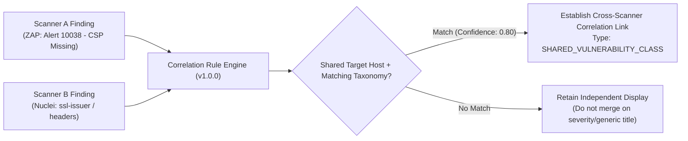

# Cross-Scanner Finding Correlation Rules

## Overview

When multi-scanner assessments execute against modern applications (e.g. Nuclei, OWASP ZAP, TLS analyzers, and preflight inspection adapters), complementary scanners identify vulnerabilities that share root-cause weaknesses or vulnerability identifiers. 

The **Cross-Scanner Correlation Rule Engine** evaluates findings across scanners, producing explainable, confidence-scored correlation links and clustering them into `CorrelationGroup` models (P3-14) without conflating independent findings or collapsing their observation histories.

---

## Architecture & Workflow

---

## Built-In Correlation Rules

| Rule ID | Version | Description | Target Conditions | Min. Confidence | Resulting Group Type |
|---|---|---|---|---|---|
| `RULE_COMMON_CVE` | `v1.0.0` | Correlates findings across scanners with overlapping CVE IDs on the same target host | `NormalizeAsset(a.Endpoint) == NormalizeAsset(b.Endpoint)` AND `intersect(a.CVEs, b.CVEs) != []` | `0.95` | `COMMON_IDENTIFIER` |
| `RULE_SAME_ENDPOINT_CWE` | `v1.0.0` | Correlates findings affecting the identical endpoint with matching CWE weakness category | `NormalizeEndpoint(a.Endpoint) == NormalizeEndpoint(b.Endpoint)` AND `a.CWE == b.CWE` | `0.85` | `SHARED_VULNERABILITY_CLASS` |
| `RULE_HTTP_HEADER_BASELINE` | `v1.0.0` | Correlates defense-in-depth HTTP security header omissions on a shared host | Same target host AND both findings match HTTP header security taxonomy | `0.80` | `SHARED_VULNERABILITY_CLASS` |

---

## Anti-Collapsing & Explainability Invariants

1. **Explainable Rationale:**
   - Every correlation match returns a descriptive `Rationale` and explicit `MatchedFactors` (e.g., `["host:api.example.com", "cve:CVE-2021-44228"]`).
2. **Rejection of Coincidental Attributes:**
   - Findings that merely share a severity level (`HIGH`, `CRITICAL`) or generic wording ("Vulnerability Detected") without matching weakness taxonomy or identifiers are **never** correlated.
3. **Multi-Tenant Isolation (ADR-0002):**
   - The engine strictly enforces `a.TenantID == b.TenantID`. Finding pairs from differing tenants immediately evaluate to `nil`.
4. **Independent Identity Retention:**
   - Correlated findings retain their independent persistent records, separate observation history, individual triage status, and evidence artifacts.
