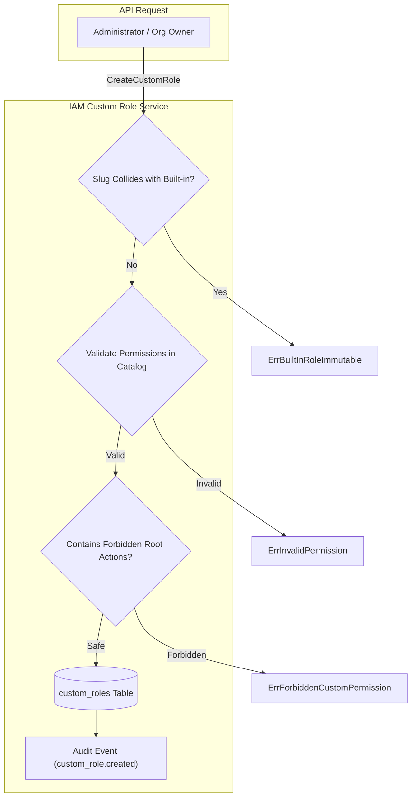
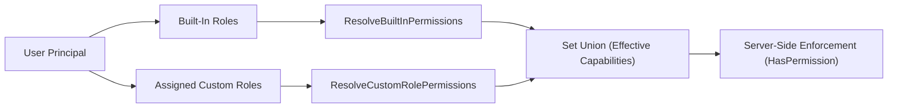

# Custom Role Creation and Management Architecture (P4-11)

## Executive Summary

Enterprise deployments frequently require bespoke personas (e.g. "Junior Security Analyst", "Compliance Auditor", "DevOps Scanner") that do not cleanly align with system-level built-in roles (`ORG_OWNER`, `ORG_ADMIN`, `SECURITY_ADMIN`, `WORKSPACE_ADMIN`, `SECURITY_ANALYST`, `AUDITOR`, `READ_ONLY_VIEWER`).

Issue **P4-11** introduces enterprise-scoped custom RBAC roles with cryptographic tenant boundaries, privilege escalation defenses, version tracking, soft-archival lifecycles, and tamper-resistant audit emission.

---

## 1. Governance & Threat Model

### 1.1 Privilege Escalation Defense
A custom role cannot grant capabilities beyond what an organization owner is authorized to delegate. Furthermore, specific super-administrative capabilities are explicitly forbidden from being included in custom roles:
- `org:billing:manage` (Financial/subscription controls)
- `org:sso:manage` (Enterprise SAML/OIDC identity provider configuration)
- `evidence:purge` (Permanent non-repudiation and evidence retention destruction)

Attempting to register or update a custom role containing any forbidden root permission results in `ErrForbiddenCustomPermission` and terminates the transaction.

### 1.2 Immutability and Collision Defense
- Built-in role slugs (`ORG_OWNER`, `SECURITY_ADMIN`, etc.) are protected from collision; an organization cannot create a custom role with a slug that matches an existing built-in role name (`ErrBuiltInRoleImmutable`).
- Within an organization, role slugs are unique (`uq_custom_roles_org_slug`).

### 1.3 Versioning & Auditability
Every modification to a custom role:
- Increments the `version` counter.
- Updates the `updated_at` timestamp.
- Emits an immutable audit event (`custom_role.created`, `custom_role.updated`, `custom_role.archived`) capturing the actor, organization, and role identifiers.

---

## 2. Architecture & Data Flow



---

## 3. Database Schema

The `custom_roles` table is partitioned by `organization_id`:

```sql
CREATE TABLE IF NOT EXISTS custom_roles (
  id              UUID PRIMARY KEY DEFAULT gen_random_uuid(),
  organization_id UUID NOT NULL REFERENCES organizations(id) ON DELETE CASCADE,
  name            VARCHAR(255) NOT NULL,
  slug            VARCHAR(100) NOT NULL,
  description     TEXT NOT NULL DEFAULT '',
  scope           VARCHAR(50) NOT NULL DEFAULT 'WORKSPACE', -- ORGANIZATION, WORKSPACE
  permissions     JSONB NOT NULL DEFAULT '[]'::jsonb,
  version         INTEGER NOT NULL DEFAULT 1,
  status          VARCHAR(50) NOT NULL DEFAULT 'ACTIVE', -- ACTIVE, ARCHIVED
  created_at      TIMESTAMPTZ NOT NULL DEFAULT clock_timestamp(),
  updated_at      TIMESTAMPTZ NOT NULL DEFAULT clock_timestamp(),
  CONSTRAINT uq_custom_roles_org_slug UNIQUE (organization_id, slug)
);

CREATE INDEX IF NOT EXISTS idx_custom_roles_org
  ON custom_roles (organization_id, status);
```

---

## 4. Multi-Role Resolution Integration

When evaluating effective user permissions across built-in roles and custom roles:



Archived roles (`status = 'ARCHIVED'`) are dynamically filtered out during resolution.
