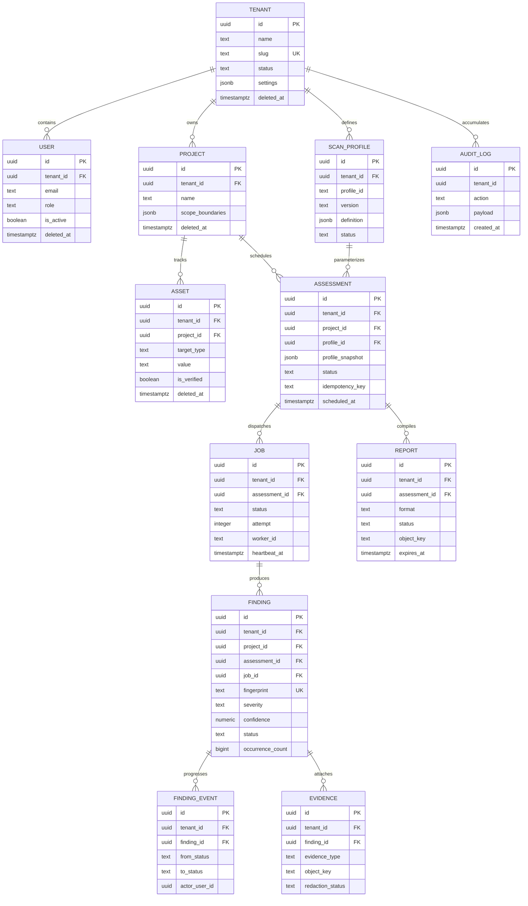

# Kelvin Security Platform — Domain Data Model

**Document Control**

| Field | Value |
| :--- | :--- |
| **Status** | Baseline — Peer Review Required |
| **Milestone** | Phase 1 — Foundation & Core Architecture (`P1-10`) |
| **Depends On** | `docs/architecture/SYSTEM_ARCHITECTURE.md` (`P1-06`), `docs/api/API_STANDARDS.md` (`P1-09`), `docs/architecture/decisions/ADR-0002.md` / `ADR-0003.md` (`P1-07`) |
| **Owner** | Platform Engineering / Data |
| **Review Cadence** | Quarterly, and on any entity, relationship, or retention change |
| **Related Docs** | `docs/MVP_AND_PHASE_BIFURCATION.md` (§2 MVP ERD — illustrative precursor), `docs/architecture/SCAN_PROFILES.md`, `docs/security/THREAT_MODEL.md`, `docs/architecture/REPOSITORY_LAYOUT.md` |
| **Classification** | Internal — Engineering Specification |

---

## 1. Executive Summary

This document is the **authoritative relational data model** for the Kelvin control plane (PostgreSQL 15+, ADR-0002). It formalizes the illustrative MVP ERD of `docs/MVP_AND_PHASE_BIFURCATION.md` §2 into a production specification: twelve entities, UUIDv7 primary keys, composite tenant-safe foreign keys, enforced row-level security, a cursor-pagination-aware indexing strategy, and explicit retention/deletion semantics that preserve assessment history without ever leaking one tenant's vulnerability data into another's rows.

The model is designed against three concrete failure modes:

| Failure mode | Root cause in an ad-hoc schema | Structural countermeasure in this model |
| :--- | :--- | :--- |
| **Orphaned jobs & evidence blobs** | `ON DELETE` unset or `CASCADE` misapplied; object store never reconciled | Cascade policy matrix (§6.1); ordered purge pipeline; daily blob reconciler (§8.4) |
| **Query degradation at millions of findings** | No composite indexes; offset pagination; unindexed dedup lookups | Keyset-ready composite indexes; unique dedup index; BRIN/GIN strategy; batch ingestion path (§10) |
| **Cross-tenant data bleed** | Isolation left to application `WHERE` clauses | `tenant_id` on every tenant-owned table; composite tenant-safe FKs (§6.2); mandatory RLS, fail-closed (§9) |

### 1.1 Corrections to the Illustrative MVP ERD

Where this specification departs from the MVP sketch, **this document wins**:

| MVP sketch | Formal model | Why |
| :--- | :--- | :--- |
| `ASSESSMENT.profile_name` (text) | `profile_id` FK + immutable `profile_snapshot` JSONB | Profiles are versioned and immutable (ADR-0005, T-03); a name string cannot guarantee reproducibility of what actually ran |
| `EVIDENCE.blob_storage_url`, `REPORT.download_url` | `object_key` + `checksum_sha256`; presigned URLs minted at read time | Presigned URLs expire and must never be persisted; keys are stable, auditable, and re-signable |
| No `tenant_id` on child tables (`ASSET`, `FINDING`, …) | Mandatory `tenant_id` on every tenant-owned table | RLS without joins; matches ADR-0002 §4 and T-08 |
| `FINDING.job_id` as sole parentage | `tenant_id` + `project_id` + `assessment_id` + `job_id` (denormalized provenance) | Dedup and dashboards query by project, not by a single job that may age out |
| — | `scan_profiles`, `finding_events`, `audit_log` added | Profile versioning; state-progression history without data destruction (acceptance); append-only audit (ADR-0002, T-05) |

---

## 2. Design Principles

1. **UUIDv7 primary keys everywhere.** Time-ordered, globally unique, generated application-side (Go, `packages/common`); index-friendly (see §3.3).
2. **Tenant ownership is a column, not a convention.** Every tenant-owned table carries `tenant_id NOT NULL` (sole exception: global `scan_profiles` rows, §5.6). Application code never filters by tenant without the database also enforcing it (§9).
3. **Soft delete by default; hard delete is a pipeline, not a query.** `deleted_at` on all tenant-owned tables; hard purge is an ordered, audited batch process (§8). Assessment history and finding state progression are never destroyed by user actions (acceptance).
4. **Foreign keys are mandatory and tenant-safe.** No orphan-capable relationships; composite FKs make cross-tenant parentage structurally impossible (§6.2).
5. **Append-heavy, lock-averse hot paths.** Findings ingestion, job heartbeats, and audit writes are designed to avoid row-lock convoys and table-level locks (§10).
6. **Structured where queryable, JSONB where variable.** Core fields typed; scanner-specific detail in JSONB (ADR-0002 §4) with GIN only where a query predicate exists.
7. **One wire vocabulary.** Enum storage values are the SCREAMING_SNAKE_CASE values published in `docs/api/API_STANDARDS.md` §5.2 — the API never translates.

---

## 3. Conventions

### 3.1 Naming

| Object | Convention | Example |
| :--- | :--- | :--- |
| Tables | plural, `snake_case` | `scan_profiles`, `finding_events` |
| Columns | `snake_case` | `created_at`, `tenant_id` |
| Primary key | `id` | `id uuid PRIMARY KEY` |
| Foreign keys | `<referenced_table_singular>_id` | `project_id`, `assessment_id` |
| Unique constraints | `uq_<table>_<cols>` | `uq_projects_tenant_name` |
| Check constraints | `ck_<table>_<rule>` | `ck_findings_severity` |
| Indexes | `idx_<table>_<cols>[_ops]` | `idx_findings_tenant_created_id` |
| Timestamps | `_at` suffix, `timestamptz`, always UTC | `finished_at` |

### 3.2 Standard Columns

Every tenant-owned table carries the full audit/lifecycle set unless noted:

| Column | Type | Null | Notes |
| :--- | :--- | :--- | :--- |
| `id` | `uuid` | NO | UUIDv7 PK |
| `tenant_id` | `uuid` | NO | FK → `tenants(id)`; RLS anchor |
| `created_at` | `timestamptz` | NO | Default `now()`; immutable |
| `updated_at` | `timestamptz` | NO | Maintained by `set_updated_at()` trigger |
| `deleted_at` | `timestamptz` | YES | Soft-delete marker; NULL = live |

### 3.3 Primary Keys — UUIDv7

* Generated **application-side** in Go (monotonic within process) — PostgreSQL 15+ (ADR-0002) has no built-in `uuidv7()`; on PG ≥ 18 the database default may be adopted via migration without changing column types.
* **Why v7 over v4:** v4 random keys scatter index pages on insert (random I/O on hot B-tree pages); v7 keys are time-ordered, so inserts append at the rightmost page — measured reductions in write amplification on multi-million-row tables, and natural clustering for time-range scans.
* PKs are never exposed as sequential integers; enumeration attacks yield no ordering information beyond creation time (acceptable; authorization is tenant-scoped regardless, T-08).
* Cursor pagination (API_STANDARDS §8) encodes `(sort_key, id)` — the `id` tie-breaker requires the PK to be part of every keyset index (§10.2).

### 3.4 Types & Enums

* All timestamps: `timestamptz`. Never `timestamp` (without zone).
* Enums stored as `TEXT` with `CHECK` constraints — **not** PostgreSQL `ENUM` types (cannot be dropped; `ALTER TYPE` limits). Wire values are identical to the API's SCREAMING_SNAKE_CASE values.
* Scores: `confidence numeric(4,3)` CHECK `0 <= confidence <= 1`; `cvss_score numeric(3,1)` CHECK `0 <= score <= 10`.
* JSONB permitted only for: `scope_boundaries`, `profile.definition`, `profile_snapshot`, `finding.scanner_data`, `finding.tags`, `tenant.settings`, `audit_log.payload`. Every JSONB column is validated in application code against the corresponding `packages/schemas` contract before persist.

### 3.5 Index Naming & Opclasses

* Descending keyset indexes append `_desc` (e.g. `idx_findings_tenant_created_id_desc`).
* Case-insensitive uniques use expression indexes: `UNIQUE (tenant_id, lower(email))`.
* GIN indexes declare `jsonb_path_ops` unless full containment scans are required.

---

## 4. Entity-Relationship Model



Supporting graph notes: `audit_log` is append-only (no outbound relationships modeled; references actors and entities by UUID inside `payload` to remain insert-only). `user` references (`assessments.requested_by`, `finding_events.actor_user_id`) are shown in §5 column tables for legibility.

---

## 5. Entity Specifications

Legend: **Null** = nullable column. All `timestamptz` in UTC. All tables §3.2 standard columns unless listed otherwise.

### 5.1 `tenants`

| Column | Type | Null | Constraints / Notes |
| :--- | :--- | :--- | :--- |
| `id` | uuid | NO | PK (UUIDv7) |
| `name` | text | NO | Display name, 1–200 chars |
| `slug` | text | NO | `^[a-z0-9][a-z0-9-]{1,62}$`, globally unique |
| `status` | text | NO | CHECK IN (`ACTIVE`, `SUSPENDED`, `OFFBOARDING`) |
| `settings` | jsonb | NO | Default `{}`; retention overrides, quota policy |
| `created_at` / `updated_at` / `deleted_at` | timestamptz | NO/NO/YES | Standard |

No `tenant_id` (this is the tenant root). Tenant hard delete is the offboarding pipeline only (§8.5).

### 5.2 `users`

| Column | Type | Null | Constraints / Notes |
| :--- | :--- | :--- | :--- |
| `id` | uuid | NO | PK |
| `tenant_id` | uuid | NO | FK → `tenants(id)` ON DELETE RESTRICT |
| `email` | text | NO | Unique per tenant, case-insensitive: `UNIQUE (tenant_id, lower(email))` WHERE `deleted_at IS NULL` |
| `display_name` | text | NO | |
| `password_hash` | text | YES | Nullable: OIDC/SAML users (Phase 4) have none |
| `oidc_subject` | text | YES | Unique per tenant when present |
| `role` | text | NO | CHECK IN (`PLATFORM_ADMIN`, `SECURITY_ANALYST`, `READ_ONLY_AUDITOR`) — SYSTEM_ARCHITECTURE §8.2 |
| `is_active` | boolean | NO | Default `true`; login gate |
| `last_login_at` | timestamptz | YES | |

### 5.3 `projects`

| Column | Type | Null | Constraints / Notes |
| :--- | :--- | :--- | :--- |
| `id` | uuid | NO | PK |
| `tenant_id` | uuid | NO | FK → `tenants(id)` ON DELETE RESTRICT |
| `name` | text | NO | Unique per tenant: `UNIQUE (tenant_id, lower(name))` WHERE `deleted_at IS NULL` |
| `description` | text | YES | |
| `scope_boundaries` | jsonb | NO | `{ allow: [...], deny: [...] }` — domains/CIDRs; validated against scope schema before persist; enforced by scope engine (SYSTEM_ARCHITECTURE §8.3) |

### 5.4 `assets`

| Column | Type | Null | Constraints / Notes |
| :--- | :--- | :--- | :--- |
| `id` | uuid | NO | PK |
| `tenant_id` | uuid | NO | FK → `tenants(id)` ON DELETE RESTRICT |
| `project_id` | uuid | NO | Composite tenant-safe FK → `projects` (§6.2) ON DELETE RESTRICT |
| `target_type` | text | NO | CHECK IN (`DOMAIN`, `IPV4`, `IPV6`, `URL`, `CIDR`) |
| `value` | text | NO | Normalized (lowercased host, canonical CIDR) |
| `is_verified` | boolean | NO | Default `false`; ownership challenges (DNS TXT / `.well-known`, ACCEPTABLE_USE) |
| `verification_method` | text | YES | `DNS_TXT`, `HTTP_WELL_KNOWN`, `LOA` |
| `verified_at` | timestamptz | YES | Re-verification clears these |
| `first_seen_at` / `last_seen_at` | timestamptz | NO/NO | Discovery bookkeeping |

`UNIQUE (project_id, target_type, value)` WHERE `deleted_at IS NULL`.

### 5.5 `assessments`

| Column | Type | Null | Constraints / Notes |
| :--- | :--- | :--- | :--- |
| `id` | uuid | NO | PK |
| `tenant_id` | uuid | NO | FK → `tenants(id)` ON DELETE RESTRICT |
| `project_id` | uuid | NO | Composite tenant-safe FK → `projects` ON DELETE RESTRICT |
| `name` | text | NO | |
| `profile_id` | uuid | NO | FK → `scan_profiles(id)` ON DELETE RESTRICT — RESTRICT guarantees profiles referenced by history are never dropped |
| `profile_snapshot` | jsonb | NO | Immutable copy of the full profile definition at submission (reproducibility; T-03) |
| `status` | text | NO | CHECK IN (`QUEUED`, `VALIDATING_SCOPE`, `RUNNING`, `COMPLETED`, `FAILED`, `TIMED_OUT`, `CANCELLED`) — the state machine of SYSTEM_ARCHITECTURE §8.4; transitions enforced application-side inside a transaction (§7) |
| `trigger_type` | text | NO | CHECK IN (`MANUAL`, `SCHEDULE`, `API`, `WEBHOOK`) |
| `requested_by` | uuid | YES | FK → `users(id)` ON DELETE RESTRICT (tombstoned users persist until tenant offboarding) |
| `idempotency_key` | uuid | YES | From API STANDARDS §5.3; `UNIQUE (tenant_id, idempotency_key)` WHERE NOT NULL |
| `correlation_id` | uuid | NO | Request tracing (API STANDARDS §10) |
| `scheduled_at` | timestamptz | YES | Cron-triggered runs (Phase 5) |
| `queued_at` / `started_at` / `completed_at` | timestamptz | YES | Lifecycle timestamps |
| `error_detail` | text | YES | Sanitized failure summary only — never raw driver errors (API STANDARDS §7.3) |

### 5.6 `scan_profiles`

| Column | Type | Null | Constraints / Notes |
| :--- | :--- | :--- | :--- |
| `id` | uuid | NO | PK |
| `tenant_id` | uuid | **YES** | **Sole nullable `tenant_id`:** NULL = global built-in profile (`kelvin.profile.*`, SCAN_PROFILES §3); RLS policy admits `tenant_id IS NULL OR tenant_id = current_tenant_id()` |
| `profile_id` | text | NO | Logical identifier, e.g. `kelvin.profile.standard.v1` |
| `version` | text | NO | Semver of the definition |
| `definition` | jsonb | NO | Validated against `packages/schemas/scan-profile.schema.json` at write time; **immutable after create** (only `status` may change) — T-03 |
| `status` | text | NO | CHECK IN (`ACTIVE`, `DEPRECATED`) |
| `created_by` | uuid | YES | FK → `users(id)` ON DELETE SET NULL |

`UNIQUE (tenant_id, profile_id, version)`. Built-ins are seeded by migration, not runtime inserts.

### 5.7 `jobs`

BullMQ is the **execution broker**; this table is the **durable job state** reconciled from the broker (ADR-0003 §4). On broker restart, queued jobs are rebuilt from `assessments` + `jobs` rows.

| Column | Type | Null | Constraints / Notes |
| :--- | :--- | :--- | :--- |
| `id` | uuid | NO | PK |
| `tenant_id` | uuid | NO | FK → `tenants(id)` ON DELETE RESTRICT |
| `assessment_id` | uuid | NO | FK → `assessments(id)` ON DELETE CASCADE — jobs are operational chattel wholly owned by their assessment |
| `attempt` | integer | NO | ≥ 1; `UNIQUE (assessment_id, attempt)`; retry budget ≤ 3 (SYSTEM_ARCHITECTURE §6.2) |
| `status` | text | NO | CHECK IN (`QUEUED`, `RUNNING`, `COMPLETED`, `FAILED`, `TIMED_OUT`, `CANCELLED`) |
| `worker_id` | text | YES | Ephemeral container identity |
| `queue_job_id` | text | YES | BullMQ job ID; reconciliation key |
| `priority` | smallint | NO | Default 100; lower = higher priority |
| `correlation_id` | uuid | NO | Propagated into broker payload (API STANDARDS §10.2) |
| `enqueued_at` / `started_at` / `finished_at` | timestamptz | NO/YES/YES | |
| `heartbeat_at` | timestamptz | YES | Hot update column; see §10.4 |
| `lease_expires_at` | timestamptz | YES | Hard execution deadline from profile snapshot |
| `exit_code` | integer | YES | Scanner process exit |
| `error_ref` | text | YES | Correlation handle / sanitized code — never raw stderr |

### 5.8 `findings`

The scale-critical table. Typed core columns for query/filter; `scanner_data` JSONB for engine-specific detail (ADR-0002 §4).

| Column | Type | Null | Constraints / Notes |
| :--- | :--- | :--- | :--- |
| `id` | uuid | NO | PK |
| `tenant_id` | uuid | NO | FK → `tenants(id)` ON DELETE RESTRICT |
| `project_id` | uuid | NO | Composite tenant-safe FK → `projects` ON DELETE RESTRICT |
| `assessment_id` | uuid | NO | FK → `assessments(id)` ON DELETE RESTRICT — provenance survives job-level purge ordering (§8.2) |
| `job_id` | uuid | NO | FK → `jobs(id)` ON DELETE RESTRICT |
| `asset_id` | uuid | YES | FK → `assets(id)` ON DELETE SET NULL (asset re-verification may retire rows; finding history persists) |
| `fingerprint` | text | NO | Dedup key computed server-side per `docs/architecture/FINDING_SCHEMA.md` §5 (sha256 of canonicalized asset + endpoint + vulnerability key, lowercase hex); scoped per project via `UNIQUE (project_id, fingerprint)` |
| `title` | text | NO | Normalized vulnerability title |
| `severity` | text | NO | CHECK IN (`INFORMATIONAL`, `LOW`, `MEDIUM`, `HIGH`, `CRITICAL`) — canonical enum of `docs/architecture/FINDING_SCHEMA.md` §4 |
| `confidence` | numeric(4,3) | NO | CHECK 0–1 |
| `cvss_score` | numeric(3,1) | YES | CHECK 0–10 |
| `cwe_id` | text | YES | e.g. `CWE-79` |
| `cve_ids` | text[] | NO | Default `{}` |
| `status` | text | NO | CHECK IN (`OPEN`, `CONFIRMED`, `FALSE_POSITIVE`, `RISK_ACCEPTED`, `RESOLVED`); default `OPEN`; transitions append `finding_events` (§5.9) |
| `affected_endpoint` | text | YES | URL/path; indexed only when queried |
| `scanner_data` | jsonb | NO | Default `{}`; engine-specific fields, schema-checked inbound |
| `tags` | text[] | NO | Default `{}`; GIN when filtered |
| `first_seen_at` / `last_seen_at` | timestamptz | NO/NO | Dedup bookkeeping |
| `first_job_id` / `last_job_id` | uuid | NO/NO | FK → `jobs(id)` ON DELETE RESTRICT / SET NULL |
| `occurrence_count` | bigint | NO | Default 1; incremented on every re-detection (hot counter, §10.4) |

**One row per vulnerability per project** — `UNIQUE (project_id, fingerprint)`. Re-detection updates `last_seen_at`/`occurrence_count` (§10.3); it **never** overwrites analyst triage: `FALSE_POSITIVE`, `RISK_ACCEPTED`, and `CONFIRMED` statuses are re-detection-immutable; `RESOLVED` + re-detection → `OPEN` with an appended event (re-open without destruction).

### 5.9 `finding_events`

State-progression history — the acceptance criterion "finding state progression preserved without data destruction" lives here.

| Column | Type | Null | Constraints / Notes |
| :--- | :--- | :--- | :--- |
| `id` | uuid | NO | PK |
| `tenant_id` | uuid | NO | FK → `tenants(id)` ON DELETE RESTRICT |
| `finding_id` | uuid | NO | FK → `findings(id)` ON DELETE CASCADE |
| `from_status` | text | YES | NULL = creation event |
| `to_status` | text | NO | CHECK IN (finding status set) |
| `event_type` | text | NO | CHECK IN (`CREATED`, `TRIAGE`, `REDETECTED`, `AUTO_REOPENED`, `MERGED`) |
| `actor_user_id` | uuid | YES | FK → `users(id)` ON DELETE SET NULL (system events NULL) |
| `note` | text | YES | Analyst note; sanitized |
| `correlation_id` | uuid | NO | |
| `created_at` | timestamptz | NO | Immutable; append-only |

### 5.10 `evidence`

Metadata rows for object-store artifacts (MinIO/S3, SYSTEM_ARCHITECTURE §8.8). Raw payloads never live in PostgreSQL.

| Column | Type | Null | Constraints / Notes |
| :--- | :--- | :--- | :--- |
| `id` | uuid | NO | PK |
| `tenant_id` | uuid | NO | FK → `tenants(id)` ON DELETE RESTRICT |
| `finding_id` | uuid | NO | FK → `findings(id)` ON DELETE CASCADE |
| `job_id` | uuid | NO | FK → `jobs(id)` ON DELETE RESTRICT |
| `evidence_type` | text | NO | CHECK IN (`HTTP_EXCHANGE`, `HEADER_DUMP`, `SCREENSHOT`, `FILE`, `LOG`) |
| `object_key` | text | NO | Tenant-prefixed key: `tenants/<tenant_id>/evidence/<finding_id>/<uuid>` — presigned URL minted at read (never stored) |
| `content_type` | text | NO | Enforced allow-list (THREAT_MODEL TB-06) |
| `size_bytes` | bigint | NO | ≤ per-type caps |
| `checksum_sha256` | text | NO | Integrity; upload verification |
| `redaction_status` | text | NO | CHECK IN (`PENDING`, `COMPLETED`, `QUARANTINED`); default `PENDING`; **only `COMPLETED` evidence is servable** (T-09); `QUARANTINED` on redaction failure |
| `redacted_preview` | text | YES | ≤ 4 KiB safe excerpt for dashboards |
| `deleted_object_at` | timestamptz | YES | Object purged by retention (§8.3); row retained as integrity tombstone |

### 5.11 `reports`

| Column | Type | Null | Constraints / Notes |
| :--- | :--- | :--- | :--- |
| `id` | uuid | NO | PK |
| `tenant_id` | uuid | NO | FK → `tenants(id)` ON DELETE RESTRICT |
| `assessment_id` | uuid | NO | FK → `assessments(id)` ON DELETE CASCADE |
| `format` | text | NO | CHECK IN (`PDF`, `JSON`, `CSV`) |
| `status` | text | NO | CHECK IN (`GENERATING`, `READY`, `FAILED`, `EXPIRED`) |
| `object_key` | text | YES | Set when `READY`; presigned at download |
| `size_bytes` | bigint | YES | |
| `checksum_sha256` | text | YES | Ties artifact to generation (non-repudiation, PERSONAS report journey) |
| `generated_by` | uuid | YES | FK → `users(id)` ON DELETE SET NULL |
| `expires_at` | timestamptz | NO | Default `created_at + 30 days`; object purged at expiry, row retained |

### 5.12 `audit_log`

Append-only, per ADR-0002 §4 and T-05.

| Column | Type | Null | Constraints / Notes |
| :--- | :--- | :--- | :--- |
| `id` | uuid | NO | PK (UUIDv7 — insertion order = time order) |
| `tenant_id` | uuid | YES | NULL = platform-level event (node maintenance, etc.) |
| `actor_user_id` | uuid | YES | Snapshot only; no FK — actor rows may be purged without breaking the trail |
| `actor_type` | text | NO | CHECK IN (`USER`, `SERVICE`, `WORKER`, `SYSTEM`) |
| `action` | text | NO | Dotted verb: `assessment.create`, `finding.triage`, `report.export` |
| `entity_type` | text | NO | `assessment`, `finding`, … |
| `entity_id` | uuid | YES | |
| `payload` | jsonb | NO | Sanitized diff/context; **never** contains secrets (T-09) |
| `correlation_id` | uuid | NO | |
| `created_at` | timestamptz | NO | BRIN-indexed |

**Grants:** application role has INSERT only. No UPDATE/DELETE privilege exists on this table for any application role — deletion happens only via offline archival by the retention pipeline using a separate privileged role (§8.3).

---

## 6. Referential Integrity

### 6.1 Cascade Policy Matrix

Default posture: **RESTRICT** for anything that carries history or security meaning; **CASCADE** only where the child is meaningless without the parent and carries no independent audit value.

| Parent | Child | FK action | Rationale |
| :--- | :--- | :--- | :--- |
| `tenants` | `users`, `projects`, `scan_profiles` | RESTRICT | Tenant rows are removed only by the offboarding pipeline (§8.5), never by accident |
| `projects` | `assets`, `assessments` | RESTRICT | Deleting a project must be an explicit, audited decision — the anti-orphan guarantee |
| `scan_profiles` | `assessments` | RESTRICT | Historical assessments must retain their profile definition |
| `assessments` | `jobs`, `reports` | CASCADE | Operational children; assessment hard delete happens only in purge after retention |
| `jobs` | `findings` (`job_id`, `first_job_id`) | RESTRICT | Findings provenance must survive individual job churn |
| `jobs` | `evidence` (`job_id`) | RESTRICT | Evidence keeps its producing job while findings exist |
| `jobs` | `findings` (`last_job_id`) | SET NULL | Latest-job pointer degrades gracefully; `job_id` (provenance) stays RESTRICT |
| `findings` | `evidence`, `finding_events` | CASCADE | Meaningless without the finding; purge order handled by pipeline anyway |
| `findings` (`asset_id`) | `assets` | SET NULL | Asset retirement never destroys findings |
| `users` (`generated_by`, `actor_user_id`, `created_by`) | `users` | SET NULL | Offboarded actors degrade to anonymous service identity in reports/profiles; audit actor is snapshot-only |

**User-facing delete = soft delete** (`deleted_at`), which triggers no FK action. **Hard delete = ordered pipeline** (§8.2): evidence objects → `evidence` → `finding_events` → `findings` → `jobs` → `reports` → `assessments` → `assets` → `projects`. RESTRICT constraints act as a tripwire: if the pipeline misses an ordering step, the transaction fails loudly instead of orphaning data.

### 6.2 Tenant-Safe Composite Foreign Keys

A naive FK on `assessments.project_id` alone permits a bug to attach tenant B's assessment to tenant A's project. Every parent table therefore also carries `UNIQUE (id, tenant_id)`, and children reference **both** columns:

```sql
ALTER TABLE assessments
  ADD CONSTRAINT fk_assessments_project_tenant
  FOREIGN KEY (tenant_id, project_id)
  REFERENCES projects (tenant_id, id);

ALTER TABLE assets
  ADD CONSTRAINT fk_assets_project_tenant
  FOREIGN KEY (tenant_id, project_id)
  REFERENCES projects (tenant_id, id);
```

A cross-tenant attach now fails with an FK violation at the database layer, independent of application logic and independent of RLS (defense in depth, T-08). Applied identically to `findings` → `projects`, `assessments` → `scan_profiles` (tenant + id), and `evidence`/`finding_events` → `findings`.

---

## 7. State Machines in the Schema

Status `CHECK` constraints guarantee *vocabulary*; transition legality is enforced in a single transactional helper in `apps/api/internal/orchestrator` (advisory-locked per assessment/job row) — the database stores only legal current states, the application stores only legal edges.

| Machine | Legal transitions |
| :--- | :--- |
| Assessment | `QUEUED → VALIDATING_SCOPE`; `VALIDATING_SCOPE → RUNNING \| FAILED \| CANCELLED`; `RUNNING → COMPLETED \| FAILED \| TIMED_OUT \| CANCELLED`; terminal states absorb |
| Job | `QUEUED → RUNNING`; `RUNNING → COMPLETED \| FAILED \| TIMED_OUT \| CANCELLED`; re-queue creates a **new** `attempt` row rather than mutating history |
| Finding | `OPEN ↔ CONFIRMED`; `OPEN → FALSE_POSITIVE \| RISK_ACCEPTED \| RESOLVED`; `RESOLVED → OPEN` (re-detection only); `FALSE_POSITIVE/RISK_ACCEPTED` require explicit human reversal |

Every transition writes: the status update **and** (for findings) an append-only `finding_events` row in the same transaction. Illegal transitions surface as API `409` (API STANDARDS §7.2).

---

## 8. Deletion, Retention & Archival

### 8.1 Soft Delete Semantics

* User/API delete sets `deleted_at = now()` (single-statement, reversible within grace).
* All list queries filter `deleted_at IS NULL`; partial unique indexes (§5) ensure a deleted name/email/slug does not block re-creation.
* RLS policies include `deleted_at IS NULL` for user-facing roles; the purge pipeline role bypasses this predicate explicitly.

### 8.2 Ordered Hard-Purge Pipeline

A scheduled control-plane job (not SQL run by hand) executes per-entity batches inside one transaction per entity page:

```
evidence objects (object store) → evidence rows → finding_events → findings
→ jobs → reports → assessments → assets → projects
```

Each purge run writes `audit_log` entries (`purge.execute`) with counts and criteria before and after. Batch size bounded (default 1 000 rows/page) to avoid long transactions and WAL spikes.

### 8.3 Retention Schedule (defaults; per-tenant overridable via `tenants.settings`)

| Data | Hot retention | After expiry | Constraint |
| :--- | :--- | :--- | :--- |
| Audit log | 24 months | Cold archive (object store, WORM), then purge | ≥ 12 months hard floor (T-05) |
| Evidence objects | 180 days | Object deleted; `evidence` row kept as tombstone (`deleted_object_at`) | Metadata integrity chain preserved |
| Reports objects | `expires_at` (default 30 days) | Object deleted; row kept | |
| Assessments / jobs / findings metadata | Tenant lifetime | Purge only via project/tenant offboarding after export | No routine destruction |
| Soft-deleted entities | 30-day grace | Purge pipeline eligible | Restore window |
| Quarantined evidence | 90 days | Secure wipe; security alert retained | T-09 |

### 8.4 Object-Store Reconciler (anti-orphan)

DB cascade cannot delete MinIO/S3 objects. A daily reconciler:

1. Lists object keys under `tenants/<id>/…` prefixes (paged).
2. Deletes objects with no referencing `evidence`/`reports` row older than 24 h (**orphaned blobs — the gigabyte-leak failure mode**).
3. Alerts on rows whose object is missing (`object_missing` signal), preserving forensic metadata.

### 8.5 Tenant Offboarding

`ACTIVE → OFFBOARDING → (export) → purge → OFFBOARDED`. Export produces a signed archive (findings JSON + evidence objects + audit slice) to the tenant's designated sink **before** any hard delete. Only then may `tenants` rows be removed; FK RESTRICT ordering guarantees nothing was missed.

---

## 9. Tenant Isolation & Row-Level Security

### 9.1 Tenant Context

```sql
CREATE OR REPLACE FUNCTION current_tenant_id() RETURNS uuid
LANGUAGE sql STABLE PARALLEL SAFE AS $$
  SELECT NULLIF(current_setting('app.tenant_id', true), '')::uuid
$$;
```

The API transaction wrapper sets `SET LOCAL app.tenant_id = '<uuid>'` per request (never session-persistent — safe under pgbouncer transaction pooling). **Fail-closed:** if the GUC is unset, `current_tenant_id()` returns NULL and every policy predicate is NULL → **zero rows visible**, never all rows.

### 9.2 Policy Template

```sql
ALTER TABLE findings ENABLE ROW LEVEL SECURITY;
ALTER TABLE findings FORCE  ROW LEVEL SECURITY;

CREATE POLICY tenant_isolation_findings ON findings
  TO kelvin_app
  USING      (tenant_id = current_tenant_id() AND deleted_at IS NULL)
  WITH CHECK (tenant_id = current_tenant_id());
```

* `FORCE ROW LEVEL SECURITY` applies policies to the table owner too — no superuser-shaped bypass in the application path.
* `WITH CHECK` prevents cross-tenant writes even if a caller smuggles another tenant's `tenant_id` into an INSERT/UPDATE.
* Identical policies on: `users`, `projects`, `assets`, `scan_profiles` (plus global-row predicate), `assessments`, `jobs`, `findings`, `finding_events`, `evidence`, `reports`, `audit_log` (SELECT restricted to auditor role).
* **Roles:** `kelvin_app` (RLS-forced, no BYPASSRLS); `kelvin_purger` (BYPASSRLS, used only by the retention pipeline, connection origin allow-listed); `kelvin_audit_writer` (INSERT-only on `audit_log`).

### 9.3 Isolation Test Gates (CI, blocking)

Per THREAT_MODEL SG-04 and ADR-0002 risk register:

1. Two seeded tenants; every table queried as tenant A after seeding rows in tenant B → assert zero rows.
2. Cross-tenant composite-FK attach attempt → assert FK violation.
3. Unset `app.tenant_id` → assert zero rows on every table (fail-closed proof).
4. INSERT with foreign `tenant_id` under RLS → assert rejection.
5. `kelvin_app` attempts `UPDATE`/`DELETE` on `audit_log` → assert permission denied.

Quarterly penetration tests re-execute this suite against staging (T-08 exit criterion).

---

## 10. Indexing & High-Volume Findings Ingestion

### 10.1 Query → Index Map

| Hot query | Index |
| :--- | :--- |
| Cursor list: findings in project, newest first (dashboard) | `idx_findings_tenant_project_created_id ON findings (tenant_id, project_id, created_at DESC, id DESC)` |
| Open-finding triage board filtered by severity | `idx_findings_tenant_status_severity ON findings (tenant_id, status, severity)` WHERE `status IN ('OPEN','CONFIRMED')` |
| Resurface/last-detected views | `idx_findings_tenant_last_seen ON findings (tenant_id, last_seen_at DESC)` |
| Dedup upsert probe | `uq_findings_project_fingerprint UNIQUE (project_id, fingerprint)` |
| Tag facets | `idx_findings_tags ON findings USING GIN (tags jsonb_path_ops)` |
| Time-series scans of huge tables | `BRIN (created_at)` on `findings`, `audit_log` (compact; beats btree for append-only time ranges) |
| Active job ops dashboard | `idx_jobs_active ON jobs (status, enqueued_at)` WHERE `status IN ('QUEUED','RUNNING')` |
| Job heartbeat / lease sweeper | `idx_jobs_heartbeat ON jobs (heartbeat_at)` WHERE `status = 'RUNNING'` |
| Reconcile queue ↔ DB | `idx_jobs_queue_ref ON jobs (queue_job_id)` WHERE `queue_job_id IS NOT NULL` |
| Assessment cursor list | `idx_assessments_tenant_project_created ON assessments (tenant_id, project_id, created_at DESC, id DESC)` WHERE `deleted_at IS NULL` |
| Idempotent submit replay | `uq_assessments_tenant_idem UNIQUE (tenant_id, idempotency_key)` WHERE `idempotency_key IS NOT NULL` |
| Evidence by finding | `idx_evidence_finding ON evidence (finding_id)` |
| Evidence redaction queue | `idx_evidence_pending ON evidence (created_at)` WHERE `redaction_status IN ('PENDING','QUARANTINED')` |
| Finding history | `idx_finding_events_finding ON finding_events (finding_id, created_at)` |

Every keyset index ends in `id DESC/ASC` to satisfy the `(sort_key, id)` cursor contract (API STANDARDS §8.1) — no `OFFSET` scans on large tables, ever.

### 10.2 Cursor Pagination Compatibility

`meta.next_cursor` encodes the last row's `(sort column, id)`. The composite indexes above make the seek predicate `(tenant_id, project_id, created_at, id) < (…)` an index-range scan — O(page), not O(offset).

### 10.3 Findings Ingestion Hot Path

Workers stream sanitized findings to the Findings Service, which persists in batches (default 1 000 rows):

1. Batch inserts into an **UNLOGGED staging table** (`finding_staging`) via `COPY` — minimal WAL.
2. Single `INSERT … SELECT … FROM finding_staging ON CONFLICT (project_id, fingerprint) DO UPDATE` performs dedup:

```sql
INSERT INTO findings (tenant_id, project_id, assessment_id, job_id, fingerprint, …)
SELECT … FROM finding_staging s
ON CONFLICT (project_id, fingerprint) DO UPDATE SET
  last_seen_at        = EXCLUDED.last_seen_at,
  last_job_id         = EXCLUDED.job_id,
  occurrence_count    = findings.occurrence_count + 1,
  status              = CASE WHEN findings.status = 'RESOLVED' THEN 'OPEN' ELSE findings.status END,
  severity            = (ARRAY['INFORMATIONAL','LOW','MEDIUM','HIGH','CRITICAL'])[
                          GREATEST(
                            array_position(ARRAY['INFORMATIONAL','LOW','MEDIUM','HIGH','CRITICAL'], findings.severity),
                            array_position(ARRAY['INFORMATIONAL','LOW','MEDIUM','HIGH','CRITICAL'], EXCLUDED.severity)
                          )],
  updated_at          = now()
WHERE findings.status NOT IN ('FALSE_POSITIVE', 'RISK_ACCEPTED', 'CONFIRMED');
```

Severity escalation uses the ordinal array above — **not** `GREATEST(text)` (text collation orders `CRITICAL < HIGH`, which would silently downgrade severities).

3. Re-detection of a `RESOLVED` finding also inserts a `finding_events` row (`AUTO_REOPENED`) in the same transaction; triage states are never silently overwritten (§5.8).
4. Staging truncated per batch; transaction commits per batch (bounded lock time, replay-safe with `correlation_id`+`job_id` dedup on staging load).

### 10.4 Lock & Vacuum posture

| Table | Tuning |
| :--- | :--- |
| `findings` | `fillfactor = 80` ( HOT updates for counters/status); autovacuum `scale_factor 0.02`, `threshold 5 000` — aggressive to prevent bloat on update-heavy dedup |
| `jobs` | `fillfactor = 70` (heartbeat + status churn); partial indexes keep the active set small |
| `audit_log`, `finding_events` | Append-only: default fillfactor 100; near-zero vacuum churn; BRIN instead of large btree |
| Ingestion | No DDL, no `LOCK TABLE`, no `TRUNCATE` on live tables during normal operation; batched `INSERT…ON CONFLICT` only |

### 10.5 Scale path (partitioning — ADR-gated)

At sustained volumes beyond ~100 M findings rows/table (expected Phase 3–4), range-partition `findings` by `created_at` (monthly) via `pg_partman`, **after** an ADR because: PK must become `(id, created_at)`, the dedup unique index must incorporate the partition key (re-shaping dedup to `(project_id, fingerprint, created_at)` or enforcing uniqueness via a sidecar lookup table), and cross-partition triage queries need concurrent pruning. Interim relief levers before partitioning: evidence tombstone purging, `BRIN` + partial indexes, read replica for dashboards (ADR-0002 §5).

---

## 11. Representative DDL

Full DDL is version-controlled as migrations (§12); these excerpts define the patterns every migration must follow.

```sql
-- Tenant root
CREATE TABLE tenants (
  id         uuid PRIMARY KEY,
  name       text NOT NULL CHECK (char_length(name) BETWEEN 1 AND 200),
  slug       text NOT NULL CHECK (slug ~ '^[a-z0-9][a-z0-9-]{1,62}$'),
  status     text NOT NULL DEFAULT 'ACTIVE' CHECK (status IN ('ACTIVE','SUSPENDED','OFFBOARDING')),
  settings   jsonb NOT NULL DEFAULT '{}',
  created_at timestamptz NOT NULL DEFAULT now(),
  updated_at timestamptz NOT NULL DEFAULT now(),
  deleted_at timestamptz
);
CREATE UNIQUE INDEX uq_tenants_slug ON tenants (slug);
CREATE TRIGGER set_updated_tenants BEFORE UPDATE ON tenants
  FOR EACH ROW EXECUTE FUNCTION set_updated_at();

-- Findings (core of the hot path)
CREATE TABLE findings (
  id              uuid PRIMARY KEY,
  tenant_id       uuid NOT NULL REFERENCES tenants(id),
  project_id      uuid NOT NULL,
  assessment_id   uuid NOT NULL REFERENCES assessments(id),
  job_id          uuid NOT NULL REFERENCES jobs(id),
  asset_id        uuid REFERENCES assets(id) ON DELETE SET NULL,
  fingerprint     text NOT NULL CHECK (fingerprint ~ '^[0-9a-f]{64}$'),
  title           text NOT NULL,
  severity        text NOT NULL CHECK (severity IN ('INFORMATIONAL','LOW','MEDIUM','HIGH','CRITICAL')),
  confidence      numeric(4,3) NOT NULL CHECK (confidence BETWEEN 0 AND 1),
  cvss_score      numeric(3,1) CHECK (cvss_score BETWEEN 0 AND 10),
  cwe_id          text,
  cve_ids         text[] NOT NULL DEFAULT '{}',
  status          text NOT NULL DEFAULT 'OPEN'
                  CHECK (status IN ('OPEN','CONFIRMED','FALSE_POSITIVE','RISK_ACCEPTED','RESOLVED')),
  affected_endpoint text,
  scanner_data    jsonb NOT NULL DEFAULT '{}',
  tags            text[] NOT NULL DEFAULT '{}',
  first_seen_at   timestamptz NOT NULL,
  last_seen_at    timestamptz NOT NULL,
  first_job_id    uuid NOT NULL,
  last_job_id     uuid,
  occurrence_count bigint NOT NULL DEFAULT 1,
  created_at      timestamptz NOT NULL DEFAULT now(),
  updated_at      timestamptz NOT NULL DEFAULT now(),
  deleted_at      timestamptz,
  CONSTRAINT uq_findings_project_fingerprint UNIQUE (project_id, fingerprint)
);
CREATE INDEX idx_findings_tenant_project_created_id_desc
  ON findings (tenant_id, project_id, created_at DESC, id DESC);
CREATE INDEX idx_findings_tenant_status_severity
  ON findings (tenant_id, status, severity)
  WHERE status IN ('OPEN','CONFIRMED');
CREATE INDEX idx_findings_tags ON findings USING GIN (tags jsonb_path_ops);
CREATE INDEX idx_findings_created_brin ON findings USING BRIN (created_at);

ALTER TABLE findings ENABLE ROW LEVEL SECURITY;
ALTER TABLE findings FORCE ROW LEVEL SECURITY;
CREATE POLICY tenant_isolation_findings ON findings
  TO kelvin_app
  USING      (tenant_id = current_tenant_id() AND deleted_at IS NULL)
  WITH CHECK (tenant_id = current_tenant_id());
```

*(Composite tenant-safe FKs per §6.2 are declared inline in the corresponding migrations.)*

---

## 12. Migrations & Schema Change Control

* Tool: **golang-migrate** (ADR-0002), SQL files at `apps/api/db/migrations/` — the `db/migrations/` path of ADR-0002 interpreted as owned by the control-plane app per `docs/architecture/REPOSITORY_LAYOUT.md`.
* File pattern: `NNNN_description.up.sql` + matching `.down.sql`; every migration reversible unless marked `-- irreversible:` with justification in the PR.
* **Expand–contract only** for changes touching live tables: add nullable/backfilled structures → dual-write/backfill → enforce NOT NULL/defaults → drop old structures in a later migration. No `ALTER` that breaks in-flight code from the previous release.
* No `ALTER TABLE` outside migration files (ADR-0002 §4) — CI rejects raw DDL in app code paths.
* Migration PR gates: SQL lint, dry-run on production-shaped fixture, RLS policy regression suite (§9.3), lock-timeout guard (`lock_timeout = '5s'`, `statement_timeout` per phase).
* Seed data (built-in scan profiles, platform rows) lives in migrations, not application boot code.

---

## 13. Governance & Change Control

1. **This document is normative for schema shape.** New tables/columns/FKs/indexes require a PR updating this spec in the same change as the migration.
2. **New entities require traceability** to a tier or interface in `docs/architecture/SYSTEM_ARCHITECTURE.md`.
3. **RLS policy changes require Product Security review** (owner of T-08).
4. **Partitioning or engine changes** (e.g., CockroachDB revisit per ADR-0002 §7) require a new ADR.
5. **Review cadence:** quarterly, and on any tenancy, retention, or ingestion-path change.

---

## 14. Traceability

| Artifact | Reference |
| :--- | :--- |
| Planning reference | `P1-10` |
| Milestone | Phase 1 — Foundation & Core Architecture |
| Blocked by | `P1-06` — `docs/architecture/SYSTEM_ARCHITECTURE.md`; `P1-09` — `docs/api/API_STANDARDS.md` (wire enums, cursor contract, correlation IDs) |
| Persistence & migrations | `docs/architecture/decisions/ADR-0002.md` (PostgreSQL 15+, golang-migrate, RLS, audit_log) |
| Job queue semantics | `docs/architecture/decisions/ADR-0003.md` (Redis brokers; DB is job-state source of truth) |
| Profile immutability | `docs/architecture/decisions/ADR-0005.md`, `docs/architecture/SCAN_PROFILES.md`, `docs/security/THREAT_MODEL.md` T-03 |
| Threat controls | `docs/security/THREAT_MODEL.md` — T-05 (audit retention), T-08 (cross-tenant / RLS), T-09 (evidence redaction/quarantine), T-12 (queue DoS / active-job indexes), SG-04 (tenant-context test gate) |
| Illustrative precursor | `docs/MVP_AND_PHASE_BIFURCATION.md` §2 (superseded by §1.1 of this document) |
| API contract | `apps/api/openapi/openapi.yaml`, `packages/schemas/` |
| Repository layout | `docs/architecture/REPOSITORY_LAYOUT.md` |

---

*Kelvin Security Platform — Phase 1 Engineering Backlog*
