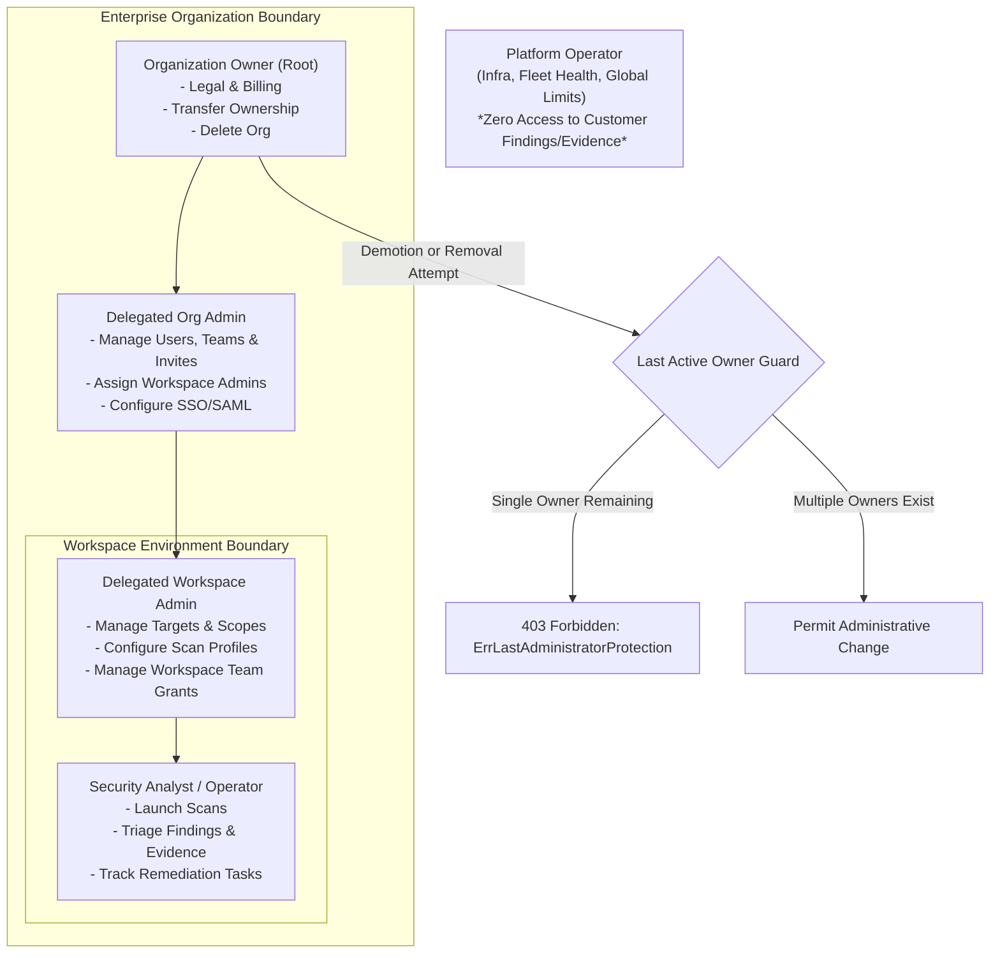

# Delegated Organization and Workspace Administration

**Milestone:** P4-08 (Issue #206)  
**Workstream:** Workstream A — Organization & Team Administration  
**Status:** Approved / Implemented  

---

## 1. Overview & Purpose

Enterprise security management demands clear delegation of operational authority without granting blanket, unrestricted platform-level privileges or opening paths for privilege escalation.

This specification establishes the **Delegated Administration Framework** for the Kelvin Security Platform, detailing role boundaries, last-administrator protection, privilege escalation guards, ownership transfer mechanics, and auditability.

---

## 2. Administrative Role Hierarchy & Boundaries

---

## 3. Administrative Responsibilities Matrix

| Role | Scope | Permitted Administrative Operations | Restricted Operations |
| :--- | :--- | :--- | :--- |
| **Platform Operator** | Global Infrastructure | Platform telemetry, quota enforcement, fleet health, hard limits. | **Strictly prohibited** from reading customer findings, evidence, or workspace data. |
| **Organization Owner** | Organization | Full governance: delete organization, transfer root ownership, appoint/demote Org Admins, billing. | Cannot remove themselves if they are the last active Owner. |
| **Delegated Org Admin** | Organization | Invite members, manage teams, assign workspace admins, configure SSO and org-level retention. | **Cannot** promote themselves or others to Owner; cannot delete or demote an Owner. |
| **Delegated Workspace Admin** | Scoped Workspace | Configure target assets, customize scan profiles, assign team access grants, view audits. | **Cannot** access unassigned workspaces; cannot modify organization-level settings. |
| **Security Analyst** | Scoped Workspace | Execute assessments, review findings, record triage decisions, manage remediation tasks. | Cannot alter target scope boundaries or delete workspaces. |

---

## 4. Key Security Guards & Invariants

### 1. Last-Administrator Protection
- Every enterprise organization must retain at least one active user with `OrgRoleOwner`.
- If an administrator attempts to remove or demote the sole active Owner, `HierarchyService` immediately rejects the request with `ErrLastAdministratorProtection`.
- Deletion or demotion is only permitted when another active Owner has already been designated.

### 2. Privilege Escalation Defense
- A Delegated Admin (`OrgRoleAdmin`) cannot promote any user to `OrgRoleOwner`.
- A Delegated Admin cannot demote or remove an existing `OrgRoleOwner`.
- Attempted escalation operations return `ErrPrivilegeEscalationForbidden`.

### 3. Ownership Transfer Protocol
- Ownership transfer is an atomic operation initiated exclusively by an authenticated active Owner (`TransferOrganizationOwnership`).
- The target user is promoted to `OrgRoleOwner`, and the former owner is safely transitioned to `OrgRoleAdmin`.

---

## 5. Audit Logging Invariants

All administrative delegations and role changes emit structured immutable audit log entries:

- `org.ownership_transferred`: Emitted on ownership transfer with previous and new owner IDs.
- `org.member_role_updated`: Emitted on member role changes with previous and new roles.
- `org.member_removed`: Emitted when an organization member is removed.
- `workspace.admin_assigned`: Emitted when workspace admin delegation is granted.
- `workspace.admin_revoked`: Emitted when workspace admin delegation is revoked.

---

## 6. Verification & Validation

The last-administrator protection guard, privilege escalation defense, ownership transfer, and workspace admin delegation are verified by unit tests in `apps/api/internal/hierarchy/delegation_test.go`.
