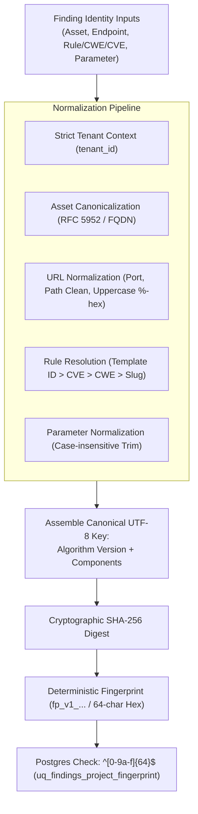

# Deterministic Finding Fingerprinting Architecture

## 1. Overview & Purpose

This document details the deterministic finding fingerprinting subsystem implemented for Kelvin as part of **P3-03** (Issue #155). 

A critical vulnerability management invariant is ensuring that repeated assessments identify recurrent findings stably over time without causing duplicate alerts, while strictly preventing false-positive merges across distinct endpoints, parameters, or tenant boundaries.

---

## 2. Cryptographic Digest & Canonical Formats

### 2.1 Algorithm v1 (Baseline Schema Standard)

Algorithm v1 follows `FINDING_SCHEMA.md §5.5` and canonical vectors (`packages/schemas/fixtures/fingerprint-vectors.json`):

$$\text{canonical} = \texttt{"v1\textbackslash n"} \parallel \text{asset} \parallel \texttt{"\textbackslash n"} \parallel \text{endpoint} \parallel \texttt{"\textbackslash n"} \parallel \text{vuln\_key}$$

$$\text{fingerprint} = \text{hex}(\text{sha256}(\text{canonical}))$$

### 2.2 Algorithm v2 (Parameter-Aware Extension)

Algorithm v2 extends canonicalization to incorporate parameter and component identifiers (e.g. form field, URL parameter, HTTP header name):

$$\text{canonical} = \texttt{"v2\textbackslash n"} \parallel \text{asset} \parallel \texttt{"\textbackslash n"} \parallel \text{endpoint} \parallel \texttt{"\textbackslash n"} \parallel \text{vuln\_key} \parallel \texttt{"\textbackslash n"} \parallel \text{parameter}$$

$$\text{fingerprint} = \text{hex}(\text{sha256}(\text{canonical}))$$

Tagged string format: `fp_<version>_<digest>` (e.g., `fp_v1_d3b07384d113...`).

---

## 3. Normalization Rules

1. **Asset Normalization**:
   - IPv6 addresses are canonicalized according to RFC 5952.
   - Hostnames are lowercased and trailing dots are removed.
2. **Endpoint Normalization**:
   - Schemes are lowercased (`http`, `https`).
   - Default ports (`80` for HTTP, `443` for HTTPS) are stripped; non-standard ports are preserved.
   - URL path traversal segments (`.` and `..`) are cleaned via `path.Clean`.
   - Percent-encoded hex sequences are uppercased (`%2f` $\to$ `%2F`).
   - Query strings and fragments are stripped from canonical endpoints to eliminate transient session tokens and timestamps.
3. **Parameter Normalization**:
   - Whitespace is stripped and strings are lowercased.
4. **Vulnerability Key Derivation**:
   - Precedence: (1) `template_id` $\to$ (2) Lowest uppercase `cve_id` $\to$ (3) Uppercase `cwe_id` $\to$ (4) Slugified Title.

---

## 4. Ambiguity Detection & Collision Handling

When an incoming observation shares the same asset and vulnerability rule as an existing finding, but points to a differing endpoint or component, automatic merging is prohibited. 

`IsAmbiguousIdentity` flags such occurrences, causing `IdentityResolver` to provision a distinct `PersistentFinding` marked with `IsAmbiguous: true`, preserving separation for analyst review rather than risking destructive false consolidation.

---

## 5. Security & Architectural Invariants

- **ADR-0002 Multi-Tenant Boundary**: Fingerprints are scoped strictly within `(tenant_id, project_id)`. Fingerprints are never merged across tenant boundaries.
- **Volatile Field Exclusion**: Execution timestamps, diagnostic logs, transient session tokens, request headers, and response payloads are excluded from fingerprint computation.
- **Immutability of Historical Evidence**: Observations are append-only. Re-detection increments recurrence counters and records transition events without overwriting historical triage.

