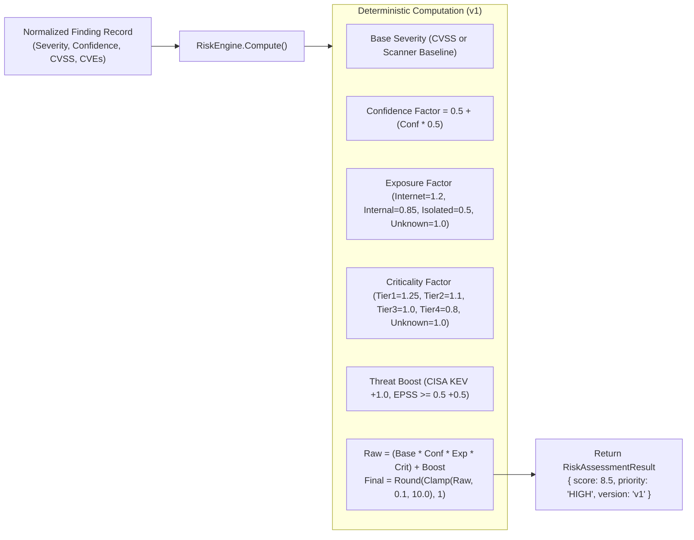

# Deterministic Risk Scoring Engine Architecture

## Overview
The Kelvin **Deterministic Risk Scoring Engine** (`RiskEngine v1`) provides an isolated, domain-level computation service that calculates consistent and mathematically explainable risk scores for normalized security findings.

The engine operates exclusively on normalized finding records (`PersistentFinding`) rather than vendor-specific scanner outputs. Given identical finding attributes and target contextual factors, the engine guarantees identical floating-point scores, priority bands, and explainability narratives across arbitrary runs and node instances.

## Core Invariants

1. **Strict Determinism:**
   - Any evaluation of a finding with the same inputs and engine version (`v1`) produces byte-identical and float-identical outputs.
   - Verified by cryptographic hashing across 1,000 continuous computation iterations.

2. **Decoupled from Scanner Parsing:**
   - The engine does not parse or interpret raw scanner formats (e.g. Nuclei, ZAP, Trivy). It operates purely on canonical normalized types.

3. **Graceful Defaults for Missing Context:**
   - If target exposure or asset criticality is not specified or unavailable, the engine defaults to a neutral coefficient (`1.0x`), preventing arbitrary deflation or inflation of risk.

4. **1-Decimal Precision Grounding:**
   - Floating point outputs are clamped to `[0.0, 10.0]` and rounded to exactly 1 decimal place (`math.Round(score * 10) / 10`) to reflect realistic confidence rather than unsupported pseudo-precision.

5. **Integrated Ingestion Lifecycle:**
   - Whenever a persistent finding is resolved or created during scanner observation ingestion, `RiskEngine.Compute()` calculates its risk score, priority band, and input factors, automatically persisting them in `findings`.
