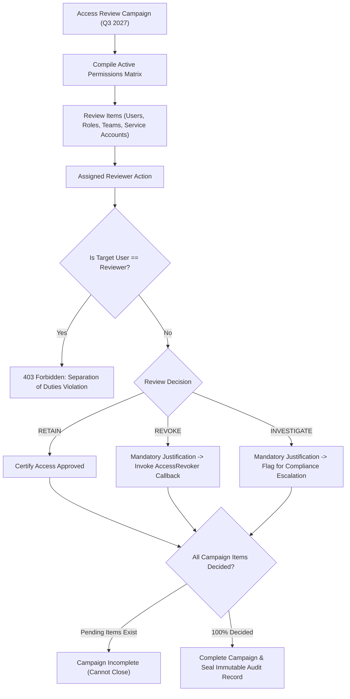

# Enterprise Access Review and Certification Architecture (P4-18)

## Executive Summary

Enterprise compliance frameworks (SOC 2 Type II CC6.1, ISO 27001 A.9.2.5, SOX ITGC, and HIPAA) mandate periodic user access certification to detect and remediate privilege creep, orphaned accounts, and excessive entitlements.

Issue **P4-18** implements an enterprise Access Certification and Governance engine supporting scheduled (quarterly, annual) or ad-hoc campaigns across organization memberships, workspace roles, team assignments, and custom roles. It enforces separation of duties (prohibiting self-certification), requires justification for sensitive revocations, triggers automated de-provisioning workflows, and seals completed audit artifacts.

---

## 1. Access Certification Workflow



---

## 2. Security Invariants & Defenses

### 2.1 Separation of Duties (Anti-Self-Certification Guard)
- A critical compliance flaw in enterprise certification systems is administrators approving their own privileged access.
- **Invariant**: `SubmitDecision` explicitly checks `item.TargetUserID == actorUserID`. If matched, the request terminates immediately with `ErrSelfReviewProhibited`. Another authorized reviewer must certify that entitlement.

### 2.2 Mandatory Justification for Revocation and Investigation
- Any decision altering access status (`REVOKE` or `INVESTIGATE`) requires explicit non-empty `decision_justification` to satisfy auditor scrutiny (`ErrJustificationRequired`).

### 2.3 Automated Revocation Workflow
- When a reviewer decides `REVOKE`, the system immediately triggers the registered `AccessRevoker` callback, executing the corresponding role or team detachment and setting `ActionTaken = true`.
- Emits structured audit events (`access_review.access_revoked`).

### 2.4 Campaign Incompleteness Defense
- An administrator cannot prematurely seal or close an access review campaign until 100% of review items have received a final human decision (`ErrCampaignIncomplete`).

---

## 3. Database Schema

Access review campaigns and items are recorded in `access_review_campaigns` and `access_review_items`:

```sql
CREATE TABLE IF NOT EXISTS access_review_campaigns (
  id                 UUID PRIMARY KEY DEFAULT gen_random_uuid(),
  organization_id    UUID NOT NULL REFERENCES organizations(id) ON DELETE CASCADE,
  name               VARCHAR(255) NOT NULL,
  description        TEXT NOT NULL DEFAULT '',
  cadence            VARCHAR(50) NOT NULL DEFAULT 'QUARTERLY', -- QUARTERLY, ANNUAL, AD_HOC
  scope              VARCHAR(50) NOT NULL DEFAULT 'ORGANIZATION', -- ORGANIZATION, WORKSPACE, PRIVILEGED_ONLY
  status             VARCHAR(50) NOT NULL DEFAULT 'ACTIVE', -- ACTIVE, COMPLETED, CANCELLED
  created_by_user_id VARCHAR(255) NOT NULL,
  due_date           TIMESTAMPTZ NOT NULL,
  completed_at       TIMESTAMPTZ,
  created_at         TIMESTAMPTZ NOT NULL DEFAULT clock_timestamp(),
  updated_at         TIMESTAMPTZ NOT NULL DEFAULT clock_timestamp()
);

CREATE TABLE IF NOT EXISTS access_review_items (
  id                     UUID PRIMARY KEY DEFAULT gen_random_uuid(),
  campaign_id            UUID NOT NULL REFERENCES access_review_campaigns(id) ON DELETE CASCADE,
  organization_id        UUID NOT NULL REFERENCES organizations(id) ON DELETE CASCADE,
  target_user_id         VARCHAR(255) NOT NULL,
  target_user_email      VARCHAR(255) NOT NULL DEFAULT '',
  resource_type          VARCHAR(50) NOT NULL, -- ORG_ROLE, WORKSPACE_ROLE, TEAM_MEMBERSHIP, CUSTOM_ROLE, SERVICE_ACCOUNT
  resource_id            VARCHAR(255) NOT NULL,
  assigned_role          VARCHAR(100) NOT NULL,
  is_privileged          BOOLEAN NOT NULL DEFAULT false,
  decision               VARCHAR(50) NOT NULL DEFAULT 'PENDING', -- PENDING, RETAIN, REVOKE, INVESTIGATE
  decision_justification TEXT NOT NULL DEFAULT '',
  reviewed_by_user_id    VARCHAR(255),
  reviewed_at            TIMESTAMPTZ,
  action_taken           BOOLEAN NOT NULL DEFAULT false,
  created_at             TIMESTAMPTZ NOT NULL DEFAULT clock_timestamp(),
  updated_at             TIMESTAMPTZ NOT NULL DEFAULT clock_timestamp()
);

CREATE INDEX IF NOT EXISTS idx_access_review_items_campaign
  ON access_review_items (campaign_id, decision);
```

---

## 4. Acceptance Criteria & Test Verification

| Acceptance Criterion | Verification Method | Status |
| :--- | :--- | :--- |
| Campaign initialization & entitlement enumeration | `TestAccessReviewService_CampaignLifecycle` | Verified |
| Separation of duties: self-review rejection | `TestAccessReviewService_CampaignLifecycle/self-review_guard_blocks_reviewer_certifying_own_access` | Verified |
| Mandatory justification on revocation/investigation | `TestAccessReviewService_CampaignLifecycle/mandatory_justification_on_REVOKE_decision` | Verified |
| Automated revocation execution via callback | Verified `AccessRevoker` invocation and `ActionTaken = true` | Verified |
| Incomplete campaign closure defense | `TestAccessReviewService_CampaignLifecycle/complete_campaign_fails_when_items_remain_pending` | Verified |
