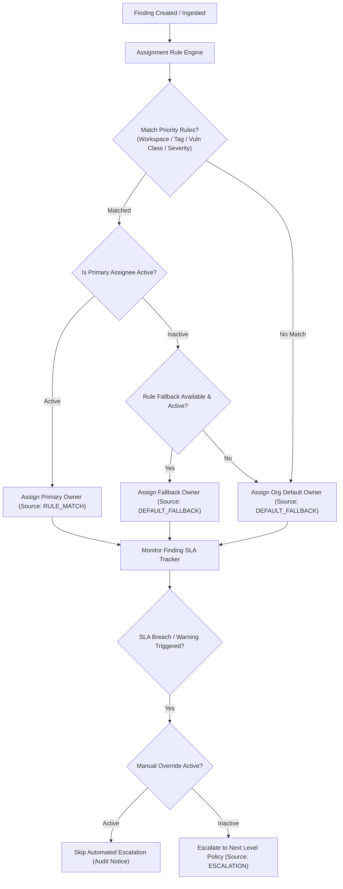
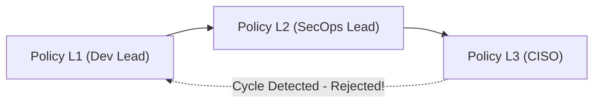

# Enterprise Assignment and Escalation Rules Architecture

## 1. Overview
The Enterprise Assignment and Escalation Rules subsystem extends Kelvin's remediation capabilities by providing multi-tenant, policy-driven owner assignment, fallback hierarchies, and automated escalation chains triggered by SLA breach conditions.

## 2. Assignment and Escalation Architecture

## 3. Anti-Circular Escalation & Cycle Defense

## 4. Key Architectural Guarantees
1. **Deterministic Rule Priority**: Rules are evaluated in strict priority order (lower priority integer evaluated first); the first rule whose workspace, target tag, vulnerability class, and severity criteria match is selected.
2. **Strict Identity & Tenant Isolation**: Assignments and escalations validate assignee activity and organization tenancy via `EntityValidator`. Inactive or cross-tenant entities are strictly rejected.
3. **Graceful Fallback Hierarchy**: If a matched rule's primary assignee is inactive, the engine falls back to the rule-level designated fallback, and subsequently to the organization default owner.
4. **Anti-Circular Escalation Defense**: Escalation chains are verified via graph cycle detection during policy configuration and execution, capped at a maximum depth ceiling (`MaxEscalationDepth = 5`).
5. **Auditable Manual Override**: Authorized operators can manually reassign findings with mandatory justification, placing a lock on automated escalation policies to prevent conflicting automated reassignments.
