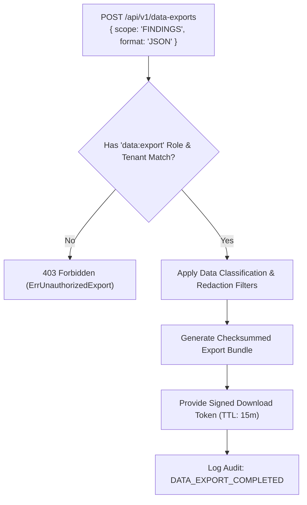

# Enterprise Data Governance & Export Controls Architecture

## 1. Overview
The Enterprise Data Governance & Export Controls system establishes normative boundaries, role authorizations, and ephemeral delivery protocols for exporting platform records (Findings, Reports, Remediations, Audit Logs) without bypassing tenant isolation or privacy safeguards.

## 2. Architecture & Export Workflow

## 3. Data Classification & RBAC Clearance Matrix

| Classification Level | Associated Scopes | Minimum Role / Permissions Required | Description |
|---|---|---|---|
| **Public** | Public advisories, docs | Any authenticated user | Non-confidential platform metadata |
| **Internal** | `REMEDIATIONS`, scan profiles | `DEVELOPER`, `SECURITY_OFFICER`, `ORG_OWNER` | Operational engineering data |
| **Confidential** | `FINDINGS`, `REPORTS` | `SECURITY_OFFICER`, `COMPLIANCE_AUDITOR`, `ORG_OWNER` | Vulnerabilities and posture assessments |
| **Restricted** | `AUDIT_LOGS`, credentials | `ORG_OWNER` or `data:export:restricted` | Highest sensitivity forensic trails |

## 4. Key Security Invariants

### Normative Redaction Prior to Export
All export payloads are piped through KELVIN's normative redaction pipeline (R1-R10) and sensitive token filters, guaranteeing that accidentally exposed credentials, bearer tokens, or API keys are replaced with `[REDACTED]`.

### Ephemeral Cryptographic Download Tokens
Export bundles are not stored permanently. Ephemeral 256-bit download tokens grant access with a strict 15-minute Time-To-Live (TTL). Once expired, tokens become invalid immediately.

### SHA-256 Integrity Checksums
Every generated bundle includes a cryptographic SHA-256 checksum so consumers can verify that the downloaded payload was not tampered with in transit.
