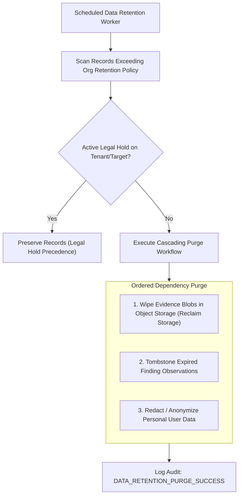

# Enterprise Data Retention and Deletion Controls Architecture

## 1. Overview
The Enterprise Data Retention & Deletion subsystem automates the data lifecycle across KELVIN (Evidence, Assessments, Findings, Reports, Audit Logs) while enforcing platform minimum safety bounds and respecting statutory Legal Holds.

## 2. Architecture & Purge Workflow

## 3. Platform Boundaries vs. Organization Customization

To ensure regulatory compliance and prevent catastrophic accidental deletion, organization policies operate within immutable platform boundaries:

| Data Category | Platform Min | Platform Max | Platform Default | Invariant Rationale |
|---|---|---|---|---|
| **Evidence Blobs** | 30 days | 365 days | 90 days | Protects active remediation verification |
| **Assessments** | 90 days | 730 days | 365 days | Historical assessment trend analysis |
| **Findings** | 180 days | 1825 days | 730 days | SLA, regression, and recurring detection |
| **Reports** | 90 days | 1095 days | 365 days | Attestation artifacts for external audits |
| **Audit Logs** | 365 days | 3650 days | 365 days | ADR-0002 mandatory immutable compliance |

## 4. Legal Hold Precedence
When an enterprise enters regulatory investigation or litigation, administrators can declare an active `LegalHold` at the Tenant, Project, or Assessment level. The scheduled retention daemon strictly checks legal holds prior to any deletion or tombstoning, preserving matching records indefinitely until the hold is formally released.
