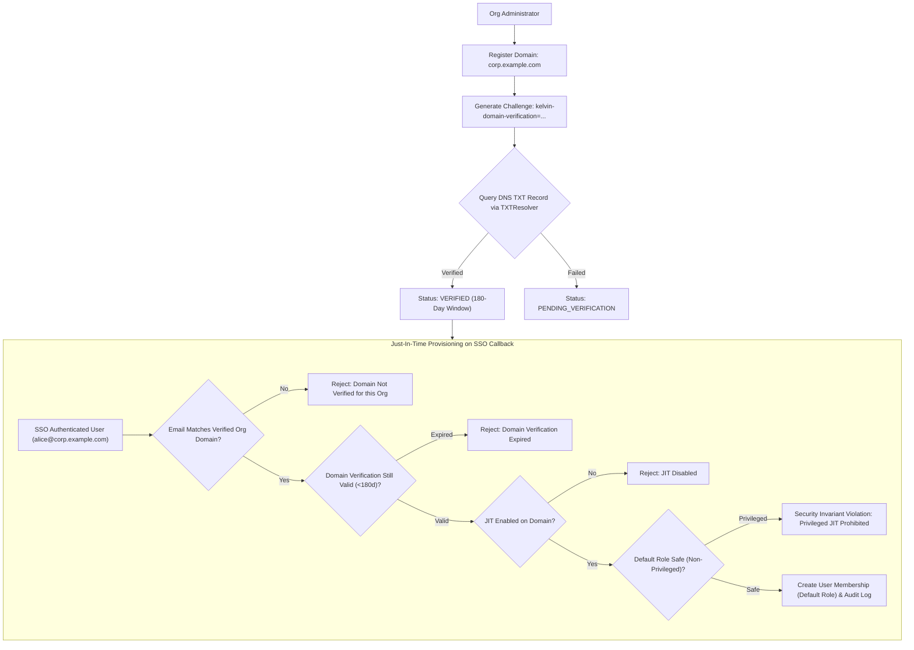

# Enterprise Domain Verification and JIT Provisioning Architecture (P4-15)

## Executive Summary

Enterprise customers deploying OpenID Connect or SAML 2.0 single sign-on require automated user lifecycle onboarding.

Issue **P4-15** implements cryptographic email domain ownership verification (via DNS TXT challenge) and safe Just-In-Time (JIT) user provisioning. It strictly enforces the principle of least privilege, preventing unverified domains from claiming users and prohibiting JIT flows from assigning privileged administrative roles.

---

## 1. Domain Ownership Verification & JIT Workflow



---

## 2. Security Invariants & Defenses

### 2.1 Cryptographic DNS TXT Challenge
- To prove administrative ownership of an email domain, the organization administrator must publish a high-entropy TXT record:
  ```text
  kelvin-domain-verification=<64-character-hex-token>
  ```
- The system queries DNS records via `TXTResolver` to confirm presence before transitioning status to `VERIFIED`.

### 2.2 Collision & Hijacking Defense
- **Single Verified Tenant**: A domain verified by Organization A cannot be claimed or verified by Organization B (`ErrDomainAlreadyClaimed`).
- Partial or unverified domain registrations cannot enable automated JIT provisioning.

### 2.3 Periodic Revalidation Expiry
- Verified domains are subject to a **180-day validity window**.
- If DNS ownership changes or the organization abandons the domain, verification expires automatically (`ErrJITDomainNotVerified`).

### 2.4 Least Privilege JIT Provisioning Guard
- **Security Rule**: JIT provisioning must never assign privileged root or organizational roles (`RoleOrgOwner`, `RoleOrgAdmin`, `RoleSecurityAdmin`).
- Registering a domain with a privileged default role is blocked at API level (`ErrPrivilegedJITForbidden`).
- Permitted JIT default roles are restricted to `RoleReadOnlyViewer` or `RoleSecurityAnalyst`.

---

## 3. Database Schema

Domain configurations are managed in `organization_domains`:

```sql
CREATE TABLE IF NOT EXISTS organization_domains (
  id                 UUID PRIMARY KEY DEFAULT gen_random_uuid(),
  organization_id    UUID NOT NULL REFERENCES organizations(id) ON DELETE CASCADE,
  domain             VARCHAR(255) NOT NULL,
  verification_token VARCHAR(128) NOT NULL,
  status             VARCHAR(50) NOT NULL DEFAULT 'PENDING_VERIFICATION', -- PENDING_VERIFICATION, VERIFIED, EXPIRED, REVOKED
  jit_enabled        BOOLEAN NOT NULL DEFAULT true,
  default_role       VARCHAR(50) NOT NULL DEFAULT 'READ_ONLY_VIEWER',
  verified_at        TIMESTAMPTZ,
  expires_at         TIMESTAMPTZ,
  created_at         TIMESTAMPTZ NOT NULL DEFAULT clock_timestamp(),
  updated_at         TIMESTAMPTZ NOT NULL DEFAULT clock_timestamp(),
  CONSTRAINT uq_org_domain UNIQUE (organization_id, domain)
);

CREATE UNIQUE INDEX IF NOT EXISTS uq_active_verified_domain
  ON organization_domains (domain)
  WHERE status = 'VERIFIED';

CREATE INDEX IF NOT EXISTS idx_org_domains_lookup
  ON organization_domains (organization_id, status);
```

---

## 4. Acceptance Criteria & Test Verification

| Acceptance Criterion | Verification Method | Status |
| :--- | :--- | :--- |
| DNS TXT domain verification | `TestDomainService_RegisterAndVerify/verify_domain_success_via_DNS_TXT_record` | Verified |
| Domain collision & hijacking protection | `TestDomainService_RegisterAndVerify/cannot_register_domain_already_verified_by_another_org` | Verified |
| JIT provisioning with safe default roles | `TestDomainService_JITProvisioning/successful_JIT_user_provisioning` | Verified |
| Privileged JIT role defense | `TestDomainService_RegisterAndVerify/reject_privileged_administrative_role_as_JIT_default` | Verified |
| Unverified and expired domain rejections | `TestDomainService_JITProvisioning/JIT_provisioning_fails_if_domain_verification_has_expired` | Verified |
