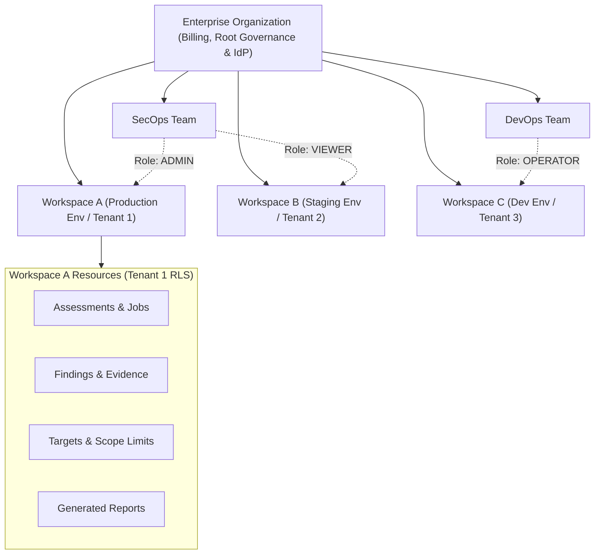

# Enterprise Organization and Workspace Hierarchy

**Milestone:** P4-01 (Issue #199)  
**Workstream:** Workstream A — Organization & Team Administration  
**Status:** Approved / Implemented  

---

## 1. Overview & Purpose

Phase 1 established single-tenant cryptographic and data isolation using PostgreSQL Row-Level Security (`app.current_tenant_id`). Phase 4 extends the Kelvin Security Platform to support **Enterprise Organizations** containing multiple operational **Workspaces**, structured **Teams**, and multi-environment postures (Production, Staging, Development) without compromising or bypassing the strict tenant isolation guarantees of ADR-0002.

---

## 2. Domain Hierarchy & Concepts

### Entity Definitions

1. **Organization (`organizations`)**:
   - The root legal, billing, and enterprise governance entity.
   - Holds organization-wide SSO/SAML identity provider connections, enterprise compliance policies, billing accounts, and cross-workspace audit export configurations.
   - Does **not** directly execute security assessments or store raw finding evidence.

2. **Workspace (`workspaces`)**:
   - The operational security environment container (e.g., "Production Core", "Staging US-East").
   - **Maps 1:1 to an underlying Tenant (`tenant_id`)**.
   - Preserves PostgreSQL Row-Level Security (RLS) as the foundational cryptographic and data boundary.

3. **Team (`teams`)**:
   - Logical group of users within an organization (e.g. "Security Engineering", "Platform SecOps").
   - Can be assigned operational roles on one or more workspaces.

4. **User & Memberships**:
   - `organization_memberships`: User's global role (`OWNER`, `ADMIN`, `MEMBER`, `BILLING`).
   - `workspace_memberships`: User's direct scoped role (`ADMIN`, `OPERATOR`, `VIEWER`).
   - `team_memberships`: Mapping users to teams (`LEAD`, `MEMBER`).
   - `workspace_team_grants`: Mapping teams to workspace roles (`ADMIN`, `OPERATOR`, `VIEWER`).

---

## 3. Resource Ownership Matrix

| Resource Type | Scope | Isolation Mechanism | Description |
| :--- | :--- | :--- | :--- |
| **SSO / SAML IdP** | Organization | Org Membership check | Enterprise login and directory sync |
| **Enterprise Policy** | Organization | Org Membership check | Baseline security rules and compliance |
| **Billing & Quotas** | Organization | Org Membership check | Subscription tiers and global job quotas |
| **Audit Log Exports** | Organization | Org Admin authorization | SIEM/S3 immutable audit stream configuration |
| **Assessment Jobs** | Workspace | **Tenant RLS** | Active scanner jobs and worker executions |
| **Targets & Scopes** | Workspace | **Tenant RLS** | Target assets, inclusion/exclusion rules |
| **Findings** | Workspace | **Tenant RLS** | Vulnerability records and triage states |
| **Evidence** | Workspace | **Tenant RLS** | Sanitized evidence and raw payloads (ADR-0005) |
| **Reports** | Workspace | **Tenant RLS** | HTML/PDF artifacts and audit seals |
| **API Tokens** | Workspace | **Tenant RLS** | Machine service keys scoped to a workspace |

---

## 4. Security & Architectural Invariants

- **Zero Implicit Cross-Workspace Access**: Being an Organization Owner or Admin does **not** grant automatic, unlogged read/write access to workspace findings or raw evidence. Access requires an explicit `workspace_memberships` record or an audited temporary session elevation.
- **Tenant Context Verification**: If a request carries a tenant context, it must match the workspace's underlying `tenant_id`. Any mismatch immediately triggers `ErrTenantMismatch` and aborts.
- **Principle of Least Privilege**: Workspace roles follow strict hierarchy (`ADMIN` > `OPERATOR` > `VIEWER`). Actions demand the minimum necessary role.
- **Audit Logging**: All workspace creations, membership assignments, and role mutations generate structured audit events.

---

## 5. Migration & Backward Compatibility Strategy

Migration `000024_enterprise_hierarchy.up.sql` preserves 100% backward compatibility for all Phase 1..3 single-tenant deployments:
1. Every existing `tenant` record is backfilled with a corresponding `organization` (`<slug>-org`).
2. A default `workspace` (`<slug>-default`) is created for each tenant linking `tenant_id` to `workspaces.tenant_id`.
3. All foreign key constraints referencing `tenants(id)` remain active and intact.
