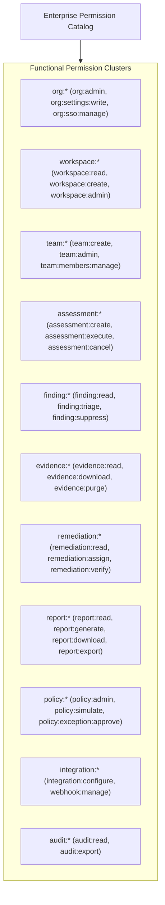

# Enterprise Permission Catalog

**Milestone:** P4-09 (Issue #207)  
**Workstream:** Workstream B — Enterprise Identity & Access Control  
**Status:** Approved / Implemented  

---

## 1. Overview & Purpose

Enterprise RBAC and ABAC policy enforcement require a formal, granular, and versioned permission catalog. This specification establishes the **Enterprise Permission Catalog** for the Kelvin Security Platform, defining standardized permission naming conventions, complete resource-action clusters, scope levels (Organization vs. Workspace), and privileged action designations.

---

## 2. Permission Architecture & Naming Conventions

### Naming Syntax Rules

1. Format: `^[a-z][a-z0-9_-]+(:[a-z][a-z0-9_-]+)+$` (e.g. `finding:triage`, `policy:exception:approve`).
2. **Resource Prefix**: Identifies the security platform domain entity (`org`, `workspace`, `assessment`, `finding`, `evidence`, etc.).
3. **Action Suffix**: Identifies the operation (`read`, `create`, `update`, `delete`, `execute`, `admin`, `purge`, `verify`).
4. **Scope Level**:
   - `ORGANIZATION`: Governs root entities, enterprise policies, SSO, and memberships.
   - `WORKSPACE`: Governs operational scanner execution, findings, evidence, and reports.

---

## 3. Comprehensive Permission Registry

| Permission Code | Scope | Privileged? | Description |
| :--- | :--- | :---: | :--- |
| `org:read` | ORGANIZATION | No | View organization profile and metadata. |
| `org:admin` | ORGANIZATION | **YES** | Full administrative governance of organization. |
| `org:settings:write` | ORGANIZATION | **YES** | Configure organization-level preferences and policies. |
| `org:members:manage` | ORGANIZATION | **YES** | Invite, update roles, or remove organization members. |
| `org:billing:manage` | ORGANIZATION | **YES** | Manage subscription plans and billing accounts. |
| `org:sso:manage` | ORGANIZATION | **YES** | Configure SAML/OIDC enterprise identity providers. |
| `workspace:read` | WORKSPACE | No | View workspace overview and health. |
| `workspace:create` | ORGANIZATION | **YES** | Provision new operational workspaces. |
| `workspace:admin` | WORKSPACE | **YES** | Administer workspace settings and team access. |
| `workspace:settings:write`| WORKSPACE | No | Modify workspace configuration overrides. |
| `team:read` | ORGANIZATION | No | View team profiles and member rosters. |
| `team:create` | ORGANIZATION | No | Create new collaborative teams. |
| `team:admin` | ORGANIZATION | **YES** | Administer team profile and archival. |
| `team:members:manage` | ORGANIZATION | No | Add or remove members from team. |
| `target:read` | WORKSPACE | No | View target assets and scope limits. |
| `target:create` | WORKSPACE | No | Add target assets to workspace scope. |
| `target:update` | WORKSPACE | No | Update target asset configuration and tags. |
| `target:delete` | WORKSPACE | **YES** | Remove target assets from workspace. |
| `assessment:read` | WORKSPACE | No | View assessment runs, logs, and status. |
| `assessment:create` | WORKSPACE | No | Define and schedule new assessments. |
| `assessment:execute` | WORKSPACE | No | Trigger active security scanner execution. |
| `assessment:cancel` | WORKSPACE | No | Abort or cancel running assessment jobs. |
| `assessment:delete` | WORKSPACE | **YES** | Delete historic assessment records. |
| `finding:read` | WORKSPACE | No | Inspect vulnerability findings and timelines. |
| `finding:triage` | WORKSPACE | No | Change triage state (Confirm, Resolve, In Progress). |
| `finding:suppress` | WORKSPACE | **YES** | Mark finding as False Positive or Accepted Risk. |
| `finding:export` | WORKSPACE | No | Bulk export finding data to external formats. |
| `evidence:read` | WORKSPACE | No | View sanitized presentation-safe evidence (ADR-0005). |
| `evidence:download` | WORKSPACE | **YES** | Download raw cryptographic evidence artifacts. |
| `evidence:purge` | WORKSPACE | **YES** | Permanently shred and purge evidence records. |
| `evidence:hold:manage` | WORKSPACE | **YES** | Apply or remove legal retention holds on evidence. |
| `remediation:read` | WORKSPACE | No | View remediation tasks and SLA status. |
| `remediation:assign` | WORKSPACE | No | Assign remediation tasks and due dates. |
| `remediation:update` | WORKSPACE | No | Update task progress and add notes. |
| `remediation:verify` | WORKSPACE | No | Verify remediation fix via automated scan. |
| `report:read` | WORKSPACE | No | View report metadata and snapshot digests. |
| `report:generate` | WORKSPACE | No | Trigger HTML and PDF report generation. |
| `report:download` | WORKSPACE | No | Download cryptographically signed report files. |
| `report:export` | WORKSPACE | **YES** | Export executive compliance bundles. |
| `policy:read` | ORGANIZATION | No | View enterprise security policies and rules. |
| `policy:admin` | ORGANIZATION | **YES** | Create and edit enterprise security policies. |
| `policy:simulate` | ORGANIZATION | No | Simulate policy evaluation on past scans. |
| `policy:exception:approve`| ORGANIZATION | **YES** | Approve temporary security policy exceptions. |
| `integration:read` | WORKSPACE | No | View configured integration connectors. |
| `integration:configure` | WORKSPACE | **YES** | Configure Jira, GitHub, or SIEM connectors. |
| `webhook:manage` | WORKSPACE | **YES** | Manage outbound webhook endpoints and secret keys. |
| `audit:read` | ORGANIZATION | **YES** | Inspect immutable security audit log entries. |
| `audit:export` | ORGANIZATION | **YES** | Export tamper-evident audit logs to SIEM/S3. |

---

## 4. Privileged Action Protections

Permissions designated as **`IsPrivileged: true`** require:
1. Explicit audit trail recording with actor identity and payload metadata.
2. Direct elevated assignment (cannot be implicitly inherited through default viewer/member roles).
3. Stepped-up authorization verification where required (e.g., legal retention hold removal, evidence purging, policy exception approval).

---

## 5. Verification & Testing

The catalog registration, naming regex validation, duplicate checks, and privileged action assertions are verified by automated tests in `apps/api/internal/iam/permissions_test.go`.
