# Enterprise RBAC Role Model

**Milestone:** P4-10 (Issue #208)  
**Workstream:** Workstream B — Enterprise Identity & Access Control  
**Status:** Approved / Implemented  

---

## 1. Overview & Purpose

The Kelvin Security Platform employs a Role-Based Access Control (RBAC) model mapping enterprise functional personas to the fine-grained permission catalog established in P4-09. This specification defines the built-in enterprise roles, their scope tiers (Organization vs. Workspace), their exact permission mappings, and the deterministic multi-role resolution engine.

---

## 2. Role Model Architecture

```mermaid
flowchart LR
    User["User Identity"] --> Assignments["Role Assignments\n(Scoped to Org or Workspace)"]

    subgraph BuiltInRoles ["Enterprise Built-in Roles"]
        R1["ORG_OWNER\n(Root Legal & Governance)"]
        R2["ORG_ADMIN\n(Users, Teams, SSO, Policies)"]
        R3["SECURITY_ADMIN\n(Cross-Cutting Policy & Audit)"]
        R4["WORKSPACE_ADMIN\n(Full Workspace Administration)"]
        R5["SECURITY_ANALYST\n(Scans, Triage, Remediation)"]
        R6["AUDITOR\n(Read-Only Compliance & Evidence)"]
        R7["READ_ONLY_VIEWER\n(Read-Only Dashboard & Reports)"]
    end

    Assignments --> BuiltInRoles
    BuiltInRoles --> Evaluator["ResolveEffectivePermissions\n(Deterministic Set Union)"]
    Evaluator --> EffectivePerms["Effective Permissions Set"]
```

---

## 3. Built-in Enterprise Roles Specification

| Role Identifier | Scope Level | Target Persona | Granted Core Capabilities |
| :--- | :--- | :--- | :--- |
| **`ORG_OWNER`** | ORGANIZATION | Chief Information Security Officer (CISO) / Legal Owner | Full root governance across organization and all child workspaces, billing, ownership transfer, destructive purge. |
| **`ORG_ADMIN`** | ORGANIZATION | Identity / IT Administrator | Provision workspaces, manage users, teams, invitations, SSO/SAML configuration, enterprise security settings. |
| **`SECURITY_ADMIN`** | ORGANIZATION | Lead Security Architect | Enterprise policy administration, policy exception approval, evidence retention hold management, compliance exports. |
| **`WORKSPACE_ADMIN`** | WORKSPACE | Workspace SecOps Lead | Target asset scope limits, scan profile configuration, team access grants, workspace integrations, scanner execution. |
| **`SECURITY_ANALYST`** | WORKSPACE | Vulnerability Analyst / Security Engineer | Create and launch assessments, triage findings, update remediation tasks, export findings, generate reports. |
| **`AUDITOR`** | WORKSPACE | Compliance Auditor / Risk Assessor | Read-only inspection of findings, evidence artifacts, downloadable compliance reports, and immutable audit logs. |
| **`READ_ONLY_VIEWER`** | WORKSPACE | Developer / Stakeholder | Read-only observation of security posture dashboards, findings, and assessment reports. |

---

## 4. Multi-Role Assignment & Deterministic Resolution

When a user holds multiple roles (e.g. `SECURITY_ANALYST` in Workspace A and `AUDITOR` across the Organization):

1. **Deterministic Set Union**:
   - The effective permission set is computed as the union of all permissions granted across assigned roles:
     $$\text{EffectivePermissions} = \bigcup_{r \in \text{AssignedRoles}} \text{Permissions}(r)$$
2. **Explicit Deny Precedence**:
   - If an active policy rule or administrative freeze explicitly denies an action, the deny override supersedes any affirmative role grants.
3. **Scope Tier Invariance**:
   - Workspace-scoped roles (e.g. `WORKSPACE_ADMIN`) can **never** grant organization-level permissions (e.g. `org:sso:manage`, `org:billing:manage`).
4. **Server-Side Enforcement**:
   - Authorization decisions are executed strictly server-side via `RequirePermission(roles, perm)` before mutations occur.

---

## 5. Verification & Testing

The role definitions, catalog registration validity, multi-role set union resolution, and least-privilege denial assertions are verified by automated tests in `apps/api/internal/iam/rbac_test.go`.
