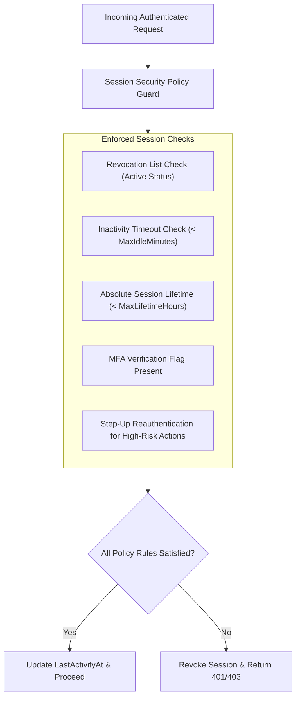

# Enterprise Session and MFA Security Policies Architecture (P4-17)

## Executive Summary

Enterprise compliance frameworks (SOC 2, ISO 27001, FedRAMP, PCI-DSS) require stringent controls over session lifetimes, idle timeouts, multi-factor authentication (MFA) enforcement, concurrent session limits, and step-up reauthentication for sensitive operations.

Issue **P4-17** implements a centralized server-side enterprise session policy subsystem with cryptographic token generation, idle inactivity tracking, absolute lifetime enforcement, FIFO concurrent session eviction, immediate single and bulk revocation, and step-up reauthentication guards.

---

## 1. Session Verification Workflow



---

## 2. Security Invariants & Defenses

### 2.1 Inactivity Timeout & Absolute Lifetime
- **Idle Inactivity**: If the duration between the request timestamp and `last_activity_at` exceeds `max_idle_minutes` (default 15 minutes), the session is marked `EXPIRED` (`ErrSessionIdleTimeout`).
- **Absolute Lifetime**: Sessions cannot live indefinitely regardless of ongoing activity. If current time exceeds `expires_at` (calculated from `max_lifetime_hours`, default 12 hours), the session is terminated (`ErrSessionExpired`).

### 2.2 Platform Security Boundaries (Non-Weakening)
- Organizations can customize their policies, but **cannot weaken security beyond the platform baseline**:
  - `max_idle_minutes` must be between 1 and 120 minutes.
  - `max_lifetime_hours` must be between 1 and 24 hours.
  - `max_concurrent_sessions` must be between 1 and 20.
  - Policy alterations exceeding these boundaries are rejected with `ErrInvalidPolicyLimits`.

### 2.3 Concurrent Session Eviction
- To mitigate credentials sharing or session hijacking, `max_concurrent_sessions` restricts simultaneous active sessions per user.
- When a user exceeds the limit, the system employs **FIFO eviction**, automatically revoking the oldest active session (`revocation_reason = "concurrent_limit_exceeded"`).

### 2.4 Mandatory MFA Enforcement
- If an organization enables `require_mfa = true`, session creation without verified MFA (TOTP, WebAuthn/FIDO2, or IdP-asserted MFA) is blocked with `ErrMFARequired`.

### 2.5 Step-Up Reauthentication
- High-risk operations (e.g., generating API keys, transferring organization ownership, modifying root policies) require re-verifying credentials if the last reauthentication occurred more than `reauth_grace_period_seconds` ago (default 5 minutes).
- Protected handlers invoke `RequireStepUpAuth` before proceeding.

### 2.6 Immediate Single & Bulk Revocation
- Single session logout immediately marks the session `REVOKED`.
- Bulk revocation (`RevokeAllUserSessions`) immediately terminates all active sessions across devices upon password reset, role alteration, or detected security anomalies.

---

## 3. Database Schema

Session configurations and state are managed in `session_policies` and `user_sessions`:

```sql
CREATE TABLE IF NOT EXISTS session_policies (
  id                          UUID PRIMARY KEY DEFAULT gen_random_uuid(),
  organization_id             UUID NOT NULL REFERENCES organizations(id) ON DELETE CASCADE,
  max_idle_minutes            INTEGER NOT NULL DEFAULT 15,
  max_lifetime_hours          INTEGER NOT NULL DEFAULT 12,
  max_concurrent_sessions      INTEGER NOT NULL DEFAULT 5,
  require_mfa                 BOOLEAN NOT NULL DEFAULT true,
  require_step_up_reauth      BOOLEAN NOT NULL DEFAULT true,
  reauth_grace_period_seconds INTEGER NOT NULL DEFAULT 300,
  created_at                  TIMESTAMPTZ NOT NULL DEFAULT clock_timestamp(),
  updated_at                  TIMESTAMPTZ NOT NULL DEFAULT clock_timestamp(),
  CONSTRAINT uq_session_policy_org UNIQUE (organization_id)
);

CREATE TABLE IF NOT EXISTS user_sessions (
  id                 UUID PRIMARY KEY DEFAULT gen_random_uuid(),
  session_id         VARCHAR(64) NOT NULL,
  organization_id    UUID NOT NULL REFERENCES organizations(id) ON DELETE CASCADE,
  user_id            VARCHAR(255) NOT NULL,
  ip_address         VARCHAR(45) NOT NULL DEFAULT '',
  user_agent         TEXT NOT NULL DEFAULT '',
  mfa_verified       BOOLEAN NOT NULL DEFAULT false,
  last_activity_at   TIMESTAMPTZ NOT NULL DEFAULT clock_timestamp(),
  last_reauth_at     TIMESTAMPTZ NOT NULL DEFAULT clock_timestamp(),
  status             VARCHAR(50) NOT NULL DEFAULT 'ACTIVE', -- ACTIVE, REVOKED, EXPIRED
  revocation_reason  VARCHAR(255) NOT NULL DEFAULT '',
  created_at         TIMESTAMPTZ NOT NULL DEFAULT clock_timestamp(),
  expires_at         TIMESTAMPTZ NOT NULL,
  CONSTRAINT uq_user_session_id UNIQUE (session_id)
);

CREATE INDEX IF NOT EXISTS idx_user_sessions_lookup
  ON user_sessions (organization_id, user_id, status);
```

---

## 4. Acceptance Criteria & Test Verification

| Acceptance Criterion | Verification Method | Status |
| :--- | :--- | :--- |
| Server-side session policy & platform boundaries | `TestSessionService_PolicyConfiguration` | Verified |
| Idle timeout and absolute lifetime enforcement | `TestSessionService_LifecycleAndValidation/idle_timeout_expiration` & `absolute_lifetime_expiration` | Verified |
| Immediate session revocation | `TestSessionService_LifecycleAndValidation/immediate_session_revocation` | Verified |
| MFA enforcement on session creation | `TestSessionService_LifecycleAndValidation/reject_session_creation_without_required_MFA` | Verified |
| Concurrent session eviction | `TestSessionService_LifecycleAndValidation/concurrent_session_eviction_of_oldest_session` | Verified |
| Step-up reauthentication for sensitive operations | `TestSessionService_StepUpAuthentication` | Verified |
