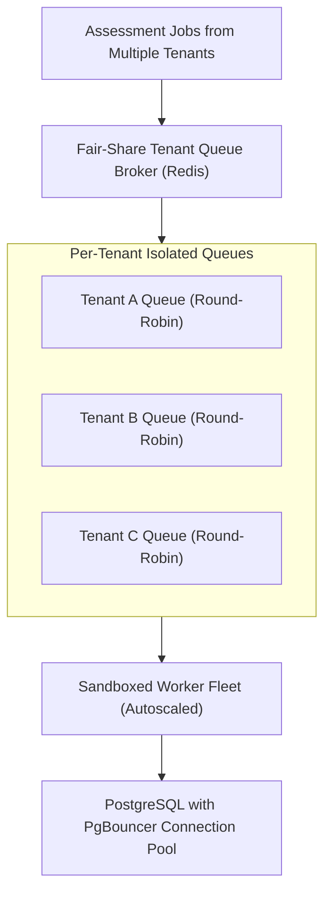

# Enterprise Workload Isolation & Scalability Controls Architecture

## 1. Overview & Bottleneck Assessment
As KELVIN scales to support hundreds of organizations running simultaneous security scans and compliance reports, shared infrastructure components must be defended against "noisy neighbor" starvation, queuing delays, and resource exhaustion.

### Bottleneck Review Across Tiers
1. **Interactive API vs. Background Batch**: Heavy report compilation and vulnerability scanner orchestrations must never block or degrade HTTP API latency for interactive dashboard users.
2. **Asynchronous Task Queue**: Without fairness controls, a single high-volume tenant submitting 1,000 scans can monopolize the entire worker fleet.
3. **Database Connections**: PostgreSQL maximum connection limits can be exhausted during burst loads. PgBouncer transaction-level connection pooling mediates access.
4. **Object Storage Throughput**: MinIO/S3 evidence blobs require chunked multipart uploads and client-side pre-signed URLs to protect backend memory.
5. **Downstream Integration Egress**: External integrations (Jira, Slack, MS Teams) are decoupled with backoff retry queues to prevent external rate limits from stalling workers.

## 2. Architecture & Fair-Share Scheduling Workflow

## 3. Key Scalability Controls

### Fair-Share Round-Robin Interleaving
The workload scheduler routes jobs into strictly isolated per-tenant queues. Worker dispatch alternates across active tenant queues in round-robin sequence:
- No single tenant can starve others, regardless of how many jobs they enqueue.
- Per-tenant concurrency caps (default: 2-5 concurrent workers) ensure remaining worker fleet capacity is always available for other tenants.

### Priority Ordering & Preemption
Within a tenant's queue, jobs are dispatched by priority (Priority 1 = Urgent / Interactive scans vs Priority 8 = Scheduled nightly scans).

### Bounded Queuing & Backpressure
- Per-tenant queue depth is bounded (default: 20 jobs). Exceeding this limit immediately rejects job submission with `ErrTenantQueueSaturated` (HTTP 429).
- Global queue capacity is capped at 500 tasks, signaling system-wide backpressure when worker fleets are fully saturated.

### Database Connection Management (PgBouncer)
All application nodes and workers connect through PgBouncer in transaction pooling mode. This allows thousands of ephemeral worker goroutines to share a small, high-performance PostgreSQL connection pool (e.g. 50-100 connections) without connection thrashing.
