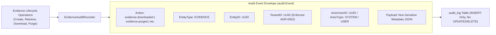

# Evidence Access and Lifecycle Audit Events

**Document ID:** KELVIN-ARCH-0051  
**Status:** Approved  
**Workstream:** Workstream D (Evidence Management & Auditability)  
**Issue Reference:** P3-33 (#186)  

---

## 1. Purpose & Overview

The Evidence Access and Lifecycle Audit Events subsystem ensures complete, immutable traceability for all evidence operations through KELVIN's append-only audit infrastructure (`audit.Recorder`).

Every creation, association, inspection, download, cryptographic verification, archival transition, legal hold update, and secure purge emits an audit event. Audit records capture actor identities, tenant contexts, evidence references, actions, and outcomes, while strictly guaranteeing that sensitive evidence payloads or credentials are never leaked into audit logs.

---

## 2. Audit Event Flow & Schema

---

## 3. Audited Actions Catalog

| Action Identifier | Description | Key Payload Metadata |
|---|---|---|
| `evidence.created` | Evidence ingested into repository | `evidence_type`, `size_bytes`, `checksum_sha256` |
| `evidence.associated` | Evidence linked to finding observation | `finding_id`, `is_primary` |
| `evidence.retrieved` | Evidence detail inspected | `finding_id`, `is_unredacted` |
| `evidence.downloaded` | Ephemeral signed URL issued | `finding_id`, `ttl_seconds` |
| `evidence.integrity_verified` | SHA-256 match validated | `status: VERIFIED`, `calculated_digest` |
| `evidence.tamper_alert` | SHA-256 mismatch detected | `status: TAMPER_DETECTED`, `calculated_digest` |
| `evidence.legal_hold_set` | Legal hold placed | `is_legal_hold: true`, `reason` |
| `evidence.legal_hold_removed` | Legal hold removed | `is_legal_hold: false`, `reason` |
| `evidence.purged` | Cryptographic wipe & purge | `finding_id`, `wiped_at` |
| `evidence.access_denied` | Unauthorized or IDOR attempt | `finding_id`, `reason` |

---

## 4. Security & Privacy Invariants

- **Zero-Payload-Leakage Guarantee:** Audit payloads explicitly exclude raw excerpts, passwords, tokens, session cookies, and authentication headers.
- **ADR-0002 Immutability:** Audit events are written to the append-only `audit_log` table with INSERT-only database permissions.
- **Tenant Scope Enforcement:** All events are bound to the authenticated tenant UUID.
