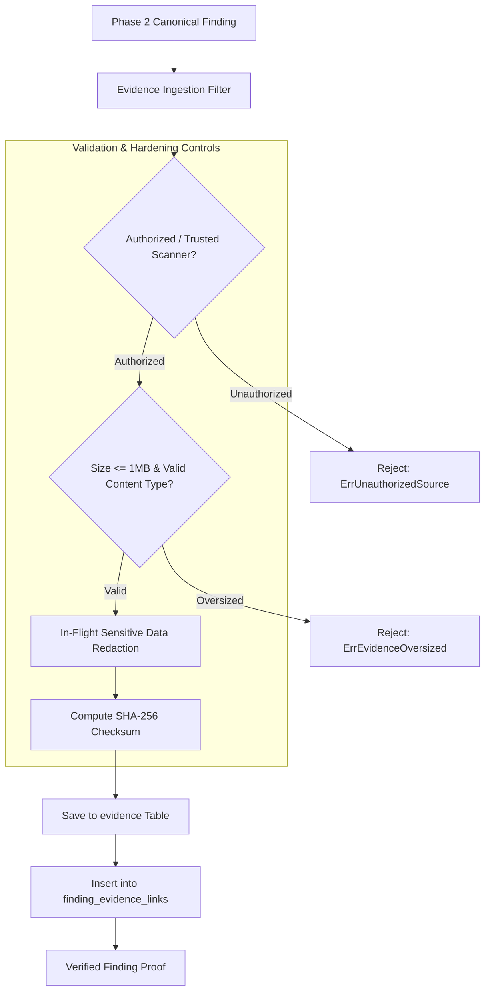

# Evidence Ingestion and Finding Association

**Document ID:** KELVIN-ARCH-0045  
**Status:** Approved  
**Workstream:** Workstream D (Evidence Management & Auditability)  
**Issue Reference:** P3-27 (#180)  

---

## 1. Purpose & Overview

The Evidence Ingestion and Finding Association engine provides a controlled, secure gateway for translating normalized scan outputs (from Phase 2 worker execution) into persistent, audit-grade evidence items linked to persistent findings (`findings`) and individual assessment observations (`finding_observations`).

Untrusted scanner output is never directly persisted or presented as authoritative proof without passing through ingestion validation, size bounds enforcement, cryptographic checksum generation, and in-flight credential redaction.

---

## 2. Ingestion & Association Architecture

---

## 3. Ingestion Controls & Invariants

### 3.1 Size Limits & Storage Partitioning
- **Maximum Payload Cap:** Evidence payloads are restricted to a maximum size of **1 MB** (`MaxEvidenceSizeBytes`). Payloads exceeding this threshold are rejected or quarantined to protect database memory and prevent denial-of-service vectors.
- **Inline vs. Storage Partitioning:** Payloads $\le 64\text{ KB}$ are stored inline in PostgreSQL (`evidence.inline_content`). Payloads $> 64\text{ KB}$ (and up to 1 MB) or external binary artifacts store an object store key reference (`evidence.storage_ref`).

### 3.2 In-Flight Redaction & Sanitization
- Header values associated with authentication (`Authorization`, `Cookie`, `Set-Cookie`, `X-Api-Key`, `Private-Token`) are redacted using `SanitizeHeaders()`.
- Bearer tokens and passwords appearing in HTTP excerpts are masked before recording in database tables or publishing to API endpoints.
- Unsanitized internal evidence is restricted to privileged tenant roles (`UNREDACTED_INTERNAL`), while public/presentation endpoints only consume `SANITIZED_PRESENTATION` records.

### 3.3 Authorization & Provenance
- Only trusted scanner workflows and authenticated orchestration workers may register `CURATED_FINDING` evidence.
- Untrusted external clients or arbitrary API callers cannot inject or forge trusted scanner evidence onto findings.

---

## 4. Relational Association (`finding_evidence_links`)

Evidence is associated with findings via the `finding_evidence_links` relational junction:
- **`tenant_id`**: Foreign tenant identifier protected by PostgreSQL Row-Level Security (`finding_evidence_links_tenant_isolation`).
- **`finding_id`**: References the canonical persistent finding.
- **`evidence_id`**: References the immutable evidence record.
- **`observation_id`**: Optional reference to the specific point-in-time observation where this evidence was captured.
- **`is_primary`**: Boolean flag indicating the principal piece of evidence demonstrating the vulnerability (e.g., initial HTTP excerpt or header diff).

---

## 5. Security & Architectural Invariants

- **ADR-0002 Tenant Isolation:** Enforced via PostgreSQL RLS on both `evidence` and `finding_evidence_links`.
- **Untrusted Content:** Ingested content types are verified to be non-executable (`IsSafeMimeType()`).
- **Cryptographic Traceability:** All evidence entries maintain an immutable 64-character SHA-256 digest verified at intake.
