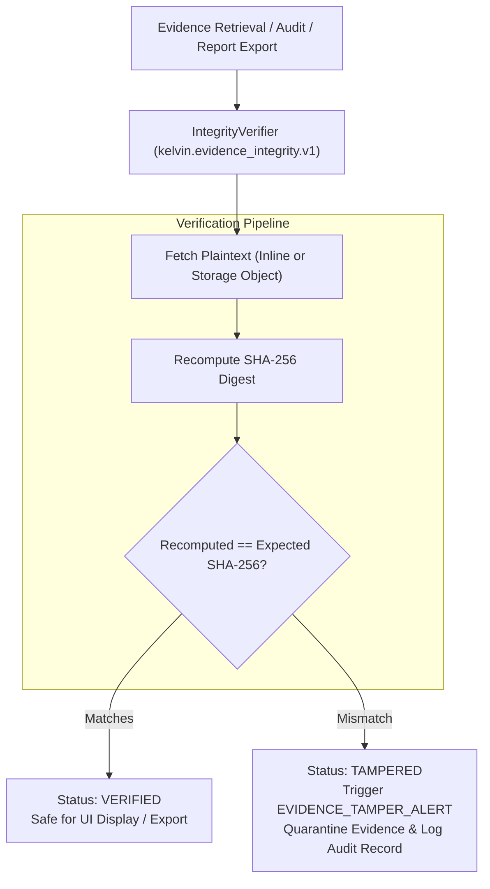

# Evidence Integrity and Provenance Verification

**Document ID:** KELVIN-ARCH-0048  
**Status:** Approved  
**Workstream:** Workstream D (Evidence Management & Auditability)  
**Issue Reference:** P3-30 (#183)  

---

## 1. Purpose & Overview

The Kelvin Evidence Integrity and Provenance Verification engine detects unexpected modifications or corruption in stored evidence items and establishes verifiable provenance linking artifacts to their executing scanner, assessment, and observation contexts.

Whenever evidence is retrieved, audited, or compiled into reports, cryptographic validation guarantees that evidence has remained untampered. Tampered objects trigger immediate `EVIDENCE_TAMPER_ALERT` events and are quarantined.

---

## 2. Integrity Verification Workflow

---

## 3. Cryptographic Specification & Provenance

1. **Algorithm & Version**:
   - `DigestAlgorithmSHA256`: `SHA-256` (64-character lowercase hexadecimal string).
   - `IntegrityVersion`: `kelvin.evidence_integrity.v1`.
2. **Scanner Provenance Tracking (`ScannerProvenance`)**:
   - `ScannerName`: Identifier of tool that captured the proof (`builtin.http_security_headers`, `zap`, `nuclei`).
   - `EngineVersion`: Underlying scanner engine version.
   - `AdapterVersion`: Kelvin scanner adapter version.
   - `AssessmentID` & `JobID`: Relational bindings ensuring end-to-end traceability.
   - `CapturedAt`: ISO-8601 UTC timestamp.

---

## 4. Tamper Detection, Alerting & Audit Logging

- **`EVIDENCE_TAMPER_ALERT`**:
  - Emitted when a hash mismatch is detected (`ErrIntegrityMismatch`).
  - Strict data protection: Audit logs record `tenant_id`, `evidence_id`, `expected_digest`, `calculated_digest`, and `scanner`, but **never print raw payload content**.
- **Quarantine Isolation**:
  - Tampered items are transitioned to `TAMPERED` status and blocked from presentation or export pipelines (`ErrEvidenceQuarantined`).
- **Database Tracking (`000019_evidence_provenance_verification.up.sql`)**:
  - Tracks `digest_algorithm`, `integrity_status`, `last_verified_at`, and `scanner_provenance` on the `evidence` table.
  - Maintains immutable verification logs in `evidence_integrity_verifications` protected by PostgreSQL Row-Level Security.
