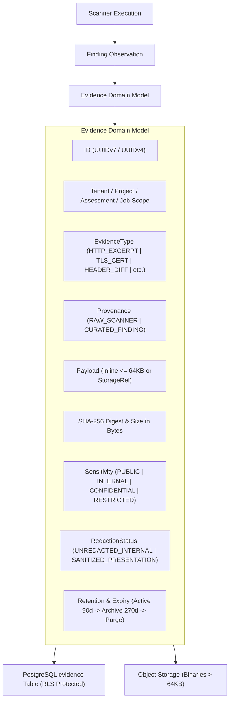

# Evidence Management Domain and Lifecycle

**Document ID:** KELVIN-ARCH-0044  
**Status:** Approved  
**Workstream:** Workstream D (Evidence Management & Auditability)  
**Issue Reference:** P3-26 (#179)  

---

## 1. Purpose & Overview

The Kelvin Evidence Management Domain translates the evidence retention, secure erasure, and signed URL generation policies established in Phase 1 (`docs/security/DATA_LIFECYCLE.md`) into a structured application-level domain model.

Evidence represents immutable, cryptographic proof of security posture captured during scan execution. It anchors finding observations to verifiable technical artifacts (HTTP exchanges, security header diffs, TLS certificate chains, scanner outputs, screenshots) while strictly isolating tenant boundaries and ensuring untrusted content is never executed or inappropriately leaked.

---

## 2. Architecture & Domain Model

---

## 3. Supported Evidence Types

| Evidence Type | Description | Primary Payload |
|---|---|---|
| `HTTP_EXCERPT` | Request & response headers and body snippets demonstrating vulnerability/reproduction | Text / JSON HTTP transaction log |
| `SECURITY_HEADER_DIFF` | Differences between expected security headers and actual target server responses | Key-value delta mappings |
| `TLS_CERTIFICATE` | Certificate chains, cipher suites, expiration dates, protocol versions | Structured X.509 metadata / PEM |
| `SCANNER_EXCERPT` | Output snippets produced by underlying scanner engines (Nuclei, ZAP) | Text / JSON scanner trace |
| `SCREENSHOT` | Visual proof of finding or user interface state | Binary PNG / JPEG (treated as untrusted) |
| `FILE_ARTIFACT` | Configuration snippets, server responses, or downloaded test files | Binary / Text file artifact |

---

## 4. Curated Evidence vs. Raw Scanner Output

Kelvin explicitly distinguishes between raw scanner output and curated finding evidence:
- **`RAW_SCANNER`**: High-volume, untamed output emitted directly by third-party scanner tools during job execution. Used primarily for debugging, auditing engine performance, and low-level diagnostic triage.
- **`CURATED_FINDING`**: Refined, deduplicated, and contextualized evidence linked directly to a verified `Finding` and `FindingObservation`. Curated evidence highlights the exact payload, parameter, and response confirming the security issue.

---

## 5. Sensitivity Classifications & Redaction

### 5.1 Sensitivity Levels
- **`PUBLIC`**: Safe for external export and disclosure. No proprietary infrastructure details.
- **`INTERNAL`**: Standard baseline accessible by authenticated members of the tenant project.
- **`CONFIDENTIAL`**: Restricted to security analysts, compliance leads, and workspace administrators.
- **`RESTRICTED`**: Highly sensitive artifacts (e.g., exposed configuration files with credentials) requiring audited access.

### 5.2 Redaction & Sanitization
All evidence undergoes sanitization before presentation in the API or reports:
- Sensitive headers (`Authorization`, `Proxy-Authorization`, `Cookie`, `Set-Cookie`, `X-Api-Key`, `X-Auth-Token`) are redacted using `SanitizeHeaders()`.
- Bearer tokens and passwords in URL queries and request bodies are masked.
- Untrusted content safeguards: Executable MIME types (`application/x-msdownload`, `application/x-executable`, `application/x-sh`, etc.) are rejected at ingestion.

---

## 6. Retention & Lifecycle States

Evidence lifecycle adheres to the Phase 1 lifecycle specification:
1. **Active (Day 0 to Day 90)**: Fast access via signed download URLs (default 15-minute TTL) and PostgreSQL inline storage for artifacts $\le 64\text{ KB}$.
2. **Archived (Day 91 to Day 360)**: Moved to cold storage tier; access restricted to security leads with short-lived URLs.
3. **Purging & Purged (After Day 360)**: Cryptographic random overwrite of storage binaries followed by soft/hard deletion in accordance with ADR-0005.

---

## 7. Security Invariants

- **ADR-0002 Compliance:** Strict PostgreSQL Row-Level Security (RLS) restricts evidence access strictly to `tenant_id = current_setting('app.current_tenant_id', true)::uuid`.
- **Integrity Validation:** Every evidence object records an immutable `SHA-256` checksum and byte length computed at ingestion.
- **Untrusted Handling:** Evidence is treated as arbitrary untrusted user input; the API never executes or renders evidence inline without strict Content-Security-Policy headers.
