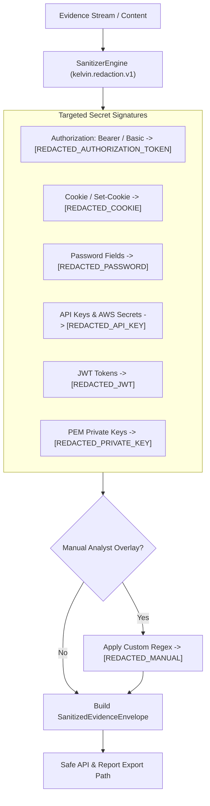

# Evidence Redaction and Sanitization

**Document ID:** KELVIN-ARCH-0047  
**Status:** Approved  
**Workstream:** Workstream D (Evidence Management & Auditability)  
**Issue Reference:** P3-29 (#182)  

---

## 1. Purpose & Overview

The Evidence Redaction and Sanitization engine prevents sensitive information (credentials, session tokens, passwords, API keys, private keys) from leaking through evidence displays, finding detail pages, or generated compliance reports.

It introduces a versioned rules engine (`kelvin.redaction.v1`), contextual replacement tokens, support for manual analyst-driven redaction overlays, and explicit separation between unredacted internal storage and sanitized presentation envelopes.

---

## 2. Architecture & Redaction Pipeline

---

## 3. Normative Redaction Rules (`kelvin.redaction.v1`)

| Rule ID | Pattern Category | Targeted Signature | Replacement Token |
|---|---|---|---|
| `AUTHORIZATION_BEARER` | Bearer Auth Header | `Authorization: Bearer <token>` | `[REDACTED_AUTHORIZATION_TOKEN]` |
| `AUTHORIZATION_BASIC` | Basic Auth Header | `Authorization: Basic <token>` | `[REDACTED_AUTHORIZATION_TOKEN]` |
| `COOKIE_HEADER` | Session Cookie | `Cookie: <key>=<val>` | `[REDACTED_COOKIE]` |
| `SET_COOKIE_HEADER` | Session Setup | `Set-Cookie: <key>=<val>` | `[REDACTED_COOKIE]` |
| `PASSWORD_FIELD` | Password In Payload | `(password\|passwd\|pwd)[:=]<val>` | `[REDACTED_PASSWORD]` |
| `API_KEY_FIELD` | API Secret Key | `(api_key\|secret_key)[:=]<val>` | `[REDACTED_API_KEY]` |
| `JWT_TOKEN` | JSON Web Token | `eyJ...\.eyJ...\.[A-Za-z0-9_-]+` | `[REDACTED_JWT]` |
| `AWS_SECRET_KEY` | AWS IAM Secret | `aws_secret_access_key:\s*[A-Za-z0-9/+=]{40}` | `[REDACTED_API_KEY]` |
| `PEM_PRIVATE_KEY` | Cryptographic Key | `-----BEGIN [A-Z ]*PRIVATE KEY-----` | `[REDACTED_PRIVATE_KEY]` |

---

## 4. Presentation Envelopes & Access Control

1. **`SanitizedEvidenceEnvelope`**:
   - Presentation layer data contract containing `OriginalSHA256`, `SanitizedSHA256`, `RuleVersion`, and masked content.
   - Default presentation for all UI, REST API endpoints, and PDF/HTML/JSON report generation.
2. **Privileged Internal Access**:
   - Only privileged compliance leads and authenticated internal scanner operators may request `allowUnredacted = true`.
   - All accesses to unredacted internal evidence are logged in the audit trail.
3. **Manual Analyst Redactions**:
   - Security analysts may attach `ManualRedactionRequest` rules (`TargetPatterns`) to mask proprietary internal domain names, test identifiers, or unclassified secrets, which are replaced by `[REDACTED_MANUAL]`.

---

## 5. Security & Privacy Invariants

- **ADR-0005 Compliance:** Credentials, tokens, and cookies are masked prior to external presentation or multi-tenant sharing.
- **Traceability:** The sanitized envelope computes a separate `SanitizedSHA256` alongside the immutable `OriginalSHA256` digest.
- **Context Preservation:** Standard HTTP metadata (`Host`, `User-Agent`, `Accept`, non-sensitive query parameters) is explicitly preserved to retain reproduction context.
